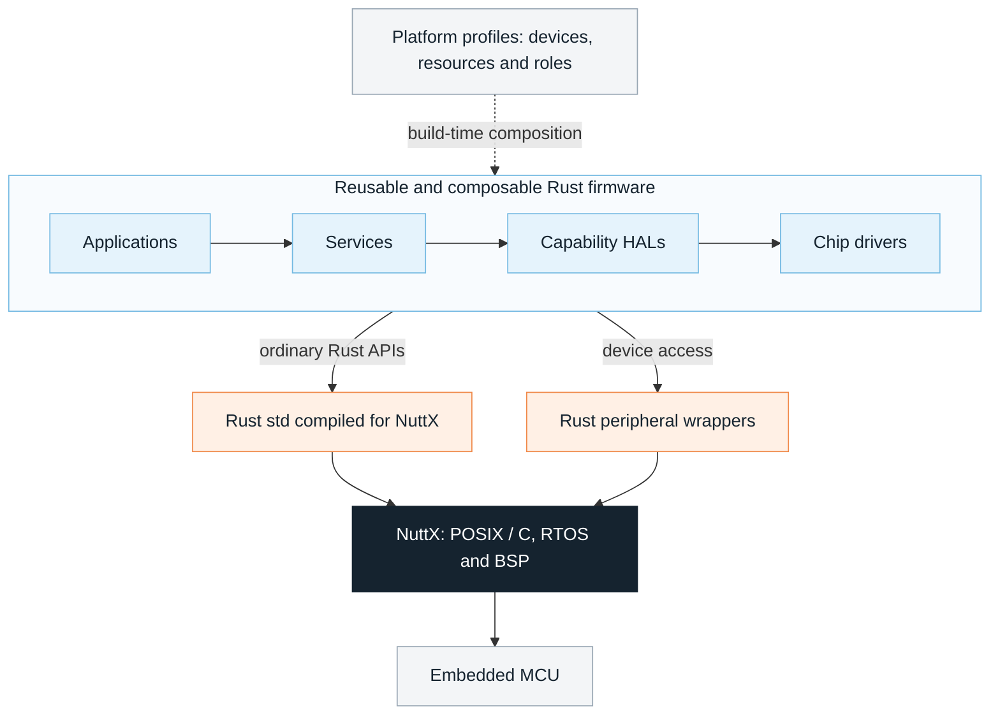

<h1 align="center">
  
</h1>

**NXRS is an experimental Rust-based firmware development environment on top of
[Apache NuttX](https://nuttx.apache.org/).**

The goal is to bring the benefits of NuttX's standards-based POSIX/C development
model to Rust: familiar, unopinionated Rust `std` code and reusable libraries on
embedded MCUs. NuttX supplies the RTOS and board support; NXRS brings together a
Rust standard library compiled for NuttX, Rust peripheral wrappers, reusable
firmware components and declarative platform profiles.

NXRS is an independent project built on NuttX. It is experimental: Rust `std`
support currently relies on maintained SDK patches, and API availability and
hardware qualification depend on the selected target and profile. See
[Rust std on NuttX](docs/nuttx-std.md) for the current scope.

## Architecture



- **NuttX is the operating-system foundation.** Its C/POSIX environment provides
  the actual RTOS, scheduling, board support packages, MCU controller drivers and
  hardware resource registration.
- **Rust `std` provides familiar OS facilities.** Applications and services use
  ordinary files, sockets, threads, synchronization and time directly where the
  target supports them. These operations do not need an additional NXRS HAL.
- **Rust components provide reusable firmware behavior.** Peripheral wrappers
  expose NuttX resources through Rust interfaces. Chip drivers build on those
  interfaces; capability HALs expose portable subsystems such as IMU or GNSS;
  services add reusable behavior; applications compose the product. An
  application can also own a capability directly when that is the natural fit.
- **Platform profiles provide device-tree-like composition.** Declarative TOML
  profiles and overlays select devices, resources, implementations and logical
  roles at build time. They keep product wiring out of reusable application and
  service code. NuttX BSP and configuration still own MCU pin wiring, controller
  initialization and device registration.

Read the
[architecture guide](docs/architecture.md),
[HAL and platform boundaries](docs/hal-platform-architecture.md) and
[peripheral composition guide](docs/peripheral-composition.md) for details.

## Programming model

Applications use an ordinary, handwritten Rust `main()` to construct services,
connect them and own their lifecycle. Reusable components stay independent of
the selected board and product policy; there is no required application trait
or generated application graph.

Concurrency uses **ordinary Rust threads, blocking waits and synchronization**.
An async executor is not required. Event-driven application modules follow a
consistent ownership model:

- Each active owner keeps its state and resources together and receives typed
  events through a bounded inbox.
- An owner waits for work, handles each event synchronously to completion and
  uses ordinary function calls within that ownership boundary.
- Queue capacity, overload behavior, cancellation and joined shutdown are
  explicit parts of component composition.

This model aims to make firmware safe to compose, ergonomic to develop and easy
to reuse, while keeping concurrency and resource costs visible. The
[event-driven demo](docs/event-driven-demo.md) shows the pattern in a small
application; the [event communication guide](docs/concurrency-event-communication.md)
explains ownership, delivery and lifecycle contracts.

## Getting started

### Run the host demo

With Rust installed, clone the repository and run the event-driven navigation
demo using the repository's pinned toolchain:

```sh
git clone https://github.com/yongkyuns/nxrs.git
cd nxrs
NXRS_PLATFORM=host-demo cargo run --locked -p nxrs-event-demo -- --duration-ms 2000
```

The `host-demo` profile explicitly selects synthetic IMU and GNSS providers.
The demo composes sensor, fusion and health services, exercises pause/resume and
shuts down after two seconds. It demonstrates composition and lifecycle behavior
on your development machine; physical sensor qualification is separate.

Platform selection is explicit. `NXRS_PLATFORM` selects a host, board or fixture
profile; without one, HAL crates expose portable contracts and do not silently
select mocks.

### Build for NuttX

The `cargo nxrs` frontend discovers applications and platform profiles and builds
firmware with the selected toolchain and NuttX configuration:

```sh
cargo nxrs apps
cargo nxrs platforms
cargo nxrs build --help
```

Follow the [build and platform selection guide](docs/build-system.md) for host
dependencies, target toolchains, profile selection and build artifacts. For
example, after installing the required dependencies, this builds the event demo
for the ESP32-S3 QEMU profile with synthetic sensors:

```sh
git submodule update --init
bash tools/install-qemu-tools.sh
cargo nxrs build --app event-demo --profile esp32s3-qemu-mock
```

Build outputs are placed under
`target/build/event-demo/esp32s3-qemu-mock/`. To execute that image with the
event-demo qualification runner:

```sh
source target/qemu-tools/environment.sh
python3 tests/host/test-event-demo-nuttx.py "$(command -v qemu-system-xtensa)" \
  --machine esp32s3 \
  --image target/build/event-demo/esp32s3-qemu-mock/nuttx/nuttx.merged.bin \
  --log target/build/event-demo/esp32s3-qemu-mock/console.log
```

The [NuttX QEMU guide](docs/nuttx-qemu.md) covers additional integration fixtures.
Host demos, build/link checks, emulation and physical-device measurements
establish different kinds of evidence.

### Development checks

Run the default workspace tests and architecture checks from the repository root:

```sh
cargo test --locked
python3 tools/check-architecture.py
```

Target-specific and instrumented qualification suites have their own setup; see
the [test and comparison guide](tests/README.md).

## Performance and memory

**Performance and memory footprint are ongoing engineering concerns.** The
benefits of Rust `std`, threads and reusable components must be evaluated against
the resource budgets of real embedded applications as NXRS evolves.

Track deployed code and static data, queue and payload storage, thread stacks,
peak heap use, and end-to-end event latency and throughput. Continue comparing
representative workloads with reference implementations such as **Zephyr**, with
hardware, compiler settings, platform configuration and measurement scope made
explicit.

Existing studies cover particular workloads and configurations. They do not
establish universal overhead, hard real-time guarantees or production
qualification:

- [Rust std footprint](docs/rust-std-footprint.md): code size, API selection and
  memory accounting.
- [Std channel performance](docs/std-channel-performance.md): event delivery,
  queue storage, thread costs and the scope of historical measurements.
- [RTOS comparison](docs/rtos-comparison.md): NuttX, Zephyr and Embassy reference
  workloads. Its NuttX Rust fixture uses native RTOS adapters, so it does not
  measure the full NXRS `std` programming model.
- [MPSC comparison fixture](tests/mpsc-comparison/README.md): maintained tooling
  for comparing the Rust workload using NuttX `std::sync::mpsc::sync_channel`
  with Zephyr's native `k_msgq`.

## Documentation

| Start here | What it covers |
| --- | --- |
| [Documentation index](docs/README.md) | Architecture and implementation guides |
| [Event-driven demo](docs/event-driven-demo.md) | Service composition and lifecycle |
| [Build system](docs/build-system.md) | Applications, profiles, toolchains and artifacts |
| [Rust std on NuttX](docs/nuttx-std.md) | Integration, supported configurations and qualification scope |
| [Peripheral composition](docs/peripheral-composition.md) | Drivers, resources, devices, roles and overlays |
| [Tests and qualification](tests/README.md) | Fixture and comparison guides |
| [Upstream sources](upstream/README.md) | Pinned NuttX and Rust sources and maintained patches |
| [Editor setup](docs/editor-setup.md) | Local development configuration |

For contribution and implementation conventions, see [AGENTS.md](AGENTS.md).
For vulnerability reporting, see [SECURITY.md](SECURITY.md).

## License

See [LICENSE](LICENSE).
