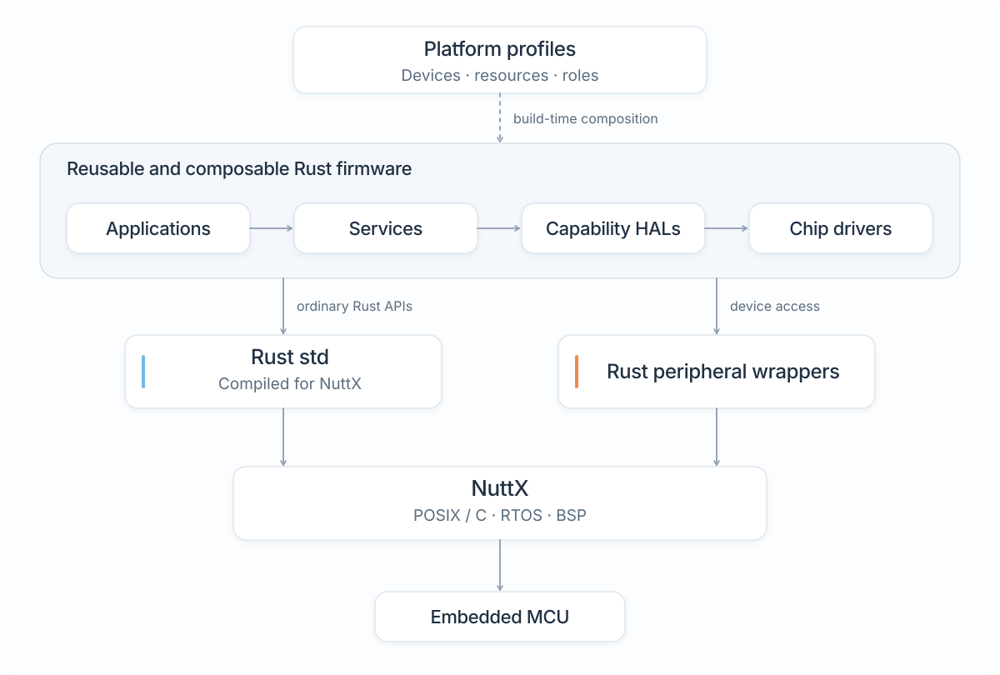

<h1 align="center">
  
</h1>

<p align="center">
  <a href="https://github.com/yongkyuns/nxrs/actions/workflows/portable.yml"></a>
  <a href="https://github.com/yongkyuns/nxrs/actions/workflows/security.yml"></a>
  <a href="https://github.com/yongkyuns/nxrs/actions/workflows/website.yml"></a>
  <a href="LICENSE"></a>
</p>

<p align="center">
  <a href="https://yongkyuns.github.io/nxrs/">Website</a> ·
  <a href="https://yongkyuns.github.io/nxrs/guide/motivation/">Why NXRS?</a> ·
  <a href="https://yongkyuns.github.io/nxrs/guide/start-here/">User guide</a> ·
  <a href="https://yongkyuns.github.io/nxrs/guide/examples/">Examples</a> ·
  <a href="https://yongkyuns.github.io/nxrs/reference/">Engineering reference</a>
</p>

**NXRS is an experimental Rust-based firmware development environment on top of
[Apache NuttX](https://nuttx.apache.org/).**

Applications use ordinary Rust `std`, threads and event-driven components.
NuttX supplies the RTOS and board support. NXRS brings together the Rust
integration, peripheral wrappers, reusable firmware components and platform
profiles.

## Why this project?

Embedded projects often solve similar problems, but reusing the surrounding
firmware is difficult. Hardware constraints, vendor tooling, device APIs and
failure behavior vary. Making acquisition, processing, communication and
recovery work together reliably takes more than getting the first prototype to
run. Early decisions about portability, ownership and test boundaries can save
work across a product's life.

An established RTOS ecosystem provides a foundation for that work. NXRS borrows
ideas from Zephyr's modular subsystems and device configuration, while using
NuttX's standards-oriented C/POSIX interfaces underneath the Rust standard
library. This allows application code to use familiar APIs, with hardware
integration kept in the platform and driver code.

Async frameworks such as Embassy are useful for I/O-heavy workloads on small
devices. NXRS uses ordinary threads and synchronous code, without requiring
applications and drivers to share an async execution model. Thread stacks,
synchronization, queues and allocation are included in performance and memory
evaluations.

Read [Why NXRS?](website/guide/motivation.md) for the reasoning behind these
choices. [Current status](website/guide/status.md) describes the implementation,
completed validation and ongoing work. NXRS is an independent project built on
NuttX.

## Architecture

<!-- Regenerate both themes with: node docs/assets/render-architecture.mjs -->
<picture>
  <source media="(prefers-color-scheme: dark)" srcset="docs/assets/nxrs-architecture-dark.svg">
  
</picture>

- **NuttX** supplies the actual RTOS, scheduling, board support packages,
  controller drivers and hardware resource registration through its C/POSIX
  environment.
- **Rust `std` and peripheral wrappers** connect Rust code to that foundation.
  Use ordinary files, sockets, threads, synchronization and time where supported;
  standard OS operations do not need an additional NXRS HAL.
- **Drivers, HALs, services and applications** separate device protocols,
  hardware capabilities, reusable behavior and product composition.
- **Platform profiles and overlays** select devices, resources, implementations
  and logical roles at build time. This is device-tree-like composition. NuttX
  owns pin wiring, controller initialization and device registration.

Read the [architecture overview](website/guide/overview.md),
[HAL and platform boundaries](docs/hal-platform-architecture.md) and
[peripheral composition reference](docs/peripheral-composition.md) for details.

## Programming model

Applications use an ordinary, handwritten Rust `main()` to construct components,
connect them and own their lifecycle. There is no required application trait or
generated application graph.

Concurrency uses **ordinary Rust threads, blocking waits and synchronization**.
An async executor is not required. Active owners keep state and resources
together, receive typed events through bounded delivery paths, and handle each
event synchronously. Queue capacity, overload behavior, cancellation and joined
shutdown are explicit parts of component composition.

Reusable behavior stays separate from board configuration and product policy.
The [event-driven example](docs/event-driven-demo.md) shows the pattern; the
[event communication reference](docs/concurrency-event-communication.md) explains
ownership, delivery and lifecycle contracts.

## Getting started

### Run the host example

With Rust installed, clone the repository and use its pinned toolchain:

```sh
git clone https://github.com/yongkyuns/nxrs.git
cd nxrs
NXRS_PLATFORM=host-demo cargo run --locked -p nxrs-event-demo -- --duration-ms 2000
```

The `host-demo` profile supplies synthetic IMU and GNSS inputs. The app composes
sensor, fusion and health services, exercises pause/resume, and shuts down after
the requested interval. It selects a logical IMU using `devices::primary_imu()`;
the profile supplies its concrete construction.

`NXRS_PLATFORM` selects a host, board or fixture profile. Without one, HAL crates
expose portable contracts and do not silently select mocks. Follow the
[getting-started guide](website/guide/getting-started.md) and
[application walkthrough](website/guide/first-application.md) for context.

### Build for NuttX

The repository's `cargo nxrs` frontend discovers applications and profiles:

```sh
cargo nxrs apps
cargo nxrs platforms
cargo nxrs build --help
```

Follow the [build reference](docs/build-system.md) for host dependencies,
toolchains and artifacts. After installing the required dependencies, the
following builds the event example for ESP32-S3 QEMU with synthetic sensors:

```sh
git submodule update --init
bash tools/install-qemu-tools.sh
cargo nxrs build --app event-demo --profile esp32s3-qemu-mock
```

Run the resulting image with the event-demo test runner:

```sh
source target/qemu-tools/environment.sh
python3 tests/host/test-event-demo-nuttx.py "$(command -v qemu-system-xtensa)" \
  --machine esp32s3 \
  --image target/build/event-demo/esp32s3-qemu-mock/nuttx/nuttx.merged.bin \
  --log target/build/event-demo/esp32s3-qemu-mock/console.log
```

The [NuttX QEMU reference](docs/nuttx-qemu.md) covers additional integration tests.

### Development checks

```sh
cargo test --locked
python3 tools/check-architecture.py
```

Run these from the repository root. Target-specific suites have their own
setup; see the [test index](tests/README.md).

## Application examples

The navigation application demonstrates service composition. The IoT camera
combines capture, detection, gateway delivery and client-visible state. See the
[examples index](website/guide/examples.md) and
[camera delivery reference](docs/camera-detection-delivery.md) for configuration,
implementation and test results. More examples are added as development
continues.

## Tests and evaluations

Basic validation includes host tests, target build and ABI checks, firmware
execution in the NuttX simulator and ESP32-S3 QEMU, and on-board measurements of
event delivery and the camera application. The [test index](tests/README.md)
contains commands, and [Current status](website/guide/status.md) summarizes the
available tests and evaluations.

Performance and memory are measured as components and applications evolve.
Evaluations include deployed code and static data, queues and payload storage,
thread stacks, heap use, event latency and throughput. Comparisons with Zephyr
record the hardware, compiler settings and workload.

- [Rust std footprint](docs/rust-std-footprint.md): code size, API selection and
  memory accounting.
- [Std channel performance](docs/std-channel-performance.md): delivery paths,
  queue storage, thread costs and measurements.
- [RTOS comparison](docs/rtos-comparison.md): reference workloads for NuttX,
  Zephyr and Embassy, using native RTOS adapters in the NuttX fixture.
- [MPSC comparison fixture](tests/mpsc-comparison/README.md): the Rust workload
  using NuttX `std::sync::mpsc::sync_channel` and Zephyr's native `k_msgq`.

## Documentation

Use the [guide index](website/guide/start-here.md) to choose a reading path.
The website separates project background, usage, examples and measurements.
Engineering-reference pages are rendered directly from the repository's
Markdown sources.

| Where to look | What it covers |
| --- | --- |
| [Why NXRS?](website/guide/motivation.md) | Motivation, choices and tradeoffs |
| [Guide index](website/guide/start-here.md) | Practical reading paths |
| [Examples](website/guide/examples.md) | Applications and test results |
| [Documentation index](docs/README.md) | Architecture and implementation references |
| [Build system](docs/build-system.md) | Applications, profiles, toolchains and artifacts |
| [Rust std on NuttX](docs/nuttx-std.md) | Integration and supported configurations |
| [Test index](tests/README.md) | Test and comparison guides |
| [Upstream sources](upstream/README.md) | Pinned sources and maintained patches |
| [Editor setup](docs/editor-setup.md) | Local development configuration |

See [AGENTS.md](AGENTS.md) for implementation conventions,
[SECURITY.md](SECURITY.md) for vulnerability reporting, and
[website maintenance](website/README.md) for site changes and publication.

## License

See [LICENSE](LICENSE).
