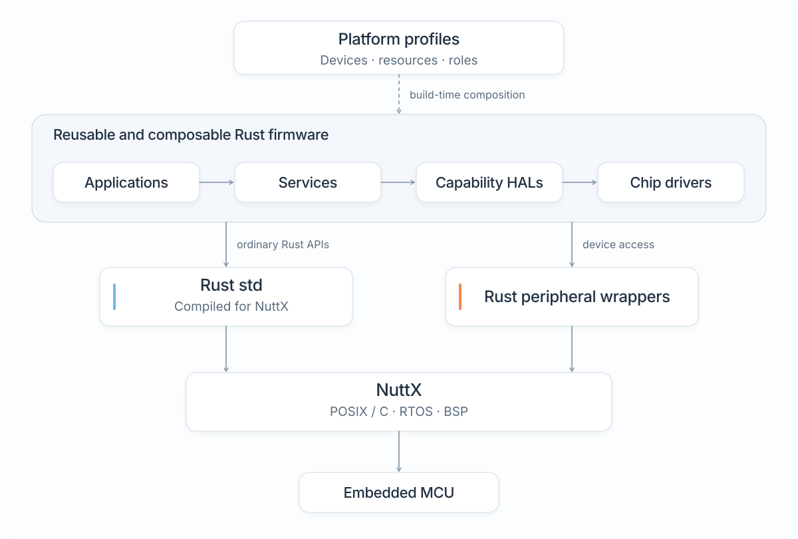
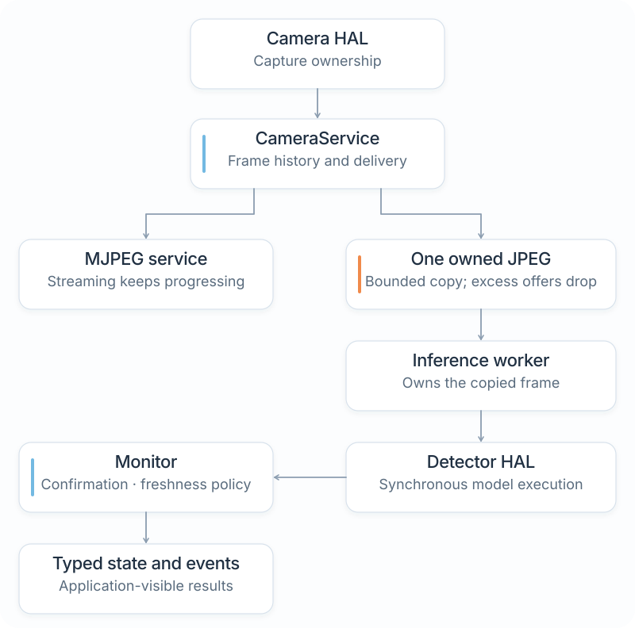
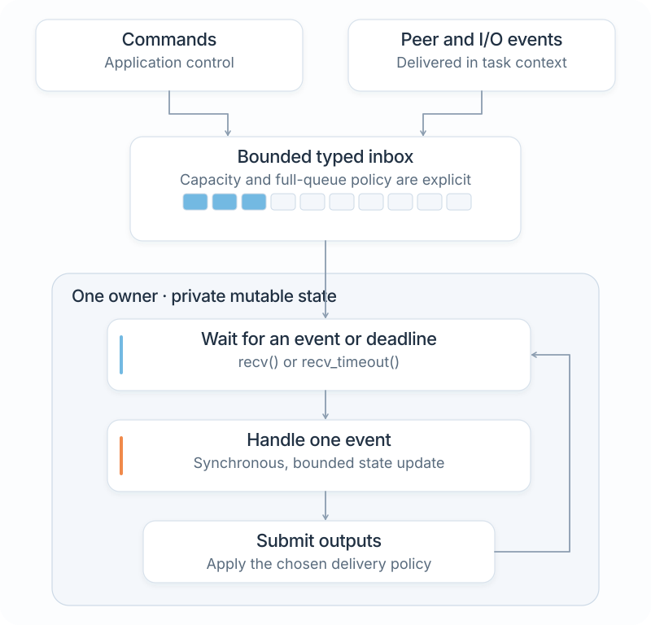
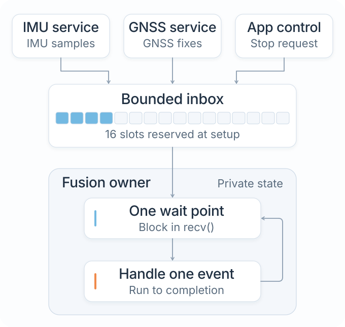

# Architecture and source ownership

The source hierarchy is app, service, hal, driver, platform, and layer-neutral shared libraries.

The normative HAL/resource ownership rules are in
[hal-platform-architecture.md](hal-platform-architecture.md). Physical NuttX
device access, including the Rust `std` boundary and private device-control
glue, is defined in [NuttX device access from Rust](nuttx-device-access.md).
The [roadmap](architecture-and-roadmap.md) describes remaining migrations.

The [concurrency and event communication guide](concurrency-event-communication.md)
records the ownership, acquisition and typed-delivery requirements. Multi-queue
transport and target-specific performance retain explicit qualification
boundaries. The [std channel performance analysis](std-channel-performance.md)
explains the current evidence for the bounded single-inbox path.

<figure class="architecture-art">
  <picture>
    <source media="(prefers-color-scheme: dark)" srcset="assets/nxrs-architecture-dark.svg">
    
  </picture>
  <figcaption>Profiles select build-time configuration. Runtime code uses the interfaces appropriate to each operation. <a href="assets/nxrs-architecture.svg">Open SVG</a>.</figcaption>
</figure>

## Accepted device and build direction

The [declarative build and static device decision](static-device-composition.md)
records the accepted follow-up to composition v1. It is tracked in
[issue #246](https://github.com/yongkyuns/nxrs/issues/246). IMU and GNSS use
canonical instances with direct device accessors and aliases.

HAL crates retain runtime contracts/implementations, native ABI source and
declarative support metadata. Shared tooling in `tools/build-support` and the
controller in `tools/build` own configuration generation and native preparation,
with tooling-owned Cargo adapters selected by package manifests. Ordinary
additive Cargo features enable implementations, and profiles define physical
devices and aliases. See the [build reference](build-system.md) for the current
prepared-input and consumed-package boundaries.
Each active IMU or GNSS device has one canonical static opaque object
with private instance state and an exclusive acquisition lease. Multiple aliases
can refer to that same object; multiple devices can use the same implementation.

Applications and services continue to consume portable capability contracts.
Static dispatch remains possible, and runtime hardware detection is explicit
opt-in. The decision defines the source/build boundary, multiple-device
semantics, lifecycle guarantees and unresolved API/integration details. Its
[implementation sequence](peripheral-composition-plan.md#static-device-follow-up)
preserves existing qualification gates while replacing obsolete emitter checks.

## Applications

Each production firmware image selects exactly one app. An app owns an ordinary
handwritten Rust main(), product-level service composition, workflows, lifecycle
and policy.

An application may also expose a reusable composition library, such as
`app/home-cam`; the selected firmware binary owns the final `main()`.
Application code may use ordinary Rust `std` facilities. Portability does not
require every application composition to be `no_std`. APIs and shared HAL
behavior follow the stricter implementation boundaries in the normative HAL
document, with platform selection confined to wiring and factories.

An application normally composes reusable services, and those services consume
capability HAL interfaces. Each dependency remains an ordinary Cargo dependency.

Applications and services are both portable layers. An app may access a
capability facade or API directly when the app itself is the natural
owner/consumer and introducing a service would not add a useful boundary.

What portable code must not do is select the concrete realization: physical
sensor model, mock/native/NuttX provider module, device driver, bus instance,
address, IRQ, or other platform-specific resource.

app/event-demo follows this rule. Its main creates ImuService,
GnssService and FusionService without naming any IMU/GNSS implementation.

app/dual-imu-demo is a separate ordinary firmware image that reuses the same
navigation services but creates two ImuService/FusionService pipelines. The two
service-owned IMU acquisitions are independent; app instances do not require a
global resource registry or application-defined HAL instance IDs.

`app/home-cam` is the home-monitoring product. It acquires camera and radio
capabilities through their HAL APIs and composes streaming, detection,
enrollment and update services. The retired replay demo is no longer an app;
its camera/recording/telemetry composition exists only in `tests/camera-support`.
App and service code has no OS or board knowledge. Apps select named IMUs
through the portable device catalogue; services receive those references.
HAL factories own admission and acquisition, including typed `Unsupported`
results when unbound. Platform build/configuration code accepts an entry as
input without naming a particular application.

There is no platform launcher, app registry, mandatory App trait, registration
macro or service-graph configuration language.

## Services

A service owns a standalone system function and the resources required to
implement it.

A service may be synchronous or may own an execution context. Active services
can intentionally own std threads, bounded channels, timing, shutdown and join
when those resources are part of their functionality.

When a capability primarily exists to implement a service, that service should
normally acquire it internally from the HAL at an explicit lifecycle boundary
such as start(). This is the preferred ownership pattern because it prevents
unnecessary resource sharing. It is not a blanket prohibition on direct
application access to portable HAL abstractions.

The navigation services are the first implementation of this rule:

| Service construction | Acquired resource | Lifetime owner |
| --- | --- | --- |
| `imu.start_on(composition::imu::primary_imu())` | HAL IMU acquisition | The service owner retains the session through shutdown and join |
| `gnss.start_on(composition::gnss::primary_gnss())` | HAL GNSS acquisition | The service owner retains the session through shutdown and join |

Their public constructors contain only service configuration and service
connections.

### Camera inference

`hal/detector` owns the portable detector API, models and platform-specific
execution. `service/detection` owns bounded inference scheduling and typed alert
policy. The detector is separate from the camera capability.
`app/home-cam` can attach `SecurityDetection` before starting capture.

<figure class="architecture-art">
  <picture>
    <source media="(prefers-color-scheme: dark)" srcset="assets/nxrs-camera-pipeline-dark.svg">
    
  </picture>
  <figcaption>Streaming and inference have independent progress. One owned frame bounds the inference path; capture buffers are not borrowed across worker execution. <a href="assets/nxrs-camera-pipeline.svg">Open SVG</a>.</figcaption>
</figure>

The worker has exactly one reusable owned JPEG, including queued/returned work.
It never borrows DMA/history storage across a camera poll. An occupied worker
rejects excess offers; after completion the owner can submit its latest frame.
This is an intentional low-rate analysis path, not a frame queue or a claim
that every video frame is inferred. Streaming continues without a viewer,
during network loss, and when inference fails.

Ordinary Rust threads and a one-slot mutex/condition-variable mailbox implement
execution. The owner only tries the mailbox lock and skips contention; it never
spins on a partially published slot owned by a lower-priority worker. Product wiring supplies
sample interval, stack capacity and an initializer for execution constraints.
The NuttX qualification fixture sets a lower worker priority through a scalar
target-header scheduler call; shared algorithms have no platform branch.
Shutdown closes admission, finishes the bounded current inference and joins;
worker failure remains observable. Restart requires attaching a fresh worker.

The monitor requires repeated evidence and applies score hysteresis. Freshness
uses the camera owner's monotonic clock; expired or failed results become
unavailable. A clear scene requires valid model evidence. The application keeps
eight local typed events with sequence IDs. No detection listener, notification,
footage retention or external disclosure is started implicitly.

The optional VWW model uses Rust MicroFlow kernels; PICO reuses the same Rust
JPEG decoder and runs ESP-DL numerical operators behind the detector HAL. Model
selection and CPU-specific compute remain below that common API. Rust owns PICO
confidence/box decoding and bounded NMS. SDK code starts no tasks.
The reviewed runtime correction is tracked under `upstream/microflow`;
model identity and licenses are beside the weights. See
[detection qualification](../service/detection/README.md) for exact bounds,
reproduction steps, sample accuracy, physical FPS and remaining limitations.

## Event-driven service communication

The section below documents the existing event-demo topology. Messages cross
meaningful ownership boundaries; the demo does not prescribe an active queue
between every processing stage. The
[communication guide](concurrency-event-communication.md) defines provider
acquisition, admission and lifecycle requirements, including separate queues
where an owner needs independent capacity for different event classes.

The event-demo services use a **single-owner, single-inbox, run-to-completion**
execution model built on Rust `std` synchronization primitives. Services that
need independent admission capacity can use multiple bounded queues with one
logical blocking selection point, as described in the communication guide.

The simple single-inbox owner is:

<figure class="architecture-art">
  <picture>
    <source media="(prefers-color-scheme: dark)" srcset="assets/nxrs-owner-event-loop-dark.svg">
    
  </picture>
  <figcaption>Cloned senders share capacity; the receiver and mutable state belong to one owner. <a href="assets/nxrs-owner-event-loop.svg">Open SVG</a>.</figcaption>
</figure>

`shared/messaging` owns generic typed delivery and rejection results. Its
`channels` feature, enabled by default, adds a thin ownership wrapper around
`std::sync::mpsc::sync_channel`:

- `Sender<E>` is cloneable so any number of producers can fan into one
  entity;
- `Inbox<E>` is intentionally not cloneable, so one execution owner
  serializes state changes;
- every inbox has an explicit finite capacity;
- `wait(Option<Duration>)` is the canonical owner wait operation and maps
  directly to std `recv` / `recv_timeout` semantics;
- `send`, `try_send`, and `try_recv` remain available with their ordinary
  std semantics.

This is not an actor framework, service registry, executor, or global event bus.
Each service keeps its event enum private and exposes narrow typed endpoints or
domain methods.

For example, Fusion has one private event type:

<figure class="architecture-art">
  <picture>
    <source media="(prefers-color-scheme: dark)" srcset="assets/nxrs-event-communication-dark.svg">
    
  </picture>
  <figcaption>The navigation demo uses the default sixteen-slot fusion inbox. Source-specific input types map into its private event enum. <a href="assets/nxrs-event-communication.svg">Open SVG</a>.</figcaption>
</figure>

`ImuInput` and `GnssInput` are typed public endpoints, but both wrap clones
of the same private Fusion event sender. Fusion therefore never has to select
between several receivers.

### One wait point

Every active service should normally have exactly one logical blocking wait
point in its owner loop.

The owner always calls the same operation:

| Owner wait | Wake condition |
| --- | --- |
| `inbox.wait(None)` | Input or channel closure; no internal deadline |
| `inbox.wait(Some(time_until_deadline))` | Input, channel closure or the current deadline |

The wrapper uses std `recv` or `recv_timeout` underneath. An owner with an
internal deadline can handle timeout expiry through its normal dispatch logic.
The current IMU, GNSS and Fusion service loops use `inbox.wait(None)`; hardware
readiness and acquisition deadlines belong to their HAL providers, not service
polling timers.

Device readiness, callbacks and IRQ notifications are adapted by the HAL before
typed delivery wakes the service owner. They must not mutate service state from
a second execution context. Platform-specific readiness and cancellation remain
below the portable service boundary.

### Run to completion

Once an event has been dequeued, the owner handles that event completely before
receiving the next event.

The handler may:

- mutate its private service state;
- call ordinary synchronous helper modules it owns;
- perform bounded local/HAL work;
- enqueue zero or more downstream events;
- update counters and deadlines.

An active-service handler should **not synchronously wait for another active
service**. A peer interaction that requires a later result should be expressed
as a request event followed by a later completion/reply event. This avoids
wait-for cycles and keeps every owner responsive to its own inbox.

Top-level application/control code may use acknowledged synchronous methods such
as `imu.pause()` or `imu.status()`; those methods enqueue a command event and
wait on a one-shot reply. The receiving service still processes that command at
its one wait point. Do not use the same blocking request/reply pattern from one
active service's event handler without an explicit deadlock/timing analysis.

### Bounded communication and overload

All active-service inboxes are bounded.

Run-to-completion handlers should normally use non-blocking `try_send` when
emitting data to another active service. The receiving service contract defines
what a full inbox means: drop-new, replace-stale, report overrun, or another
explicit bounded policy.

Blocking `send` is reserved for paths where waiting for admission is known to
be safe, such as top-level lifecycle/control code. A handler must not acquire an
unbounded dependency on downstream progress merely to publish data.

Different traffic classes may intentionally use different policies. High-rate
IMU samples can be dropped and counted when Fusion is saturated; shutdown or
configuration control generally requires a reliable path. Reliability does not
mean introducing an unbounded queue.

### Ordering and determinism

A single inbox gives one serialized mutation order for each service. Per-producer
message order follows the underlying std channel semantics, but semantically
independent producers may race.

If cross-source ordering matters, the protocol must encode the required ordering
using timestamps, sequence numbers, generations, priorities, or another explicit
domain rule. Sensor fusion in particular must not equate host-thread arrival
order with measurement-time order.

Determinism therefore comes from:

- one owner of mutable service state;
- one bounded inbox;
- one wait point;
- run-to-completion handlers;
- explicit message ordering semantics where needed;
- explicit overload behavior.

It does not come from assuming that the OS will schedule concurrent producers in
a repeatable global order.

### Synchronous code remains synchronous

Not every module is an active entity. Processing stages that share one ownership
and execution context should use ordinary Rust function calls rather than
channels. Message passing is for crossing an independently scheduled ownership
boundary, not for turning every type into an actor.

## HAL: one crate per capability

`hal/` is Nxrs's hardware/platform abstraction layer, but provider selection
is not centralized in a global HAL package.

Each capability is one Cargo crate. Its package name is `nxrs-<capability>`;
Rust code imports its root namespace (`imu`, `camera`, and so on). The root
reexports the contract and the selected provider's public types. Provider
implementation modules remain private.

| Path inside `hal/<capability>/` | Responsibility |
| --- | --- |
| `Cargo.toml` | Capability package and declared dependencies |
| `src/api.rs` | Portable capability contract |
| `src/platform/<provider>/` | Private Rust provider implementation |
| `src/platform/<provider>/ffi/` | Provider-owned target ABI glue, only when needed |

Portable app/service code depends on capability crates, not split API or
implementation packages. HAL roots own provider selection and expose no
provider module as a public namespace.

For example:

| Consumer | Public Rust namespace | Cargo package | Implementation |
| --- | --- | --- | --- |
| `ImuService` | `imu` | `nxrs-imu` | Private provider selected by the profile |
| `app/home-cam` | `camera` | `nxrs-camera` | Private provider selected by the profile |

For host/test Cargo invocations, one `NXRS_PLATFORM` value selects the profile's
provider bindings. NuttX builds use `cargo nxrs build`, which supplies the
validated `NXRS_RESOLVED_PROFILE` receipt and prepared native inputs. For example,
`linux`, `macos` and `windows` select their OS providers. File replay,
recording and UDP use shared Rust code enabled by Cargo features. `mock` selects mock IMU and
GNSS; `host-imu` selects only a mock IMU. `std` is an environment, not a platform. The NuttX
profiles bind only capabilities with an implemented NuttX provider. There is
no provider Cargo feature, no global `nxrs-hal` or `hal/platform` package, and
no giant `Hal` object.

Without a selected profile or resolved-profile receipt, portable contracts still
compile and no mock is selected implicitly. Acquisition reports its documented
unavailable result when no implementation is bound.

Ordinary `std::time` is not a HAL capability. Services use it directly where
qualified; sensor timestamp domains remain explicit device/data contracts.

## Providers and drivers

A provider implements one capability. It may use repository-owned protocol
drivers, OS support, or pinned upstream NuttX drivers.

For a physical NuttX capability, the provider itself remains the Rust
implementation. Use qualified Rust `std` file/I/O/socket facilities directly
for ordinary descriptor operations. Device-specific controls such as NuttX
`ioctl` requests stay private to that provider and use only the minimum
target-header/ABI glue required. Do not add a generic POSIX/device translation
layer between the Rust HAL and NuttX. See
[NuttX device access from Rust](nuttx-device-access.md).

Concrete device identity belongs in the capability provider and deployment
configuration. BMI270, LSM6DSO, u-blox model selection, I2C/SPI/UART instances,
addresses, and IRQs must not appear in application or portable service policy.

Repository-owned low-level protocols belong in `driver/`. Existing physical
NuttX drivers can remain under `external/nuttx` when reused directly.

The [peripheral composition architecture](peripheral-composition.md) makes chip
drivers reusable through existing Rust resource traits. Sensor-specific HAL
modules translate into the capability API. OS factories construct them from
resolved device and resource bindings. Profiles and explicit overlays select
instances and aliases. The [implementation plan](peripheral-composition-plan.md)
records the stages and the separate requirements for host validation, target
cross-linking, and physical qualification.

## platform/ directory

`platform/` owns product profiles and concrete device composition:

- `platform/<family>/` contains product profiles, while `platform/nuttx/` contains
  BSP resource mappings and selected linker inputs;
- the composition crate supplies portable named devices and concrete resource
  construction;
- host orchestration and Cargo adapters live under `tools/`;
- platform code does not construct services or run the application through a
  second launcher.

Changes to dependency sources live separately in `upstream/`, grouped by
dependency with their patches, revision pins and provenance. `external/`
remains the pinned upstream source; builds apply patches to archived copies.
See [upstream patchsets](upstream-patchsets.md) for the active series and
optional proposals.

The Cargo firmware frontend combines these inputs through
`cargo nxrs build --app <app> --platform <platform>`:

| Build input | Supplies |
| --- | --- |
| Application Cargo metadata | Firmware entry and application requirements |
| One product platform | Target, board, OS and capability-provider bindings |

The selected product platform supplies capability-provider bindings and
execution target/board/OS facts, while `main()` remains the source of service
topology. There is no separate checked-in deployment graph.

## Enforced production dependencies

tools/check-architecture.py inspects Cargo metadata without a platform filter,
so optional, target-conditional and build edges cannot evade layer rules.

| Source | Permitted production dependencies |
| --- | --- |
| app | services, capability facades/APIs, portable device catalogue and shared libraries |
| service | services, capability facades/APIs and shared libraries |
| HAL capability crate | its contract, private selected provider, required drivers/support and shared libraries |
| driver | APIs, lower drivers and shared libraries |
| platform composition crate | HALs, drivers and shared libraries, never apps |
| host build tooling | shared build-support packages |
| tests | production layers as required |

New apps may use portable HAL capability facades/APIs when justified, but cannot
depend directly on concrete providers. In particular, app/event-demo cannot
regain configured-imu/configured-gnss aliases that bypass the capability crate
roots.

HAL contracts and portable service behavior use safe Rust. HALs and peripheral
drivers may use `std`; portability depends on clean OS and resource boundaries,
not a blanket `no_std` requirement. Core-only qualification applies to packages
that intentionally support it. Native ABI glue remains private to its owner.
App binaries own safe handwritten `main()` functions.

The root workspace explicitly lists its members and host-oriented default
members. Target-only qualification packages stay outside that default set.
Standalone tutorial and external application workspaces retain their own
manifests and lockfiles.

## Event-demo boundary

app/event-demo is the reference implementation for the target architecture.

Its production graph is:

| Dependency boundary | Consumer and selected dependency |
| --- | --- |
| Application composition | `app/event-demo` uses navigation services |
| Portable device access | Navigation services use `nxrs-imu` and `nxrs-gnss` |
| Acquisition implementation | Each capability uses its build-selected provider |

With `NXRS_PLATFORM=mock`, ImuService and GnssService acquire synthetic
providers internally. The app source and manifest do not know that.

Service tests exercise explicit mock providers and test-only session injection
for controlled lifecycle failures. The private `start_with_test_device` helpers
in the navigation services keep those injected sessions out of production
construction. Production applications acquire their selected devices through
the same public service lifecycle.

The same app/service graph is qualified on:

- native host execution;
- ESP32-S3 NuttX/QEMU;
- MPS2 AN521 ARMv8-M/Cortex-M33 NuttX/QEMU;
- Raspberry Pi Pico 2 board build/link/ABI.

Those deployments currently bind mock IMU/GNSS implementations, so they establish
software portability rather than physical IMU/GNSS behavior.

See [event-driven-demo.md](event-driven-demo.md).

## Multi-app and multi-instance proof

There are now two distinct ordinary application binaries using
`nxrs-navigation-services`:

| Application | Constructed services |
| --- | --- |
| `app/event-demo` | IMU, GNSS and fusion |
| `app/dual-imu-demo` | Two independent IMU and fusion pipelines |

Neither app depends on the other. The architecture checker continues to reject
app-to-app production dependencies.

The dual-IMU app proves that a capability may supply more than one resource
instance when its selected provider supports that operation. The app passes
`composition::imu::primary_imu()` and `composition::imu::secondary()`
to `ImuService::start_on`;
each service owns an exclusive session for its selected device. Starting two
services on the same device returns Busy. Pausing one does not affect the other.

The `host-imu` profile selects the scripted two-device mock IMU fixture; GNSS stays
unbound. The event demo uses `mock`, which binds mock IMU and GNSS. Starting
the dual app without an IMU binding is required to fail Unsupported, so no
implicit mock fallback hides an unsupported image.

The existing event-demo Cargo firmware builds separately prove that one
unchanged app/service graph builds/runs against several product-platform
profiles.

## Camera stack

The camera/recording/telemetry services remain generic over their capability
contracts. `tests/camera-support` composes them for native, NuttX and browser
qualification; no production package depends on that helper. Native tests use
explicit replay, directory recording and UDP APIs, independently of hardware
admission. See [native qualification](native-backend.md).

Product-level camera integration belongs to `app/home-cam`, which owns the
streaming and monitoring lifecycle. Replay qualification does not establish
physical capture or radio behavior.

## Build policy

Use Cargo, NuttX Kconfig/menuconfig, board definitions and focused scripts.

Configuration chooses:

- application binary;
- one product platform;
- application command/resource settings.

The product platform owns HAL bindings, execution target/board, and
target-specific configuration. Firmware builds select it through the frontend's
`--platform` or `--profile` argument; host/test Cargo invocations use
`NXRS_PLATFORM`. Cargo features select optional software and driver code, not
per-HAL operating-system providers.

Handwritten Rust chooses service topology.

Do not add a generated app manifest, platform launcher, runtime device registry,
generic actor framework, compulsory executor, or xtask merely to represent this
architecture.
