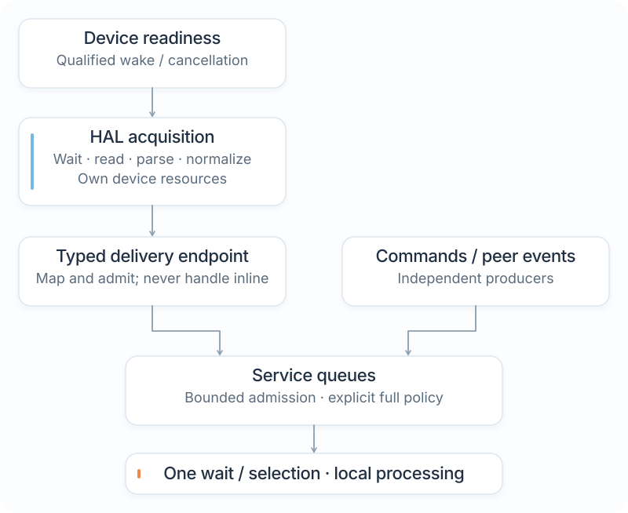
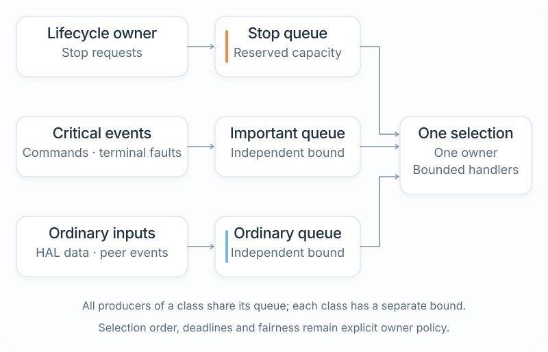

# Concurrency and event communication architecture

> **Status:** the acquisition/ownership principles are requirements. Platform
> implementations still require target ABI and physical qualification; channel
> allocation, timing and footprint claims require measurements.

## Architectural decisions

Keep tightly coupled application processing together. Messages cross meaningful
ownership boundaries, not every processing stage. Normalized hardware delivery
is a legitimate asynchronous boundary even when measurements are periodic.

| Concern | Direction |
| --- | --- |
| Service state | Ordinary owning Rust structs with synchronous helper modules |
| Independent execution | Qualified `std` threads; no mandatory actor trait |
| Device acquisition, waiting, parsing and normalization | HAL/provider, never the service event loop |
| Important traffic | Dedicated bounded queue capacity, independent of ordinary measurements |
| Multiple queues | One receiver owner and one logical blocking selection point |
| Multi-queue implementation | Pinned Crossbeam bounded channels as the preferred qualification candidate |
| Simple single-queue cases | Existing std bounded channels remain valid; no automatic migration |
| Data inside an owner | Direct calls and borrows |
| Bulk data across a justified boundary | Explicit bounded buffers/rings with a tested notification contract |
| Acceptance | Functionality, allocations, latency, linked binary size and RAM all matter |

This is an in-process Rust application model. Neither availability of `std` nor
an upstream crate's desktop support qualifies a NuttX or browser target.

The [std channel performance analysis](std-channel-performance.md) connects
these requirements to the bounded inbox implementation and its reported
ESP32-S3 timing and memory observations. It distinguishes many producers sharing
one inbox from selection across independently bounded queues.

## Ownership and the HAL boundary

The service owns application state, processing policy and HAL session lifecycle.
The provider owns device resources and acquisition/parsing state. Owning a GNSS
session does not mean reading a UART on the service thread.

<figure class="architecture-art">
  <picture>
    <source media="(prefers-color-scheme: dark)" srcset="assets/nxrs-acquisition-boundary-dark.svg">
    
  </picture>
  <figcaption>For GNSS, the provider owns UART parsing and coherent measurement assembly. Calibration, fusion and health policy run with the receiving service state. <a href="assets/nxrs-acquisition-boundary.svg">Open SVG</a>.</figcaption>
</figure>

GNSS HAL hides NMEA versus UBX, serial framing, checksums, partial input,
receiver-specific configuration/recovery and coherent measurement assembly.
Reusable protocol/parser crates may implement that work behind the HAL facade.
The service receives device-independent data, not raw packets or descriptors.

The capability contract defines units, coordinates, measurement versus arrival
time, validity, optional fields, epochs, sequence/gap reporting and source
lifecycle. Missing receiver data must not be fabricated. Product decisions,
such as entering degraded navigation, remain service policy.

A blocking provider may own a worker thread. Existing driver workers, shared
provider loops or callbacks are also valid. There is no mandatory thread per
device or parser, and no additional service whose only job is relaying HAL data.
Provider-internal device waits and cancellation remain behind HAL/target support.
No std/Crossbeam channel operation is assumed ISR-safe; use a qualified deferred
path before invoking a service delivery endpoint.

Production acquisition is signal-driven: IMU IRQs or explicitly configured
ODR-derived timer wakes, and GNSS UART readiness, wake HAL-owned acquisition.
Services never poll devices on sampling timers. For an unwired IMU, a HAL timer
feeds the same FIFO drain/normalization path as an IRQ. It is only a wake hint;
actual FIFO contents admit samples. Missed ticks coalesce instead of generating
backfilled measurements. A configured IRQ failure never silently selects a timer.
ISR callbacks only use qualified OS notification; parsing, FIFO/UART I/O and
bounded sink admission execute in task context. Queue-full measurements follow
an explicit loss policy with observable counts/sequence gaps; terminal faults
remain available through the session result even if notification is rejected.

Application processing remains ordinary `&mut self` methods. Do not default to
`Arc<Mutex<Service>>`; move state to the one execution owner. Thread creation
requires the appropriate `Send + 'static` bounds, not that all private state be
`Sync`. Ordinary `main()` remains the composition root. [Thread builder][thread]

## Typed endpoints without a global event graph

Services expose command/semantic-event enums. HAL capabilities expose normalized
data/status enums. A destination combines only the types it consumes, potentially
in separate enums for separate admission classes. There is no global message enum,
`Any` registry, subscription system or serialized internal wire format.

Inject a narrow source-typed sink into each producer. Application/service wiring
maps, for example, a GNSS solution to the ordinary queue and a terminal provider
fault to an important queue. The producer need not know the destination's private
enums. Classification is explicit policy, not an arbitrary priority number
supplied by every sender.

The sink runs on the producer and only maps/admit events. It never calls the
receiving service's handler, starts a forwarding thread, or adds an intermediate
HAL-output queue. Rejected events remain owned by the caller. Admission means
queued, not processed, acknowledged or durably stored. [Channel operations][cb]

`shared/messaging` owns generic delivery results and the bounded `Sender<T>` /
`Inbox<T>` wrapper. It has no HAL/service dependencies. Its default `channels`
capability supplies std channels; HAL contracts disable that capability for
core-only builds. Producers accept ordinary `FnMut(T) -> DeliveryResult<T>`
callbacks; no sink trait or forwarding worker is needed. Multi-instance identity
uses local variants or bounded tags when needed. Explicit fan-out needs a partial-admission policy; a
sender clone is not a broadcast subscription.

### Requests that leave the owner responsive

While external work is pending, its requesting owner must continue handling its
other permitted inputs. Retain the operation state and receive completion through
the existing dispatch/wake path. A synchronous reply-channel wait inside a
handler introduces a second wait dependency even if the destination itself has
one well-structured event loop. Blocking sends, worker joins and destructors that
join need the same review.

The [navigation demonstration](event-driven-demo.md#control-without-suspending-observation)
uses startup-allocated reply storage, one outstanding request per sensor handle,
and a wake callback shared with fusion output. Completion is retained before
notification. Full wake admission therefore does not lose the result. Consuming
the reply releases the outstanding slot; a caller's expired deadline does not.
The private reply channel scopes request identity to the service lifetime, and
stale wake hints carry no response data. Existing blocking convenience calls
remain available for explicitly blocking callers.

Keep callback behavior bounded and in its declared context. A producer callback
may publish owned data or a wake hint; it must not call the recipient's mutable
handler. Source/API checks prevent particular misuse, but do not prove that
arbitrary Rust, dependency or foreign code cannot block. Qualify the complete
admission, publication and native wake path on the selected scheduler/backend.
This follows the event-loop discipline described by
[Cummings, Managing Concurrency in Complex Embedded Systems](https://www.state-machine.com/doc/Cummings1006.pdf).

### Notification and retention

Specify what a wakeup tells the reader and what remains available to read. The distinction applies at different layers, from driver buffers to application middleware.

| Example | Contract to examine |
| --- | --- |
| NuttX buffered sensor driver | Interrupt or polling acquisition pushes records into the driver's upper-half ring buffer. The reader retrieves buffered events through the device interface. [NuttX sensor drivers](https://nuttx.apache.org/docs/latest/os/drivers/special/sensors/sensors_uorb.html#programming-modes) |
| Zephyr zbus | A subscriber receives a channel reference and reads its current value. A message subscriber receives a copy, while an inline listener runs in the publisher's context. [Zephyr zbus observers](https://docs.zephyrproject.org/latest/services/zbus/index.html#concepts) |
| PX4 uORB | A topic in the flight stack retains one message by default. Configured deeper queues retain more history, and a slow subscriber can still lose messages. [PX4 uORB buffer length](https://docs.px4.io/main/en/middleware/uorb#uorb-buffer-length-orb_queue_length) |

For NXRS, decide per consumer whether it needs current state or ordered history. If one wake can cover several retained records, define how a bounded drain will resume while unread records remain. Check freshness for latest-state readers and use sequence numbers or explicit loss reports for readers that need history.

### Motion Tracker observations and capture

Motion Tracker's acquisition callbacks publish latest values directly to
navigation's fixed readers. Each IMU and the GNSS fix has one preallocated
triple buffer per reader. Only the display subscribes to satellite reports.
Publication runs in the existing acquisition tasks and bypasses the app inbox.
Communications takes its reader when it starts, including for late pairing.

A reader starts in `Waiting` and then sees complete samples with their
original reception times. A snapshot can combine sources updated at different
instants. Later samples may replace unread ones. IMU readings expire at 500 ms,
GNSS fixes at 3 s and satellite reports after two receiver intervals, with a
six-second minimum. Callback, open and joined failures all latch terminal
state for the acquisition lifetime, even if the display misses a wake.

The [owner qualification fixture](../tests/owner-qualification/README.md)
compares the former mutex with fixed `triple_buffer` 9.0.0 readers. It checks
that a reader can retain a complete record while the producer publishes and
that independent readers can see different complete records. The product
comparison below measures the application path on CoreS3.

Ordered capture belongs to the Motion Tracker export. It uses a 512-record
pool shared across sources, drains batches of up to 16, and retains the first
rejected record's source and sequence on overflow. A wake tells communications
to inspect that retained work. The admission, overflow and wake gates for a
capture replacement are tracked in [#446](https://github.com/yongkyuns/nxrs/issues/446).

#### CoreS3 product-path baseline

A physical CoreS3 and M135 ran the `m5stack-cores3-dual-imu` product profile
at `283e7597` with temporary timing probes. The same image used the live
display, both 100 Hz IMUs, GNSS, and authenticated BLE v3 export in each case.
The preemption case made a priority-95 task runnable for 120 ms while the
priority-90 display held the observation mutex. NuttX reported both
priority-100 IMU tasks waiting on a semaphore inside observation publication.
The BLE peer withheld cumulative acknowledgments independently. The four main
cases observed export for 10 seconds each, with a second run for the control
and combined cases.

| Load | Longest IMU callback | Longest BLE batch gap | Peak capture depth |
| --- | ---: | ---: | ---: |
| Control | 0.81–3.05 ms | 0.121–0.123 s | 17–19 |
| Display preemption | 121.67 ms | 0.137 s | 20 |
| 0.95 s BLE acknowledgment hold | 1.60 ms | 1.043 s | 152 |
| Preemption and BLE hold | 119.04–119.58 ms | 0.816–0.877 s | 137–138 |

Observation publication accounted for the forced delay. The ordered capture
step took at most 2.86 ms. The peer saw no sequence gaps in the received
prefixes. With acknowledgments held for 7 seconds, the 512-record pool filled.
The peer received all 1,093 admitted records and a loss marker for IMU 1
sequence 788, immediately after that source's record 787.

An IMU stopped early in the control as well as under load. Runs that recorded
the cause reported a sensor timeout. Qualifying sustained acquisition requires
isolating the timeout and checking hardware FIFO continuity.

#### CoreS3 fixed-reader comparison

With the same profile and priorities, the display retained an IMU reader slot
through a 120 ms forced pause. Both IMUs kept publishing, with 15 and 12
publications during the pause, and the longest callback was 2.41 ms. In a
combined repeat with BLE acknowledgments held for 0.95 s, the IMUs published
11 and 12 samples during the pause and the longest callback was 2.50 ms. Both
IMUs and GNSS stayed live through that 25-second run.

A 0.95 s acknowledgment hold alone raised queue depth to 148 records with
contiguous received sequences. A 7 s hold filled the 512-record queue. The peer
received all 1,099 admitted records followed by the first-loss marker.

The BMI270 timeout also occurred with fixed readers. Target traces showed
three consecutive FIFO length snapshots crossing sensor sampling boundaries,
which is when the driver returns `Timeout`. Both IMUs stayed live in the
25-second BLE-off and advertising-only controls. The connected runs establish
the failure path. The cause of the extended register-read intervals and
sustained acquisition remain open.

The matched build added 3,348 bytes of linked flash and 104 bytes to the boot
image. Publication setup used 3,720 bytes of heap versus 480 bytes. Static RAM
and task stack reservations were identical.

## Dedicated capacity, one logical wait point

The baseline for a service needing importance isolation is independently bounded
important and ordinary queues. A dedicated lifecycle-stop queue can additionally
isolate shutdown from an important-event burst. This replaces the earlier rule
of one physical queue for every source.

<figure class="architecture-art">
  <picture>
    <source media="(prefers-color-scheme: dark)" srcset="assets/nxrs-priority-inboxes-dark.svg">
    
  </picture>
  <figcaption>Separate capacity isolates admission classes. Selection preference does not preempt a handler or establish fairness by itself. <a href="assets/nxrs-priority-inboxes.svg">Open SVG</a>.</figcaption>
</figure>

All senders for a class fan into its queue. Separate capacity is not a reason to
create one queue per producer, device, enum variant or processing module.

Use existing Crossbeam selection instead of writing a selector. Fixed-arm
`select_biased!` gives the earliest ready arm preference. It does not preempt a
running handler, make arbitrary source order deterministic, or guarantee normal
traffic progress during an unbounded important-event stream. [Biased selection][biased]

Illustrative dispatch shape (not the final helper API):

~~~rust,ignore
loop {
    // Check absolute deadlines between dispatches, not only after a timeout.
    service.run_due_work();
    let remaining = service.time_until_next_deadline();
    crossbeam_channel::select_biased! {
        recv(stop_rx) -> request => { handle_stop_request(request); break; },
        recv(important_rx) -> event => handle_important_or_closed(event),
        recv(ordinary_rx) -> event => handle_ordinary_or_closed(event),
        default(remaining) => {},
    }
}
~~~

There is one blocking selection, not sequential blocking receives. Required
channel closure causes explicit failure/teardown; optional closed channels are
disabled. Disconnected channels are ready, so ignoring errors can spin.
A source can fail while other senders keep its class queue alive; source status
must be explicit rather than inferred from whole-channel disconnection. [Selection][select]

Handlers perform bounded work and do not block waiting for another service,
queue capacity, a device response or a worker join. Service-specific deadline and
fairness policies must be tested under sustained traffic. Strict priority is
acceptable only with a justified important-traffic bound or an explicit starvation
policy. Selection preference is not a real-time scheduling guarantee.

Simple services with only one queue may use `recv`/`recv_timeout`. Existing
standard receivers cannot be passed to Crossbeam's selector. Neither path
requires Rust async. There is no generic service-side descriptor reactor.

## Admission and lifecycle contracts

Independent queues prevent ordinary traffic consuming important-event slots;
they do not make a finite important queue incapable of overflowing.

- Ordinary admission returns accepted, full-with-original-event or closed-with-
  original-event. No implicit allocation, unbounded retry or silent discard.
- Each measurement consumer declares its loss/coalescing policy. A display's
  latest-value semantics must not silently become an estimator's loss policy.
- Important full/disconnected outcomes must be retained/retried or escalated by a
  bounded source-specific protocol. Terminal state must remain observable even
  when its event cannot be admitted; do not report overflow only by sending
  another event into an already full queue.
- Shutdown has isolated admission. The initial fixture uses a capacity-one,
  lifecycle-owner-only stop queue. A pending duplicate stop may be treated as
  already requested; normal traffic can never occupy that slot. Disconnect and
  completion remain distinct from successful admission.

Source rates, burst bounds, capacities, permitted retry storage and overflow
visibility are part of the resource contract. HAL acquisition must not block
indefinitely on the consumer and become unable to drain hardware or cancel.

Lifecycle meanings are separate:

| Milestone | Meaning |
| --- | --- |
| Start accepted | Session exists and initialization has begun |
| Ready | Provider configured and capable of acquisition; not necessarily a valid GNSS fix |
| Operation accepted | Request admitted; later completion is explicit where needed |
| Stop requested | Cancellation initiated without blocking normal service dispatch |
| Acquisition stopped | Native acquisition has ended; apply the capability's callback-retirement contract |
| Callbacks quiescent | No remaining callback or sink invocation can access its captured resources |
| Joined | Worker execution has terminated and its resources are reclaimed |

Create queues and install sinks before enabling production. Roll back partial
starts. Provider stop must wake a blocked device wait. Quiescence does not remove
already queued events: the session contract defines draining/discard and, when
restart is supported, how old-session data is rejected.

For Wi-Fi, `ProviderStatus::Stopped` records successful native cleanup before
the final status sink runs. Retain sink-owned resources until successful
`Wifi::finish()` establishes callback retirement and worker joining. Publishing
the terminal snapshot before its wake preserves reconciliation when the final
event is rejected. Status observation alone is not permission to reclaim the
sink. The worker releases its pending-state mutex before external wake and final
notification calls.

Do not join a producer that still needs the joining service to drain a full
queue. The single-wait rule applies to normal dispatch; explicit joins belong to
teardown after progress dependencies are resolved. Do not hide a blocking join
in `Drop`. A retained HAL session whose worker retains a sender cannot rely on
automatic inbox closure to start shutdown. [Join semantics][join]

## Memory budgets for deadline-sensitive work

Reserve bounded scratch, queue and buffer storage during construction or session
setup. The owning component supplies and reuses it through the normal API.
Keep capacity and exhaustion behavior explicit. Reject excess work or apply
bounded backpressure using the capability's existing policy.

On fixed-priority targets, qualify steady-state code for zero calls to the
shared heap, including frees, first-use work, error paths and native SDK calls.
Measure setup, reconfiguration and teardown separately. Exercise the full
supported inputs when adding a reserve. Use priority inheritance for shared
task-context locks where supported and qualify the resulting wait times.

Use positive-capacity bounded channels with a fixed set of participants and
selection arms. Do not create channels/selectors/threads during normal dispatch.
Prefer fixed-arm macros to constructing a dynamic `Select` repeatedly.

Neither `std::sync::mpsc::sync_channel` nor Crossbeam's bounded API promises an
allocation-free lifecycle. Allocation behavior depends on the selected source:
the [generic std implementation][std-implementation] and
[Crossbeam][cb-source] have their own blocking bookkeeping, while nxrs's pinned
NuttX SDK uses the [bounded queue/waiter backend](std-channel-performance.md#where-the-memory-goes)
described in the performance analysis. That backend preallocates the ring and
keeps blocked-operation waiters on caller stacks. Thread/parker setup and
payload-owned buffers still need accounting. Fixed message storage does not
prove allocation-free waiting; reusable first-use bookkeeping is also different
from allocation per message. Audit the pinned sources and measure the complete
path.

Record construction, first blocking use, repeated ready-path operations,
repeated blocking/timeouts, overload and teardown separately. First-blocking
cases run on fresh threads/processes so earlier tests cannot hide lazy setup.
Initialization and every participant's prescribed first-use setup must be
explicit. Target acceptance is documented bounded initialization and no
unbudgeted steady-state allocator activity; measured exceptions must be reported,
not normalized away by calling arbitrary extra warm-up iterations.

Reuse `tests/allocation-probe`. Rust allocator hooks do not account for all
libc/OS heap usage or task stacks, and instrumented timings are not performance
measurements. Keep allocation, timing and linked-footprint artifacts separate.
Crossbeam is preferred for its required selection functionality, not yet claimed
qualified or superior on a particular target. Do not write a replacement mailbox
unless qualification identifies a concrete unmet requirement.

## Binary footprint is a first-class acceptance criterion

Measure the final linked executable/firmware, not `.rlib` sizes or the sum of
crate archives. Adding a dependency and using a dependency are different cases;
dead-code elimination, LTO, panic handling and shared runtime paths affect the
marginal linked cost. [Cargo profiles][profiles]

Required comparison ladder:

| Variant | Purpose |
| --- | --- |
| Minimal C with matched kernel configuration | Existing OS/application baseline |
| Minimal Rust core/no_std with comparable entry, where buildable | Separates Rust core/entry from std startup effects |
| Minimal ordinary Rust std | Whole-image incremental std/entry/runtime cost |
| Std plus one thread/join workload | Incremental threading use |
| Std bounded channel workload | Standard-channel baseline |
| Crossbeam bounded channel with the same workload | Dependency substitution delta, not a different workload |
| Crossbeam separate queues plus selection | Incremental selection/queue-isolation cost |
| Std channel and Crossbeam used together | Measures coexistence/possible duplicated implementations during migration |
| Future thin nxrs helper with the same workload | Measures framework overhead after extraction, not before it exists |

Use the same target, source workload/payload, compiler/SDK and library versions,
resolved NuttX settings, stack configuration, optimization, LTO, panic strategy,
linker/GC options, instrumentation state and enabled features for matched pairs.
Only explicitly enumerated application-selection differences may be ignored in
kernel-config comparisons. Reject mismatches rather than print misleading deltas.

Report bytes and incremental deltas for text/read-only code/data, initialized
data, BSS, `text + data` (flash-like proxy), `data + BSS` (static-RAM proxy), and
actual loadable/flash image size where available. Keep full ELF file size separate
from those metrics: debug/symbol metadata is not device flash. Account separately
for alignment/gaps, stacks, heap peaks and reserved pools. Keep maps/section tables,
symbol evidence, build commands, resolved configs, lockfile/feature identities and
artifact hashes. A Rust no_std baseline must demonstrate absence of std runtime
symbols; a label alone is not evidence.

C versus minimal std is a whole-image deployment delta, not a language-intrinsic
constant. No_std versus std includes their entry/panic choices unless separately
controlled. Host dynamically linked binaries are diagnostics, not MCU flash
estimates. Firmware on the actual target is the adoption gate. Reuse the existing
matched C/std footprint pipeline under `tests/rtos-bench` rather than replace it.

Record dependency features and transitive dependencies. Repeat the relevant
matched rows when adding a runtime dependency; inspect coexistence before claiming
that replacing std channels necessarily reduces size. Size, memory and latency
tradeoffs go into the review, not an unsupported claim of zero-cost abstraction.

## Bulk data remains a separate concern

Keep local samples/frames borrowed within one service. Across a justified
boundary use an explicitly sized pool/ring or preallocated owning buffers.
Moving a `Box<[u8]>` does not deep-copy bytes; immutable `Arc` is for actual
simultaneous readers, not unrestricted mutation. DMA/cache/completion constraints
remain provider responsibilities.

Generic pool/notification machinery is not part of the first shared crate.
Path-specific implementations must test rejected availability notifications,
partial draining, re-notification and stop/restart. Pending data cannot become
permanently invisible after a full inbox rejects its wake event. All notification
handling remains integrated into the service's one selection point.

## Implementation sequence and qualification boundaries

1. Qualify raw std versus pinned Crossbeam with a synthetic HAL producer and
   separate stop/important/ordinary queues; use existing allocation instrumentation.
2. Add matched linked-size variants and comparison guards, then run the selected
   native and NuttX builds. Keep each result tied to exact source/toolchain/config.
3. Extract only repeated endpoint, dispatch and lifecycle machinery into a small
   neutral crate after the fixture passes. No actor runtime, custom queue algorithm,
   serializer, global enum, service graph or service-side device poller.
4. Integrate one event-producing HAL and coarse processing service; qualify provider
   cancellation and data normalization before broader migration.

The [GNSS HAL](../hal/gnss/README.md#event-driven-session) implements bounded event
delivery through `open(sink)` and a session with explicit `request_stop()` and
`join()`. `shared/acquisition` supplies worker lifetimes and readiness; GNSS
owns queue-full handling and terminal notification. The event demo exercises
the topology under portable and stress workloads.
See [architecture.md](architecture.md) and [event-driven-demo.md](event-driven-demo.md).

Tests must cover typed multi-source delivery, isolated capacity, important-full
outcomes, biased selection and non-preemption, deadlines under sustained traffic,
source failure while peers remain alive, full-queue stop, partial-start rollback,
blocked device-read cancellation, callback quiescence, allocation phases and
mismatch-rejecting footprint reports. A fixture's synthetic cancellation is not
qualification of a real UART/driver cancellation implementation.

Crate names, sink-wrapper syntax and concrete GNSS fields are implementation
choices. Target cancellation support, fairness limits and measured resource
budgets are acceptance work. The architecture need not be reopened to choose them.

## References

References describe mechanisms, not nxrs target qualification. Pin dependencies
and toolchains in the executable qualification change.

[thread]: https://doc.rust-lang.org/std/thread/struct.Builder.html
[join]: https://doc.rust-lang.org/std/thread/struct.JoinHandle.html
[cb]: https://docs.rs/crossbeam-channel/0.5.17/crossbeam_channel/
[biased]: https://docs.rs/crossbeam-channel/0.5.17/crossbeam_channel/macro.select_biased.html
[select]: https://docs.rs/crossbeam-channel/0.5.17/crossbeam_channel/macro.select.html
[cb-source]: https://docs.rs/crossbeam-channel/0.5.17/src/crossbeam_channel/lib.rs.html
[std-implementation]: https://doc.rust-lang.org/src/std/sync/mpmc/mod.rs.html
[profiles]: https://doc.rust-lang.org/cargo/reference/profiles.html
