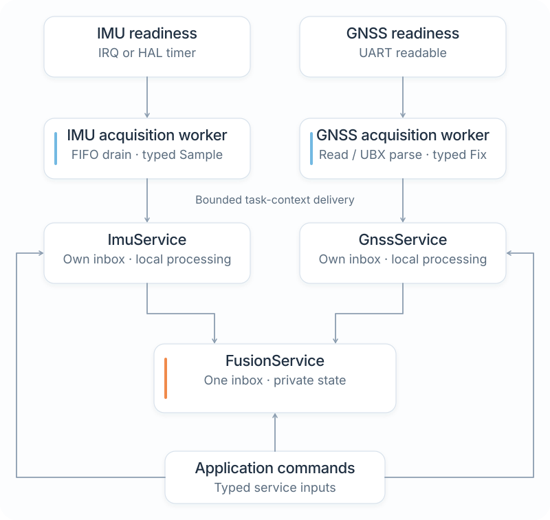

# Event-driven navigation demonstration

The application composes IMU, GNSS, fusion and health processing through portable
service APIs. Product profiles select HAL implementations; app and service code
contain no OS, board, device-path or native-driver knowledge.

```sh
NXRS_PLATFORM=mock cargo run --locked -p nxrs-event-demo
NXRS_PLATFORM=host-imu cargo run --locked -p nxrs-dual-imu-demo
```

## Ownership and delivery

<figure class="architecture-art">
  <picture>
    <source media="(prefers-color-scheme: dark)" srcset="assets/nxrs-navigation-dataflow-dark.svg">
    
  </picture>
  <figcaption>Acquisition and each service own separate execution lifetimes. Arrows denote bounded task-context delivery; interrupts only notify the acquisition path. <a href="assets/nxrs-navigation-dataflow.svg">Open SVG</a>.</figcaption>
</figure>

Each HAL owns acquisition, parsing, normalization and device cleanup. Services
own local processing and session lifecycle. Acquisition events use bounded,
nonblocking task-context admission; handlers do not execute inline on producers.
ISRs notify through a qualified native path and never invoke Rust channels.

Each sensor service blocks on its event inbox and handles samples, commands and
faults. It has no sampling timer and performs no bus/UART reads. Pause/resume
controls processing; HAL acquisition continues draining and suppressed samples
count as drops. Hardware ODR is independent of service commands. The former
`set_period`/service polling configuration is removed.

There are two sensor acquisition workers, two sensor service owners and one
fusion owner in the full demonstration. The dual-IMU fixture creates two
independent pipelines by passing the mock fixture's primary and secondary device
references to `ImuService::start_on`. A hardware composition needs a second
physical device bound to `aliases.imu_secondary` for the same app. This counts
application workers, not OS/system tasks.
Synthetic sources use timers solely as explicit mocks; production providers use
UART readiness or IMU IRQ/ODR-derived wakes. The stock unwired M135 uses a HAL
timer; a configured IRQ failure remains an error.

## Control without suspending observation

The app registers its thread's wake operation when starting IMU, GNSS and fusion.
It then uses one `park_timeout` wait for output, control completions and its next
absolute deadline. Before each wait it checks both retained control replies and
drains at most eight fusion outputs. A full batch immediately starts another
dispatch turn, so a coalesced wake cannot strand the remaining output. Deadlines
are checked even when data stays ready.

`try_request(ControlRequest::Pause)` attempts admission and returns a `RequestId`.
`try_completion()` later returns the matching command and resulting status. The
same interface handles resume and status requests. Each sensor handle has one
reply slot allocated at startup and permits one outstanding retained request until
that reply is consumed. Requests do not create channels. `Busy`, `Full`, `Closed` and
identifier exhaustion are explicit admission failures. The older `pause`,
`resume` and `status` methods remain blocking conveniences for callers that can
wait; this observation loop does not use them.

The two reply channels and their endpoint bookkeeping add permanent startup
storage to this demonstration, including when callers use the compatibility
`start_on` entry point. They add no worker or stack reservation. Existing handle
`Send`/`Sync` support is preserved; the retained request API requires an exclusive
mutable borrow. A private receiver wrapper uses only `Mutex::get_mut`, so this
compatibility wrapper performs no lock acquisition in request or completion calls.

Replies are retained before the wake callback runs. The callback only wakes the
owner or attempts bounded notification; it must not wait, perform I/O, or run the
recipient's handler. Failed startup may invoke the sensor retirement wake from
the startup caller. A rejected wake does not remove its reply. Callers using an
inbox for wake hints must reconcile retained replies between dispatches. Request
IDs belong to one unique handle, whose reply storage is never shared with a
replacement session; an old wake can only trigger another inspection.

The demonstration retries full command admission every five milliseconds and
expires a control phase after one second. Both use the same deadline-aware wait.
Expiry ends observation and enters explicit teardown; it does not reopen the
service's request slot or claim cancellation completed. The two phase decisions
remain ordered while fusion output continues to be consumed. These constants and
console reporting illustrate a workflow, not a product response-time guarantee.

## Lifetime and overload

Create inboxes and sinks before starting acquisition. Ordinary queue-full
rejections are counted and sequence gaps remain visible. A terminal producer
fault has one retained retry event and a sticky join result. The acquisition
worker never waits for a consumer to free measurement capacity.

Explicit teardown wakes blocked acquisition, joins it, and verifies cleanup
before reporting resource release. Explicit fusion stop drains previously
admitted inputs; abandoned handles cancel immediately. Drop requests cancellation without joining;
the detached worker retains resources until its cleanup completes. Terminal
cleanup failures quarantine the corresponding native capability until reboot.
Partial startup rolls back owners already started. Observation failure or command
expiry also joins all started owners before returning the error. An abandoned
control reply cannot block the service's completion or teardown.

IMU samples carry SI units, host receive time and nominal hardware sample
interval. Fusion integrates consecutive samples using that interval, skips
missing input intervals, and exposes `imu_discontinuities`; it does not extrapolate
unobserved motion. FIFO arrival time does not supply the integration interval.
Full FIFO is an explicit source fault.

## Qualification

`service/navigation/tests/active.rs` exercises event delivery, pause/resume and
explicit teardown using mocks, including retained control replies and the common
wake point. The control unit cases cover a delayed owner, full wake inbox,
admission rejection, closure, late consumption and request-identifier exhaustion.
Sensor HAL suites exercise UBX fragmentation,
FIFO framing, units, overload and failures. `tests/host/test-event-demo-nuttx.py`
checks the actual demo transcript in existing NuttX simulator/QEMU runs.

### Retained-control comparison

The 2026-11-26 comparison used clean baseline `5511a6c97be0ccc026261222df9e3317a50873bb`
and candidate `768c03c3fbc1241ed2205ed06058c46fa1420a49` sources with the unchanged
[`mps2-an521-mock` profile](../tests/profiles/mps2-an521-mock.toml). Both builds
passed 122 native ABI witnesses and the existing QEMU transcript validator,
including both control phases, final accounting and invalid-duration rejection.
GNSS samples intentionally ignored during pause remain counted as drops.

| Whole firmware measurement | Baseline | Retained control | Change |
| --- | ---: | ---: | ---: |
| Linked flash | 388,118 B | 382,342 B | -5,776 B |
| Unpadded binary image | 388,120 B | 382,344 B | -5,776 B |
| Static RAM | 10,548 B | 10,548 B | 0 B |

Linked flash sums allocated non-`NOBITS` ELF sections; static RAM sums allocated
sections in the profile's SRAM range. Binary image size is the `nuttx.bin` file
length. These are whole-demo results, including the changed orchestration and
linked code paths. The new reply channels consume runtime startup storage even
though static RAM is unchanged. Runtime heap use, stack high-water marks and
response-time bounds were not measured. No workers or stack reservations were
added.

Both builds used `thumbv8m.main-nuttx-eabi`, Rust `nightly-2025-09-15`
(`rustc 1.92.0-nightly 52618eb33`, LLVM 21.1.1), ARM GCC 14.2.1 (20241119),
NuttX `2b5c0de5e933281c209f954a63b99cf10c132346`, apps
`3c772ea35b9245972e18999828f7b533e6fc57cc`, and QEMU 10.0.13. Effective NuttX
configuration and std patch receipts were identical. The configuration SHA-256
was `76ef48537b71fb1b3b9b66c25ed5a41bb04aec54850f72258c8b4765e1c7396c`.
This profile uses flat, single-core NuttX, mock sensors, 65,536-byte default
pthread stacks and no priority inheritance.

Normal reproduction uses the repository frontend and transcript checker:

```sh
cargo +1.90.0 nxrs build --app event-demo --profile mps2-an521-mock --out /tmp/event-demo
python3 tests/host/test-event-demo-nuttx.py /path/to/qemu-system-arm \
  --machine mps2-an521 --image /tmp/event-demo/nuttx/nuttx \
  --log /tmp/event-demo/console.log
```

The comparison ran the exact-source frontend binary directly with
`--workspace-root`, reusing one pinned std build for both revisions. Its host
environment disallowed local sockets, so a temporary transport wrapper used QMP
process pipes, kept the UART PTY and omitted the optional GDB listener. Firmware,
profile, optimization settings and the checked-in transcript oracle were unchanged.

Host/mocked results do not establish physical interrupt latency, sample-clock
accuracy, power use or FIFO throughput. See [CoreS3 constraints](m5stack-cores3.md)
for the unwired M135 interrupt and its HAL timer wake source. See [communication requirements](concurrency-event-communication.md)
for the wider event-driven architecture and qualification requirements.
