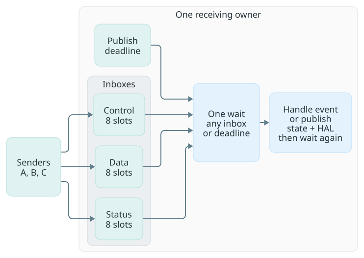
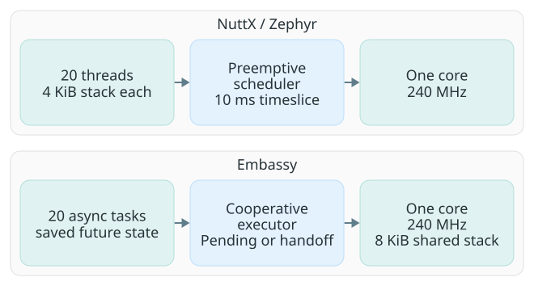
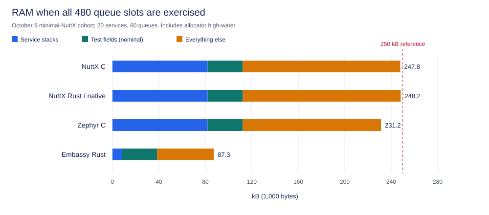
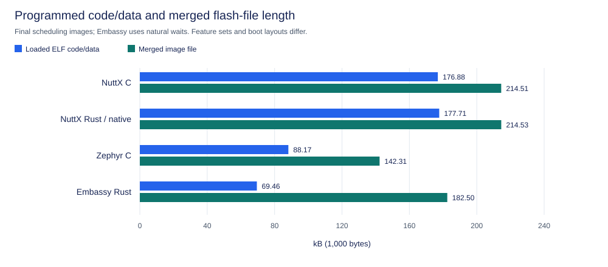

# Historical RTOS resource accounting

This supporting ledger explains the October native-adapter cohorts summarized
in [the RTOS comparison](rtos-comparison.md). It preserves their configuration,
byte attribution and interpretation; it does not turn those images into an
ordinary std or current NXRS product comparison. For the broader measurement
scope, see [Characterizing Zephyr, NuttX and NXRS](rtos-characterization.md).

## Workload and fairness

Each service owns an event loop, receives from multiple senders and has one
wait point for its inboxes and publication calendar. There are no reply
round trips or sequential queue-poll timeouts.

The layout is 20 services × 3 queues × 8 slots × 64 bytes: **30,720 bytes
of event storage**. Each test event has 44 dummy payload bytes and 20 routing,
timing and validation bytes; production chooses its own schema/capacity.
A 20-mailbox alternative preserves capacity by combining
each service's inboxes into one 24-slot FIFO. Normal traffic offers 3,900
deliveries in two seconds; burst traffic offers 6,240, then a 500 ms drain.

Accepted events are checked for delivery, order and payload correctness.
Nonblocking sends can reject overload; correct queues alone cannot guarantee
that every offered event fits or meets its deadline.

| Held equal | Different by design |
| --- | --- |
| One 240 MHz core, flash/cache settings, routing, payloads, calendar and application `-O2` | Native POSIX, Zephyr or Embassy facilities |
| Same minimal NuttX kernel configuration and C/Rust native adapter; NuttX/Zephyr kernel `-Os`, applications `-O2` | NuttX retains POSIX/VFS/libc; Zephyr and Embassy expose different native APIs |
| 20 × 4 KiB native worker stacks in C and Rust | Embassy uses an 8 KiB shared stack plus saved task state |

NuttX Rust here does **not** use `std::thread`, std MPSC, Crossbeam or
`println!`. This isolates application-language cost, not full std convenience.
Zephyr Rust integration and other Embassy executor arrangements were not tested.

## RAM: count provisioned capacity

NuttX allocates messages on demand; Zephyr/Embassy reserve buffers statically.
Compare full capacity, not quiet-run heap: the control fills/drains every slot
and deliberately rejects overflow.

| October 10 matched capacity control | Full telemetry | Lean qualification | Saved |
| --- | ---: | ---: | ---: |
| NuttX C, minimal | 247,204 B | 221,092 B | 26,112 B |
| NuttX Rust, minimal / native threads | 247,220 B | 221,108 B | 26,112 B |
| Zephyr C | 231,492 B | 205,380 B | 26,112 B |
| Embassy Rust, natural waits | 87,284 B | 61,172 B | 26,112 B |

All 48 invocations passed without PSRAM; original flash was restored/verified.
Rebuilt lean images remove only 102 × 64 × 4 histogram bytes, retaining
scalar/delivery checks—not latency distributions or a production minimum.

### What is required, chosen, or added by the test?

Bytes below reconcile to the **lean** totals. “Required” means required by this
implementation, not an irreducible cost of the language or RTOS.

| RAM portion | NuttX C / Rust | Zephyr C | Embassy | How to interpret it |
| --- | ---: | ---: | ---: | --- |
| Service execution workspace | 81,920 | 81,920 | 12,512 | Native: 20 × 4 KiB stack requests. Async: 8 KiB shared stack + 4,320 B service task pool, including futures and task headers. Application-sized. |
| Chosen event capacity | 30,720 | 30,720 | 30,720 | Artificial: 21,120 dummy payload + 9,600 routing/timing/check bytes. Choose real messages/burst capacity. |
| Queue/adapter controls | 18,512 | 7,040 | 1,932 | Selected metadata/lifecycle bookkeeping, including test choices; not payload or a universal minimum. |
| Fixture application state | 3,040 | 3,040 | 3,040 | Synthetic flow/digest state, not messaging infrastructure. Real services need their own state. |
| Checker/coordinator overhead | 4,424 | 4,432 | 5,059 | Diagnostics, gates and padding; not required by nxrs. Full telemetry adds 26,112 B. |
| RAM code/vectors | 37,732 | 49,576 | 5,912 | Instructions/vectors, not heap. Shared here; changes with features. |
| Other OS stacks/arena | 7,168 | 18,432 | 0 | Configuration-selected. Zephyr includes a 4,096 B heap arena; zero does not mean no runtime state. |
| Runtime storage not individually split | 37,576 / 37,592 | 10,220 | 1,997 | Linked data/padding; NuttX also includes live heap and transient high-water. Mixed, **not certified unavoidable**. |

NuttX's controls comprise 5,200 B adapter objects, 7,552 B dynamic message
headers/allocator alignment, and 5,760 B static-pool spare/headers. Eight events
use the static pool; 472 heap messages cost 80 B each for 64 B of contents.
Pool spare includes unused IRQ/System-V reservations and oversized preallocated
messages—configuration costs, not application requirements. The remaining
37,576 B is 9,360 B linked storage + 27,792 B live heap beyond worker stacks
+ 424 B peak margin. That heap mixes main-task stack, thread/queue/VFS objects
and runtime/test allocations; its fixed-versus-per-service split is unmeasured.
The [ELF-bound ledger](../tests/event-services-comparison/README.md#ram-attribution)
retains object sizes and avoids pool/payload and arena/heap double counting.

### What the RAM ratio establishes

The full-telemetry NuttX Rust / Embassy ratio is **2.83×**; the lean ratio is
**3.61×**. Removing the same 26,112 B from both changes the ratio while leaving
the absolute gap unchanged. These are configured whole-system footprints for
the [October 10 images](../tests/event-services-comparison/results/esp32s3-instrumentation-2026-10-10.json),
not a measurement of an intrinsic thread-versus-async multiplier.

The lean NuttX Rust / Embassy gap is 159,936 B. The execution-workspace
difference accounts for 69,408 B, or 43.4%. The remaining 90,528 B includes
queue implementations, RAM code, OS reservations and unsplit allocations.
Some unsplit NuttX allocations are thread-related; this remainder must not all
be labeled fixed platform overhead. The Embassy shared stack is already
included, and both implementations provision all 480 payload slots.

The native fixture uses uniform 4 KiB worker stacks without recorded
per-worker high-water observations. Thus the evidence does not establish how
much of that reservation is safely removable. Changing twenty requests from
4 KiB to 2 KiB would remove 40,960 B of requested stack budget arithmetically;
it is not a measured, safe 180,148 B Rust firmware. Allocator rounding, thread
objects, exceptional paths and background stacks need their own observations.

Even correctly sized threads retain separate stack capacity for concurrent
execution contexts, plus native lifecycle/scheduler metadata. Cooperative
async tasks retain suspension state while sharing transient call depth on the
executor stack. Async can therefore save RAM beyond unused safety margins,
with the responsiveness contract described below: this executor cannot
preempt a long synchronous handler.

The **16 B C/Rust delta applies to the shared native C pthread/mqueue adapter**.
It does not qualify ordinary Rust startup, `std::thread`, Nxrs inboxes or
Crossbeam. The separate twenty-idle-thread std-wrapper experiment is a
different cohort and cannot be added to or subtracted from these totals.

The [fresh RAM controls](../tests/event-services-comparison/RAM.md) now collect
thread-only 0/1/5/10/20-worker increments, queue empty/full/drained increments,
and worker/shared-stack observations with configurable requests. The Zephyr
helper now uses effective `K_HEAP_MEM_POOL_SIZE`: a board-added arena can
exist when `CONFIG_HEAP_MEM_POOL_SIZE=0`. This corrects helper visibility;
the historical ELF ledger already counted that 4,096 B arena once.
The separate [ordinary Rust controls](../tests/ram-footprint-std/README.md)
exercise the actual Nxrs and Crossbeam paths.

These additions are a new measurement cohort. Their host checks and target
compilation do not replace physical stack and heap observations. The October
tables and frozen result files remain unchanged; no smaller-stack target RAM
result has been inferred from the new host evidence.

## Image size: distinguish contents from address span

October 9 image measurements use minimal NuttX and frozen Zephyr/Embassy builds.[^flash-size]

The minimal profile removes shell/board utilities, unused UART/random/C++/float
printing, environment/child-task bookkeeping and PSRAM. Native queues, `poll`,
pthreads, LED readback, assertions, stack coloration, timing, TLS and ABI remain.
Kernel/libc use `-Os` like Zephyr; handlers remain `-O2`. This workload-specific
profile is not a general-purpose std configuration.

| Current image | Stored contents, no gaps | Gap-free package | Flash address span |
| --- | ---: | ---: | ---: |
| NuttX C | 114,764 B | 115,835 B | 138,992 B |
| NuttX Rust | 115,580 B | 116,651 B | 139,008 B |
| Zephyr C | 88,248 B | 89,319 B | 142,312 B |
| Embassy Rust | 91,012 B | 92,362 B | 182,656 B |

The matched NuttX comparison across the earlier NSH/board baseline and minimal
benchmark was:

| Matched NuttX profile | C code + initialized data | Rust code + initialized data | C / Rust flat flash file |
| --- | ---: | ---: | ---: |
| Earlier NSH/board baseline | 176,884 B | 177,708 B | 214,508 / 214,532 B |
| Minimal benchmark | 114,667 B | 115,483 B | 138,992 / 139,008 B |

NuttX C's code + initialized data falls by **62,217 B (35%)** and its binary
by **75,516 B (35%)**. These are combined configuration/build-policy savings,
not an attribution to any single subsystem. Rust adds **816 B of code +
initialized data**, also **816 B to the gap-free package**, over matched C.
The flat `.bin` grows only 16 B because the extra code consumes existing padding.

Uncompressed ZIP packages omit validated gaps, retaining actual zero-filled
data. Manifest-driven reconstruction reproduces each measured SHA-256. Packages
are not bootable: flashing uses reconstructed `.bin` files with required
alignment. The on-device address span does **not** shrink.

Embassy additionally stores a 21,072 B bootloader and 128 B partition records;
NuttX/Zephyr embed simple-boot loading. Its 91,644 B gaps are not debug data.
Smallest application need not mean smallest bootable system. All spans fit
2 MB; budget partitions by span, not ZIP size. Boot/linker policy is unchanged.

Remaining NuttX C bytes, from its ELF and retained link-map intervals:

| Component | Bytes |
| --- | ---: |
| Architecture/HAL, startup and board code | 42,663 |
| Scheduler, threads, signals and queues | 20,024 |
| VFS code | 8,385 |
| libc, drivers and heap code | 15,850 |
| Benchmark code | 8,938 |
| In-section padding/unattributed code bytes | 1,867 |
| Constants and initialized data | 16,940 |
| Total | 114,667 |

Architecture/HAL includes boot and flash initialization. These platform costs
are shared by C and Rust; they are not a Rust tax or debug information.

For formatting, startup, thread wrappers and containers, see the separate
[Rust footprint analysis](rust-std-footprint.md). Those choices should not be
charged to this native-API fixture.

## Evidence

The [numeric evidence index](../tests/event-services-comparison/results/README.md)
retains the source cohorts and image identities. The
[ELF-bound attribution recipe](../tests/event-services-comparison/README.md#ram-attribution)
explains how to replay the ledger. Current hardware controls are a separate
cohort; no smaller-stack physical result is inferred from their host tests.

[^flash-size]: Code + initialized data counts stored firmware ELF sections,
    including read-only data and initial RAM values. Stored image contents add
    boot components/headers but exclude explicit gaps; packages add ZIP/manifest
    overhead without compression. Flash address span includes gaps needed by
    the chosen boot/flash layout. Debug symbols stay in the separate ELF;
    uninitialized RAM such as `.bss` is not stored in these files.
