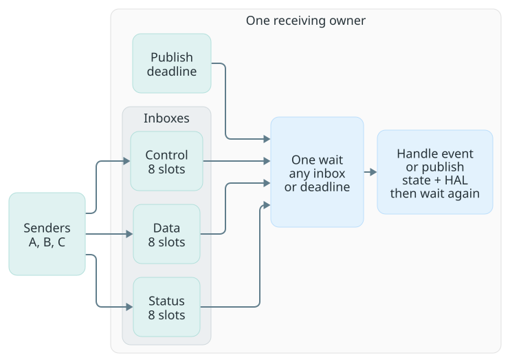
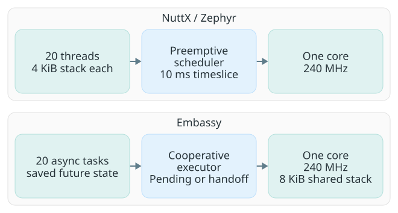
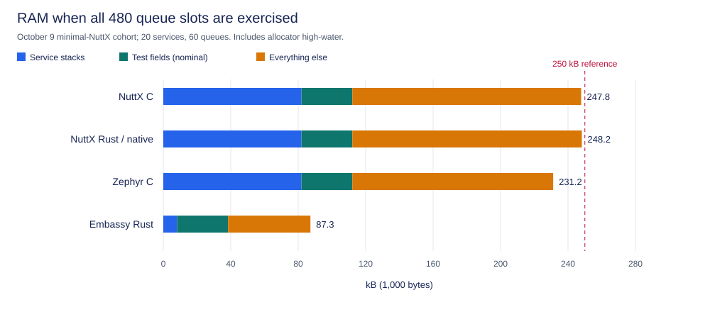
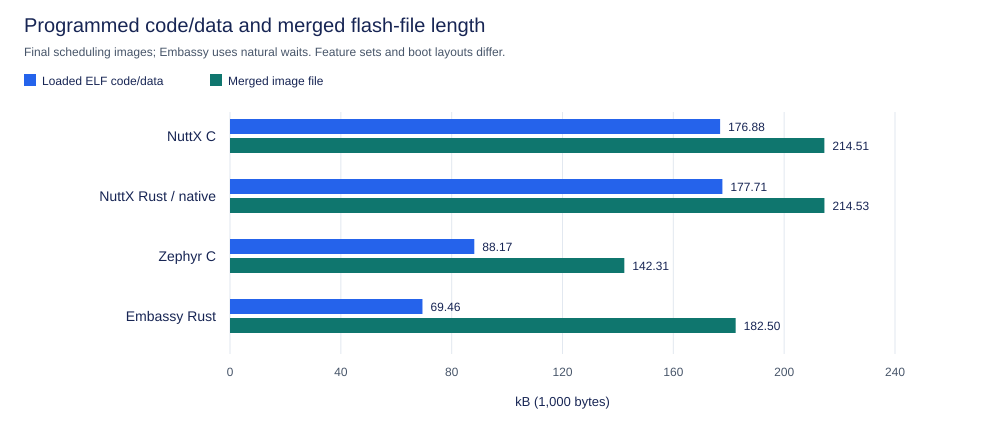
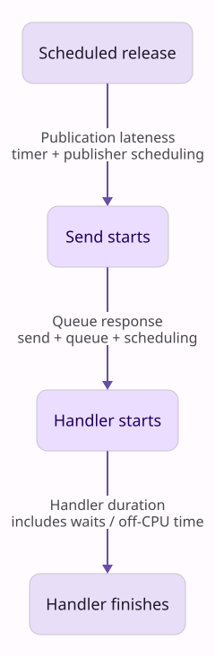
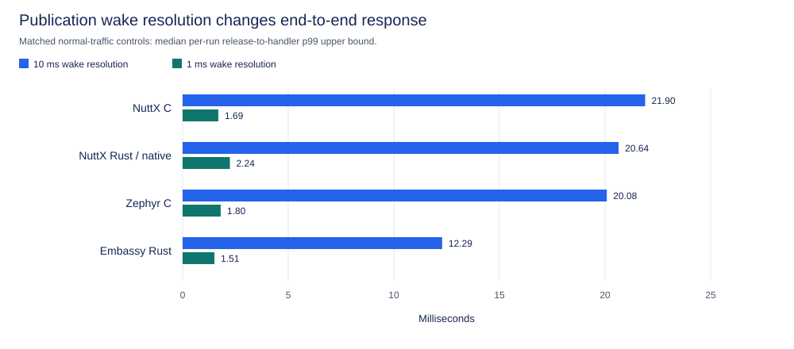

# Event-driven services on NuttX, Zephyr and Embassy

For the broader comparison of OS behavior, the ordinary NXRS application model,
resource costs, progress, recovery and portability, see
[Characterizing Zephyr, NuttX and NXRS](rtos-characterization.md). This page
retains the historical native-adapter experiments and their measurement scope.

Twenty services and sixty bounded queues run correctly on all four tested
implementations. Native Rust on NuttX adds little over matched C. Embassy saves
execution RAM, but synchronous work blocks its single cooperative executor.
Zephyr C handles the tested heavy work well. These are fixture results,
not finished-product qualification.

## Workload and fairness

Each of twenty services owns an event loop, receives from multiple senders and
has one wait point for its inboxes and publication calendar. There are no reply
round trips or sequential queue-poll timeouts.

The layout is 20 services × 3 queues × 8 slots × 64 bytes: **30,720 bytes
of event storage**. A 20-mailbox alternative keeps the same capacity using one
24-slot FIFO per service. Accepted events are checked for delivery, order and
payload; nonblocking sends may reject overload.

| Held equal | Different by design |
| --- | --- |
| One 240 MHz core, flash/cache, workload and application `-O2` | Native POSIX, Zephyr or Embassy facilities |
| Matched NuttX C/Rust kernel and native adapter; NuttX/Zephyr kernel `-Os` | OS facilities and driver ecosystem |
| 20 × 4 KiB native worker stacks | Embassy: 8 KiB shared stack plus saved task state |

NuttX Rust here uses neither `std::thread`, std MPSC, Crossbeam nor `println!`.
Zephyr Rust and other Embassy executors were not tested.
[Detailed workload contract](rtos-comparison-accounting.md#workload-and-fairness).

## RAM: count provisioned capacity

NuttX allocates messages on demand; Zephyr/Embassy reserve buffers statically.
Compare full capacity, not quiet-run heap: the control fills/drains every slot
and deliberately rejects overflow.

| October 10 matched capacity control | Full telemetry | Lean qualification | Saved |
| --- | ---: | ---: | ---: |
| NuttX C, minimal | 247,204 B | 221,092 B | 26,112 B |
| NuttX Rust, minimal / native threads | 247,220 B | 221,108 B | 26,112 B |
| Zephyr C | 231,492 B | 205,380 B | 26,112 B |
| Embassy Rust, natural waits | 87,284 B | 61,172 B | 26,112 B |

All 48 invocations passed without PSRAM; original flash was restored/verified.
Rebuilt lean images remove only 102 × 64 × 4 histogram bytes, retaining
scalar/delivery checks—not latency distributions or a production minimum.

### What is required, chosen, or added by the test?

Native execution reserves 81,920 B; Embassy reserves 12,512 B including its
shared stack and task pool. All provision 30,720 B of event storage.
Queue/adapter controls add 18,512 B on NuttX, 7,040 B on Zephyr and 1,932 B on
Embassy. The totals also include fixture state, checks, RAM code/vectors,
other stacks and unsplit allocations.

These are implementation/configuration costs, not certified minima. The
[detailed accounting](rtos-comparison-accounting.md#what-is-required-chosen-or-added-by-the-test)
reconciles every lean total, identifies test-only bytes, and links the
ELF-bound ledger without double-counting message pools or heap arenas.

### Conclusions a developer can use

Native Rust adds **16 B RAM** here; C shares execution costs. Embassy saves
**69,408 B execution workspace**, plus platform/runtime differences—not event
capacity. Futures grow with locals held across awaits. Four slots halve event
storage, not all queue costs.
Execution/metadata recur with services/queues. RAM code/platform reservations
are shared only for this configuration.

Lean NuttX/Zephyr leave **29/45 kB against 250,000 B**, before product drivers,
buffers and state. The total is not “messaging overhead”; subtracting test bytes
does not qualify a product. Rebuild with real workloads. Image/timing cohorts differ.

### What the RAM ratio establishes

The full-telemetry NuttX Rust / Embassy ratio is **2.83×**; the lean ratio is
**3.61×**. Removing the same 26,112 B changes the ratio but leaves the gap
unchanged. These are whole-system footprints of the
[October 10 images](../tests/event-services-comparison/results/esp32s3-instrumentation-2026-10-10.json),
not an intrinsic thread-versus-async multiplier.

Execution workspace accounts for **69,408 B (43.4%)** of the 159,936 B lean
gap. The remaining 90,528 B mixes queue implementations, RAM code, OS
reservations and unsplit allocations, some thread-related. It cannot all be
called fixed platform overhead.

The uniform 4 KiB stacks have no recorded per-worker high-water observations.
Reducing twenty requests to 2 KiB saves 40,960 B arithmetically, without
establishing a safe 180,148 B Rust firmware. Correctly sized threads still
retain separate concurrent stacks and lifecycle/scheduler metadata; async
retains suspension state and shares transient call depth. This executor's
long synchronous handlers remain nonpreemptible.

The **16 B C/Rust delta** applies to the shared native pthread/mqueue adapter.
It does not qualify ordinary std; the separate std-wrapper cohort cannot be
added to or subtracted from these totals.

[Fresh native RAM controls](../tests/event-services-comparison/RAM.md) and
[ordinary Rust controls](../tests/ram-footprint-std/README.md) add thread-count,
queue-lifecycle and stack observations, including actual Nxrs/Crossbeam paths.
Their host tests/builds do not replace physical measurements. The
[accounting notes](rtos-comparison-accounting.md#what-the-ram-ratio-establishes)
retain the heap-arena correction and cohort limits; historical totals remain
unchanged.

## Image size: distinguish contents from address span

October 9 image measurements use minimal NuttX and frozen Zephyr/Embassy builds.[^flash-size]
The workload-specific minimal profile is not a general-purpose std configuration.

| Current image | Stored contents, no gaps | Gap-free package | Flash address span |
| --- | ---: | ---: | ---: |
| NuttX C | 114,764 B | 115,835 B | 138,992 B |
| NuttX Rust | 115,580 B | 116,651 B | 139,008 B |
| Zephyr C | 88,248 B | 89,319 B | 142,312 B |
| Embassy Rust | 91,012 B | 92,362 B | 182,656 B |

Relative to the earlier NSH/board baseline, NuttX C saves **62,217 B (35%)**
of code + initialized data and **75,516 B (35%)** of binary size. These are
combined configuration/build-policy effects. Matched Rust adds **816 B** of
code + initialized data; its flat binary grows only 16 B because padding
absorbs the rest.

Gap-free packages are not bootable. Reconstruction preserves required alignment
and measured hashes; on-device address spans do not shrink. All spans fit
2 MB. The [detailed image accounting](rtos-comparison-accounting.md#image-size-distinguish-contents-from-address-span)
retains profile controls, component attribution, boot components and package
semantics. For ordinary entry, formatting, wrappers and containers, see the
separate [Rust footprint analysis](rust-std-footprint.md).

## Speed: responsiveness is not queue-operation time

Release-to-handler includes publication lateness and queue response. Handler
duration includes sleeps/preemption, not just CPU work. Tail latency, deadline
misses and rejected sends expose stalls that means hide.

Changing wake resolution from 10 ms to 1 ms reduces median per-run response
p99 from 12–22 ms to 1.5–2.2 ms, without changing the native 10 ms timeslice.
Finer wakes' CPU/power cost was not measured.

### I/O and CPU work need different treatment

October 9 delivered all 205,920 messages without rejection. All 40 traffic
invocations outside long-CPU met deadlines; each simulated-I/O run completed
117 operations. Embassy's timer-backed I/O suspended naturally, without explicit
handoffs, as in earlier budgeted/chunked controls.

An await that is immediately ready does not suspend. A cooperative service
therefore needs bounded ready-loop work, and a long synchronous handler must
be split if peers need timely service. A between-handler budget cannot
interrupt the handler itself.

The October 9 cohort retains the frozen six-patch Rust compiler, without
further tuning. The long profile adds 400,000 arithmetic iterations to one
handler; all four implementations process it monolithically.

| Long-CPU profile, two runs each | Longest handler | Peer queue maximum | Deadline misses |
| --- | ---: | ---: | ---: |
| NuttX C, minimal | 11.267 ms | 10.993 ms | 2 |
| NuttX Rust, minimal / patched compiler | 12.839 ms | 10.929 ms | 23 |
| Zephyr C | 10.879 ms | 10.035 ms | 0 |
| Embassy natural, patched compiler | 10.032 ms | 21.002 ms | 4 |

Earlier chunked Embassy controls reduced peer queue maximum to 1.251 ms but
increased elapsed handler time; samples stay separate. Loss-free delivery is
not deadline qualification. Observed maxima/two runs establish neither hard
bounds nor stable speed rankings. The
[compiler assessment](../tests/arithmetic-parity/RESULTS.md) covers remaining gaps;
its 29-patch candidate is opt-in, not SDK/CI activation.

## Lean NuttX application check

The separate [LED qualification](../tests/service-qualification/README.md) uses
16-byte events, 1/8/8 queue capacities, GPIO readback and ordinary Rust startup
without PSRAM. It includes footprint, restart/fault and sustained/pressure
checks. No Zephyr/Embassy comparison or IRQ-latency qualification applies there.

## Development choice

| Approach | Benefit | Cost or constraint |
| --- | --- | --- |
| nxrs / Rust on NuttX | Rust app types/ownership, existing drivers and POSIX/std options, preemptive blocking work | Broader platform footprint, FFI boundaries, deliberate API and RAM budgeting |
| C on NuttX | Same native facilities; small matched application | Manual ownership/lifetime discipline; common OS costs remain |
| Zephyr C | Compact tested image, native wait-any queues, good tested CPU-load response | Different driver/configuration ecosystem; threaded RAM remains substantial |
| Embassy Rust | Much lower execution RAM, bounded channels/tasks, naturally suspending I/O | Async drivers and bounded synchronous work; no in-handler preemption on this executor |

Rust on NuttX remains viable; async execution deserves consideration for tight
RAM budgets and mostly-waiting services. Next, qualify interrupt-driven I/O
under concurrent traffic, with deadlines and a full driver/buffer budget.

## Evidence and reproduction

- [Shared event-service contract and local tools](../tests/event-services-comparison/README.md)
  and [numeric evidence index](../tests/event-services-comparison/results/README.md).
- [nxrs before/after demo](../tests/service-footprint/README.md) and
  [current LED qualification](../tests/service-qualification/README.md).
- [Compiler coverage and assessment](../tests/arithmetic-parity/RESULTS.md);
  [figure regeneration](assets/rtos-comparison/README.md).

Reports retain numeric runs and artifact/configuration provenance, not private
backups/device identifiers. Cohorts stay separate; Zephyr/Embassy are optional
experiments, not production dependencies.

[^flash-size]: Code + initialized data counts stored firmware ELF sections,
    including read-only data and initial RAM values. Stored image contents add
    boot components/headers but exclude explicit gaps; packages add ZIP/manifest
    overhead without compression. Flash address span includes gaps needed by
    the chosen boot/flash layout. Debug symbols stay in the separate ELF;
    uninitialized RAM such as `.bss` is not stored in these files.
