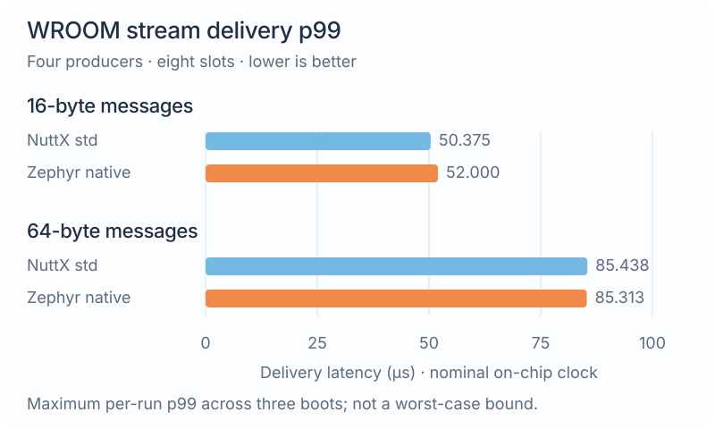

# RTOS comparison of delivery, RAM and deadlines

NXRS runs ordinary Rust services on NuttX, using its scheduler and Rust's bounded channels. On ESP32-S3 WROOM, the tested std channel delivers messages with similar tail latency to Zephyr's native queue. A separate service fixture shows why the choice of execution model matters for RAM and deadlines. Embassy's cooperative tasks use much less RAM, while long synchronous handlers delay their peers.

## Message delivery on WROOM

| Item | Configuration |
| --- | --- |
| Hardware | One physical ESP32-S3 WROOM; one 240 MHz core; radio and PSRAM disabled |
| Implementations | Patched NuttX `std::sync::mpsc::sync_channel` and `std::thread`; Zephyr native `k_msgq` and threads |
| Shared work | The same Rust workload, payload validation, producer ordering, admission accounting and joined cleanup |
| Versions | NuttX `2b5c0de5e933`; Zephyr 4.5.0 `41d10b597304`; Espressif Rust `abf50ae2e`; GCC 14.2.0 |
| Build and scheduling | Rust optimization level 2, no LTO; FIFO workers; 100 Hz tick; no time slicing |
| Measurement | Nominal 16 MHz SYSTIMER; three rotated passes, fresh boot per case; 24 captures on November 17, 2026 |

Both arms ran four-producer streams with 16- and 64-byte messages and eight slots, a separate sustained 16-byte case, and a one-producer paced case. Streams use 128 warm-up transfers and 2,048 measured offers; sustained throughput uses 131,072 deliveries without per-message timing; paced delivery uses 256 offers at a nominal 100/s. No sensor I/O or useful application processing runs in the receiver.

**Delivery p99** spans offer to reception, including admission, queue residence and scheduling. **Sustained rate** counts valid deliveries over the active interval. The reported range is across three independent runs.

### Placement and comparison limits

The reviewed queue, wakeup, timer and switch paths run from internal memory in both images, with the same ROM copy/compare routines. The qualification build moves NuttX's pending-signal helper into IRAM. Its execution during the test is unverified. Total executable internal-memory sections are 62,840 B for NuttX and 55,240 B for Zephyr. The kernels use different tick and dispatch implementations. The review covers known hot-path calls and callbacks, with general indirect paths still unverified. [ELF inspection and limits](../tests/rtos-characterization/WROOM-REVIEW.md#placement-what-was-corrected-and-what-was-reviewed).

### Delivery results

<figure class="architecture-art">
  <picture>
    <source media="(prefers-color-scheme: dark)" srcset="assets/nxrs-message-comparison-dark.svg">
    
  </picture>
  <figcaption>Same board, four producers, eight slots. Bars show the largest per-run p99, not a pooled percentile or worst-case bound. <a href="../tests/rtos-characterization/wroom-review-2026-11-17.json">Numeric evidence</a>; <a href="assets/nxrs-message-comparison.svg">open SVG</a>.</figcaption>
</figure>

| Measurement | NuttX std | Zephyr native |
| --- | ---: | ---: |
| 16-byte stream delivery p99 | 50.375 µs | 51.938–52.000 µs |
| 64-byte stream delivery p99 | 85.375–85.438 µs | 85.313 µs |
| 16-byte sustained deliveries/s | 268,505 | 234,835 |
| One-producer paced delivery p99 | 7.375 µs | 8.188 µs |

All admitted messages arrived in order with valid content. Every capture passed replay against its build.

The 16-byte stream p99 is about 1.6 µs lower with std. At 64 bytes the difference is at most 0.125 µs. Larger messages raise both stream tails by roughly 34–35 µs, consistent with more payload movement and queue residence. The measurements combine those costs. Std delivers 14.3% more messages/s in the separate sustained case, with similar stream tails under per-message timing.

### What carries over to other cases

On Pico 2 W the earlier 16-byte stream p99 was 81 µs for std and 65 µs for Zephyr. The exact indirect hot paths still need placement review before attributing the gap to the channel or scheduler. The earlier WROOM campaign also found higher latency for native POSIX queues than for std on the same Rust threads. CPU and IRQ measurements used separate observers, with different rules for charging IRQ time and an alarm measurement that includes dispatch. [Earlier physical results](../tests/rtos-characterization/PHYSICAL-RESULTS.md#messaging-and-progress).

## Service RAM and deadline behavior

The four-way WROOM fixture runs 20 services with 480 × 64-byte slots (30,720 B of event capacity), using one core, 1 ms timers and lean instrumentation. The native arms request 4 KiB per worker. Embassy's cooperative Rust executor uses one shared 8 KiB stack and retains task state between polls. RAM includes resident code, data and reservations, plus observed NuttX heap high water. Each `work-long` pass offered and delivered all 3,900 events. A miss means completion after the event class's 20, 40 or 80 ms deadline, measured from scheduled release. [Physical results and fixture](../tests/rtos-characterization/PHYSICAL-RESULTS.md#ram).

| Implementation | Accounted RAM | Deadline misses per pass |
| --- | ---: | ---: |
| NuttX C, pthreads and POSIX queues | 218,940 B | 0–1 |
| NuttX Rust, same native adapter | 218,940 B | 1–7 |
| Zephyr C, native threads and queues | 204,060 B | 0–6 |
| Embassy Rust, cooperative tasks | 61,184 B | 1,285–1,286 |

Embassy used **28% of the NuttX RAM** and missed **about one in three deadlines** under this long-handler load. A synchronous handler keeps a poll running until the handler returns. Interrupts can still run during that poll. Other tasks on the executor wait for control to return to it. The threaded configurations can schedule peers while a handler is still running.

The original **2.83×** NuttX Rust to Embassy ratio included full telemetry. In the October matched build pair, removing the same 26,112 B from each raised that ratio to **3.61×** and left the 159,936 B gap unchanged. Execution storage explains **69,408 B (43%)** of that gap. Native stack requests total 81,920 B. Embassy uses an 8,192 B shared stack and 4,320 B of task state and metadata. The rest combines queue machinery, RAM code, other reservations and mixed runtime allocations. [October byte ledger](rtos-comparison-accounting.md#what-the-ram-ratio-establishes).

The November 17 native C control covers NuttX and Zephyr only. With at least 4 KiB **usable** per worker and the same event capacity, NuttX used **223,748 B** versus **204,076 B** for Zephyr, a 9.6% difference. POSIX queue machinery is the largest contributor, adding 27,656 B before offsets elsewhere in the image. These totals describe the selected native APIs and configurations. NXRS std threads and inboxes have a separate footprint measurement. [Matched-stack ledger](../tests/rtos-characterization/WROOM-REVIEW.md#ram-separate-requests-usable-stacks-and-queue-costs) · [Ordinary Rust RAM](rust-std-footprint.md#ram).

## Implications for NXRS

- **Keep std as the WROOM service baseline.** The measured delivery is competitive with Zephyr. Budget latency from event release to application output under real handler and I/O load, including queue residence. Review Pico's hot-path placement before using its gap to choose an optimization.
- **Provision a worker for an independent execution need.** Twenty ordinary std workers added 90,448 B of heap above the fixture baseline, with 81,920 B in stack requests. A service can wait once for several inputs and handle each event to completion while remaining preemptible under NuttX scheduling. Size stacks from handler, error and teardown coverage. Size queues from the burst they must absorb and reserve capacity for control traffic that must get through a full data path. [Ordinary Rust RAM](rust-std-footprint.md#ram).
- **Evaluate a smaller execution model against the same deadlines.** Embassy shows how much RAM shared execution can save in this fixture. A comparable deployment needs to bound synchronous work, exercise the same load and lifecycle, and report both RAM and deadline outcomes. The available data cover the stated fixtures. They leave full-application portability, interrupt latency and recovery to the [evaluation method](rtos-characterization.md).

## Evidence and reproduction

The [WROOM review](../tests/rtos-characterization/WROOM-REVIEW.md) and [numeric evidence](../tests/rtos-characterization/wroom-review-2026-11-17.json) record setup and build identities. Use the [MPSC procedure](../tests/mpsc-comparison/README.md) or the [event-service RAM case](../tests/event-services-comparison/RAM.md) to reproduce the corresponding result. The [compiler assessment](../tests/arithmetic-parity/RESULTS.md) and [Thread-Metric/PX5 work](rtos-benchmarking.md) cover separate workloads.
