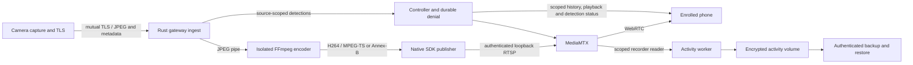

# Security integration architecture and qualification

The review stack combines authenticated camera ingest, credential-safe media
publication, durable authorization, encrypted activity storage and authenticated
backup recovery. The gateway is a trusted endpoint that can read footage.
Camera-to-gateway TLS and phone-to-gateway WebRTC do not provide camera-to-phone
end-to-end encryption. These branches require review and integration before
release; their tests do not authorize live service changes or board provisioning.
This 2026-10-27 evidence snapshot describes the separate review branches below;
the documentation branch itself does not contain every implementation change.

## Runtime boundaries

The camera keeps one capture owner. Its shared Rust stream/TLS implementation
serves bounded JPEGs; the selected operating-system providers supply sockets,
entropy, time and native resource access. The gateway's Rust ingest authenticates
the enrolled camera, validates its JPEG envelopes, and supervises finite
handshake, frame and child-progress deadlines. Device qualification must measure
the exact board/image/providers even when the Rust implementation is shared.

Ingest relays encoded bytes to a separate publisher. Only the publisher receives
its token through the inherited pipe; the encoder receives no publisher secret
in argv, environment or input. The publisher remuxes through the FFmpeg SDK and
does not decode pixels. Ingest retires both children before retry. Native parser
safety, dependency provenance and service isolation remain separate requirements.
Annotated publication keeps exact source identity in each H264 access unit.
The publisher clock supplies transport timing; it does not identify a decoded
image. Detection status/history has its own freshness and failure policy.
Expired or failed detection is unavailable, and missing/ambiguous image mappings
omit overlays. Native clients retain this mapping through source replacement,
backgrounding and decoder retirement.
See the [publisher boundary](../gateway/ingest/publisher.md) and
[reader/isolation boundary](../gateway/ingest/reader.md).

The [activity worker](../gateway/activity/README.md) observes the existing
authenticated loopback stream without acquiring the camera. Its bounded segment
ring, motion decoder and finalizer write to the declared protected activity tree.
The controller scopes history and playback to enrolled viewers and preserves
durable denial. Generated services bind operation to the actual encrypted mount;
mount loss must stop the group and retire its descendants. Backup/restore has
its own authentication, staging and interrupted-recovery controls.

Firmware and gateway remain separate Rust workspaces. The gateway workspace
owns controller, ingest, activity and process/isolation helpers; its host
dependencies do not establish MCU support. Ordinary host workspace checks and
native SDK/provider qualification are both required.

## Executed evidence and open work

Evidence below is specific to the recorded source, images and environment. A
later branch does not inherit a completed integration result merely because it
contains the earlier implementation. Exact artifact digests and source joins
remain linked from [#32](https://github.com/yongkyuns/nxrs/issues/32),
[#36](https://github.com/yongkyuns/nxrs/issues/36),
[#38](https://github.com/yongkyuns/nxrs/issues/38) and
[#123](https://github.com/yongkyuns/nxrs/issues/123).

The composed recording qualification still requires the actual SDK-generated
camera CSR and offline issuer, scoped mutual TLS, the production ingest/encoder/
publisher path, two decoded WebRTC viewers and one source owner. The strict
recorder must create a fully decoded camera-scoped clip and reject publisher
credentials for playback. After all media resources retire, authenticated
backup and interrupted restore must preserve that exact clip's bytes and hash.
Live nested-plaintext refusal, wrong key/UUID, locked storage and backup
corruption controls remain mandatory. OS entropy and initial clock/generation
in this hosted fixture do not qualify protected device sources.

| Boundary | Executed evidence | Remaining qualification |
| --- | --- | --- |
| Camera TLS and annotated SDK ingest | At [PR #140 source 9d864da](https://github.com/yongkyuns/nxrs/pull/140), [ingest run 40483873438](https://github.com/yongkyuns/nxrs/actions/runs/40483873438), artifact 12725372247, joins 102 SDK/216 media inputs and 11 receipts: mutual TLS, two decoded viewers, reconnect, credential absence from argv/environment and joined source/encoder/publisher retirement. | Physical entropy/time/key custody, CPU/RAM/stack/buffers and sustained reconnect/exhaustion remain open under #33/#35. This standalone witness does not qualify recording composition. |
| Minimized encoder and strict services | At 9d864da, [media run 40483873400](https://github.com/yongkyuns/nxrs/actions/runs/40483873400), artifact 12723689276, decodes 16 frames per MPEG-TS/Annex-B format, 16 access-unit delimiters and a finalized clip with 96 frames, with original-leak/patched-sanitizer recovery. [Strict run 40483873340](https://github.com/yongkyuns/nxrs/actions/runs/40483873340), artifact 12724836242, joins 211 inputs, eight artifact refusals, 12 failure-handler invocations, credential expiry/rotation, management-loss fail-stop/recovery and cleanup. | Each job retains its own executable/library identities. Host isolation and service controls do not close whole-native, physical power-loss, protected rollback or operator custody gates. |
| Composed SDK/TLS, recording, backup and restore | At [PR #139 source a86675e](https://github.com/yongkyuns/nxrs/pull/139), [recording run 40474957814](https://github.com/yongkyuns/nxrs/actions/runs/40474957814), artifact 12720524066, verifies 18 receipts and three distinct encrypted volume cases: 106/103/103 recorded frames, authenticated backup/full-decoded restore and interrupted recovery. Old recorder keys refuse; 16/17/18 new-key frames advance. Kept bytes, denial and activation window survive replacement. | Hosted composition does not qualify physical camera resources or production unlock/recovery custody. |
| Generated encrypted service group | The same a86675e recording cohort joins 228 inputs, 11 unit policies and 10 executables. The actual service group retains 284685 bytes/150 decoded frames and denial through mount loss/recovery, with joined cleanup. | Warm service recovery remains distinct from boot activation, physical power loss and protected rollback. |
| Automatic encrypted cold boot | At a86675e, [four boots run 40474957710](https://github.com/yongkyuns/nxrs/actions/runs/40474957710), artifact 12720752898, binds 252 boot inputs and a source snapshot of 1913 files. Four fresh kernels preserve the same clip (590851 bytes/270 frames) and denial across missing-key refusal/recovery; guest proxy/XML ABI execution and all cleanup barriers join. | This virtual cohort does not qualify physical power loss, production key custody, protected rollback or a verified firmware boot chain. |
| Shared device TLS on NuttX | At a86675e, [NuttX run 40474957732](https://github.com/yongkyuns/nxrs/actions/runs/40474957732), artifacts 12721380927/12721660452, joins 220 identity/225 TLS inputs, actual SDK/compiler/libc/TCP ABI and four fresh kernels. 52 certificate/56 revocation refusals, TLS 1.3/1.2 ChaCha, exact JPEG delivery and retirement/recovery pass. | Entropy/time/generation are emulator fixtures. The 8 KiB TLS buffers and 64 KiB worker stack do not qualify board memory, physical timing, protected entropy or key custody. |
| Native supply chain and Expat | At 9d864da, [native run 40483873287](https://github.com/yongkyuns/nxrs/actions/runs/40483873287), artifact 12725295893, authenticates 211 inputs, 34 distro images/27 packages/three signed releases. 42 distro findings plus Expat CVE-2025-66382 remain. At a86675e, recorded/guest XML joins bind 22 inputs, 5196 upstream checks and four current-Python/C-ABI/wrong-image controls. | The 43 retained matches keep admission red; they are not a proven count of reachable vulnerabilities. Expat replacement does not close CVE-2025-66382. Bootstrap, kernel, delayed plugins, release trust and signing lifecycle remain open. |
| Shared PCRE package and signed systemd source | At 9d864da, [PCRE run 40483873326](https://github.com/yongkyuns/nxrs/actions/runs/40483873326), successful retry job 122127642114/artifact 12725032893, joins 14 package/10 source inputs, all 14 install/recovery controls and 79 candidate exports preserving 73 vendor exports. [PR #137](https://github.com/yongkyuns/nxrs/pull/137), 6f963c5, authenticates the reviewed signed Ubuntu systemd source; package source-version metadata joins the native cohort. | Package install repair is separate from cold boot/power loss/protected rollback. Immutable prior PCRE vendor-image inspection is digest-joined; no fresh inspection is claimed. Systemd source authentication does not prove source/binary build correspondence, installed configuration or advisory applicability. No finding is cleared. |
| Native camera clients | At [PR #141](https://github.com/yongkyuns/nxrs/pull/141), d3ac7f6, [Android run 40490400010](https://github.com/yongkyuns/nxrs/actions/runs/40490400010), job 122142603377, verifies four actual instrumentation tests and cleanup. The API 35 x86_64 functional emulator records zero pixel/annotation mismatches: over 10.018s, decoded 16.37/16.47 FPS and rendered 15.37/16.07 FPS. At b734a97, [iOS run 40499420965](https://github.com/yongkyuns/nxrs/actions/runs/40499420965), job 122173056135, independently matches checkout, native camera/capture/retirement and cleanup markers, two consecutive catalog-removal cycles, all nine UI tests and the unsigned iPhone SDK build. | Android nominal source cadence is 17 FPS; actual source FPS is unmeasured and the separate throughput case is unqualified. iOS rendered/source FPS remain unmeasured. The earlier d3ac7f6 camera-recovery failure remains unexplained; these bounded runs do not establish long-duration stability. Physical-device qualification remains open. |
| Durable revocation | At d3ac7f6, [revocation run 40490399780](https://github.com/yongkyuns/nxrs/actions/runs/40490399780), job 122142603337, independently matches checkout and all seven runtime/cleanup markers: selective live termination, outage admission refusal/retry, durable denial, orphan retirement/reauthorized reconnect and corrupt-state refusal. | This loopback transcript has no executable-inventory join and does not qualify the operator VPN, physical host or credential custody. |
| Host SDK and parser qualification | At a86675e, [Linux/macOS SDK run 40474957750](https://github.com/yongkyuns/nxrs/actions/runs/40474957750) joins 102 SDK/109 audit inputs and 35 required controls per host; [portable run 40475483756](https://github.com/yongkyuns/nxrs/actions/runs/40475483756) passes all six jobs. The frozen e777185 [enrollment fuzz run 40421827151](https://github.com/yongkyuns/nxrs/actions/runs/40421827151/job/121917894589) witness binds 80 inputs, 100,000 executions and a real ASan positive control. | These host results preserve their original source scopes. They do not qualify physical entropy/resources or establish complete native/parser/release closure. |

The source identifiers above refer to independently checked frozen cohorts:
PR #139 `a86675ea4d936e38f1cb805d0d4213fa4f588de8`,
PR #140 `9d864da6f4478beb19e3ae0cb7948a849d370f1f`, and PR #141 revisions
`d3ac7f6a6c88a6720d8f3ccd123452634460127f` and
`22b6480becdbbf03dbfb7574def98d07d98ad7cd` and
`b734a974a8fbfcbe9e91bf6bae96e84bf3edc9ea`.
The 22b6480 iOS camera sample passed while its UI job failed tab selection;
the b734a97 fixture correction passes that case. Keep that intermediate
failure and the earlier recovery failure with their original source identities.
The source cohorts' equal-tree CI merges, ZIP digests, full input/image identities
and bounded receipt/transcript checks remain linked from the tracker.
Native client transcripts have no executable-inventory join. A passing component or an equal
source tree does not make different executed images interchangeable.

The 9d864da audit preserves all 34 distro-image hashes and 27 full package records
from the independently checked 1df3856 cohort. Seven custom source images changed;
retain their actual identities. Earlier image/report hashes and failure records
remain frozen. In particular, no current composition result is inferred from an
older successful job, and no native finding is dismissed solely from a feature,
source version or default-configuration assumption.

The [current native client architecture](https://github.com/yongkyuns/nxrs/blob/b734a974a8fbfcbe9e91bf6bae96e84bf3edc9ea/docs/client-camera-architecture.md)
describes independent media/detection freshness, exact decoded-image mapping,
bounded per-camera captures and joined retirement. These controls are independent
of model accuracy and physical-device throughput. The shared Rust device TLS
implementation still needs exact board/provider resource qualification.

## Qualification and operator handoff

Use the named disposable workflows for native library, actual PID1, encrypted
volume and virtual-boot qualification. Local unit tests exercise admission,
privacy, ownership and failure handling; they are not substitutes for those
executions. Formatting volumes, mounting storage or changing live services is
restricted to the explicitly guarded disposable hosted fixtures. Private keys,
configuration, raw logs, corpora, footage, disks and backup repositories remain
private; only each workflow's declared bounded public receipts are retained.

Before installing a reviewed deployment, follow the
[strict service procedure](../gateway/deploy/strict-services.md),
[encrypted-volume procedure](../gateway/deploy/encrypted-activity.md),
[durable-denial procedure](../gateway/deploy/revocation.md) and
[backup/recovery procedure](../gateway/deploy/encrypted-backup.md).
Preserve enrollment and denial across credential replacement, stop and join the
whole cohort before changing credentials, and qualify the actual unlock/key
custody mechanism. A manual reference unlock is not unattended startup.

The remaining original acceptance includes protected entropy/time/generation,
device credential lifecycle, verified mutable boot stages, protected rollback,
activation/confirmation, full NuttX kernel/application startup, physical
ROM/watchdog/power-loss behavior, component key isolation, actual phone/network
transitions, sustained resource/exhaustion recovery, complete native advisory
closure, trusted release provenance and operator review. Keep issues #33–#38
open until their own evidence establishes these requirements.

The [threat model and release matrix](security.md) records general IoT/camera use
with no known FIPS requirement. No FIPS certification is claimed or required by
this baseline. A concrete future requirement needs its own exact module,
operating-environment and integration assessment under #39. Hardware fuse/debug
changes, live deployment, release merges and laboratory spending require their
separate authorization.
