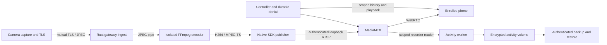

# Security integration architecture and qualification

The review stack combines authenticated camera ingest, credential-safe media
publication, durable authorization, encrypted activity storage and authenticated
backup recovery. The gateway is a trusted endpoint that can read footage.
Camera-to-gateway TLS and phone-to-gateway WebRTC do not provide camera-to-phone
end-to-end encryption. These branches require review and integration before
release; their tests do not authorize live service changes or board provisioning.

## Runtime boundaries

The camera keeps one capture owner. Its shared Rust stream/TLS implementation
serves bounded JPEGs; the selected operating-system providers supply sockets,
entropy, time and native resource access. The gateway's Rust ingest authenticates
the enrolled camera, validates its JPEG envelopes, and supervises finite
handshake, frame and child-progress deadlines. Device qualification must measure
the exact board/image/providers even when the Rust implementation is shared.

Ingest relays encoded bytes to a separate publisher. Only the publisher receives
its token through the inherited pipe; the encoder receives no publisher secret
in argv, environment or input. The publisher remuxes through the FFmpeg SDK and
does not decode pixels. Ingest retires both children before retry. Native parser
safety, dependency provenance and service isolation remain separate requirements.
See the [publisher boundary](../gateway/ingest/publisher.md) and
[reader/isolation boundary](../gateway/ingest/reader.md).

The [activity worker](../gateway/activity/README.md) observes the existing
authenticated loopback stream without acquiring the camera. Its bounded segment
ring, motion decoder and finalizer write to the declared protected activity tree.
The controller scopes history and playback to enrolled viewers and preserves
durable denial. Generated services bind operation to the actual encrypted mount;
mount loss must stop the group and retire its descendants. Backup/restore has
its own authentication, staging and interrupted-recovery controls.

Firmware and gateway remain separate Rust workspaces. The gateway workspace
owns controller, ingest, activity and process/isolation helpers; its host
dependencies do not establish MCU support. Ordinary host workspace checks and
native SDK/provider qualification are both required.

## Executed evidence and open work

Evidence below is specific to the recorded source, images and environment. A
later branch does not inherit a completed integration result merely because it
contains the earlier implementation. Exact artifact digests and source joins
remain linked from [#32](https://github.com/yongkyuns/nxrs/issues/32),
[#36](https://github.com/yongkyuns/nxrs/issues/36),
[#38](https://github.com/yongkyuns/nxrs/issues/38) and
[#123](https://github.com/yongkyuns/nxrs/issues/123).

The composed recording qualification still requires the actual SDK-generated
camera CSR and offline issuer, scoped mutual TLS, the production ingest/encoder/
publisher path, two decoded WebRTC viewers and one source owner. The strict
recorder must create a fully decoded camera-scoped clip and reject publisher
credentials for playback. After all media resources retire, authenticated
backup and interrupted restore must preserve that exact clip's bytes and hash.
Live nested-plaintext refusal, wrong key/UUID, locked storage and backup
corruption controls remain mandatory. OS entropy and initial clock/generation
in this hosted fixture do not qualify protected device sources.

| Boundary | Executed evidence | Remaining qualification |
| --- | --- | --- |
| Shared gateway TLS and child ownership | At PR134 source `c9a3412`, equal-tree merge `4383b08`, [macOS ingest](https://github.com/yongkyuns/nxrs/actions/runs/40414051990/job/121891754341) passes all 24 TLS scenarios without skips, 109 workspace tests (two ignored), and Clippy with warnings denied. | Exact physical device entropy/time/key custody, CPU/RAM/stack, production buffers and reconnect/exhaustion behavior remain open under #33/#35. |
| Composed SDK/TLS, recording, backup and recovery | At PR132 source `702b79e`, equal-tree merge `a680c22`, [encrypted recording](https://github.com/yongkyuns/nxrs/actions/runs/40398976725) verifies three distinct volume cases, authenticated backup/decoded restore, interrupted recovery and key replacement. Old keys refuse; replacement frames are 16/17/17. | This is hosted SDK execution, not physical camera qualification or production unlock custody. |
| Generated encrypted service group | The same recording cohort verifies 215 source inputs, 11 unit policies and 10 executables; it decodes 180 frames and preserves the exact clip and denial through mount-loss recovery. [Atomic proxy recovery](https://github.com/yongkyuns/nxrs/actions/runs/40398976881) verifies four interruption/error recoveries and joined cleanup at that source. | Warm service recovery and injected write failures do not prove boot activation, physical power loss or protected rollback. |
| Automatic cold boot | [PR131](https://github.com/yongkyuns/nxrs/pull/131) separates filesystem initialization from the managed service mount and adds an actual PID1 ordering experiment. | The mechanism and complete four-boot sequence still need successful source-bound execution. Historical automatic-start failures remain unresolved; host control tests are insufficient. |
| Native supply chain | The [PR132 native audit](https://github.com/yongkyuns/nxrs/actions/runs/40398976950) verifies its actual loaded graph and authenticated distribution payloads, retaining 45 active source/advisory matches plus one withdrawn record. | The advisory gate remains red. These are retained matches, not a proven count of reachable vulnerabilities. Bootstrap, kernel, delayed plugins, whole-release trust and signing lifecycle remain separate. |
| Expat replacement and new recording graph | [PR134](https://github.com/yongkyuns/nxrs/pull/134) implements signed-source Expat qualification and schema-2 native/payload/recording image joins. | Actual signature, upstream-suite, Linux ABI/current-Python mapping and composed runtime results remain pending. CVE-2025-66382 stays unresolved; virtual-guest XML integration is also open. |
| Production parser fuzzing | At PR134 source `e777185`, equal-tree merge `8c4e31b`, [enrollment fuzzing](https://github.com/yongkyuns/nxrs/actions/runs/40421827151/job/121917894589) passes 100,000 executions and the real ASan positive control, binding all 80 source inputs. | This is one host parser job. Other parser/native/complete-baseline results and physical device qualification remain separate. |

Across the verified PR132 recording/native jobs, publisher, reader, FFmpeg and
shared-PCRE bytes agree; installer and media-receipt bytes differ. Keep those
jobs' cohorts distinct. The public receipts bind the exact clean CI checkout,
source/executable hashes, parent reports, decoding and retirement observations.
They do not turn the new Expat graph into a qualified replacement.

## Qualification and operator handoff

Use the named disposable workflows for native library, actual PID1, encrypted
volume and virtual-boot qualification. Local unit tests exercise admission,
privacy, ownership and failure handling; they are not substitutes for those
executions. Formatting volumes, mounting storage or changing live services is
restricted to the explicitly guarded disposable hosted fixtures. Private keys,
configuration, raw logs, corpora, footage, disks and backup repositories remain
private; only each workflow's declared bounded public receipts are retained.

Before installing a reviewed deployment, follow the
[strict service procedure](../gateway/deploy/strict-services.md),
[encrypted-volume procedure](../gateway/deploy/encrypted-activity.md),
[durable-denial procedure](../gateway/deploy/revocation.md) and
[backup/recovery procedure](../gateway/deploy/encrypted-backup.md).
Preserve enrollment and denial across credential replacement, stop and join the
whole cohort before changing credentials, and qualify the actual unlock/key
custody mechanism. A manual reference unlock is not unattended startup.

The remaining original acceptance includes protected entropy/time/generation,
device credential lifecycle, verified mutable boot stages, protected rollback,
activation/confirmation, full NuttX kernel/application startup, physical
ROM/watchdog/power-loss behavior, component key isolation, actual phone/network
transitions, sustained resource/exhaustion recovery, complete native advisory
closure, trusted release provenance and operator review. Keep issues #33–#38
open until their own evidence establishes these requirements.

The [threat model and release matrix](security.md) records general IoT/camera use
with no known FIPS requirement. No FIPS certification is claimed or required by
this baseline. A concrete future requirement needs its own exact module,
operating-environment and integration assessment under #39. Hardware fuse/debug
changes, live deployment, release merges and laboratory spending require their
separate authorization.
