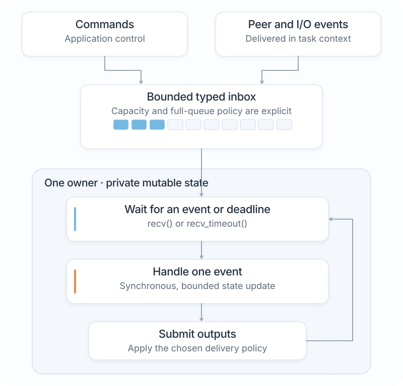
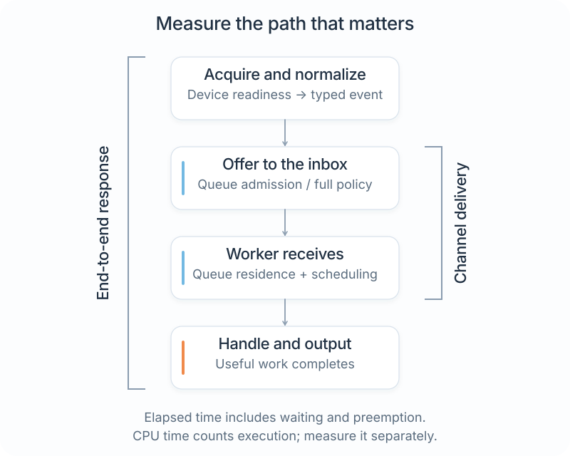

# Bounded Rust channels on NuttX

This assessment explains the implementation, timing and storage costs of the positive-capacity std channel used by NXRS's single-inbox services. It distinguishes guarantees established by the queue design from behavior observed in host tests and on physical boards.

## Scope and evaluation setup

| Item | Scope |
| --- | --- |
| Public API | `std::sync::mpsc::sync_channel(n)` with `n > 0`; clonable senders and one receiver |
| NXRS wrapper | `messaging::Sender` / `Inbox`, with no forwarding thread or intermediate queue |
| Runtime under review | Repository-pinned NuttX std patches; ordinary desktop builds use host std |
| Implementation evidence | Queue, parker and context-switch source, plus the channel semantic tests |
| Physical evidence | The shared Rust MPSC workload on ESP32-S3 WROOM and Pico 2 W; three fresh-boot passes per case |
| Selected physical workload | Four producers, one receiver, eight slots; 16- and 64-byte inline messages; no sensor or application handler |
| Execution | One core; equal-priority FIFO workers; no time slicing, radio or external RAM |
| Measurement | Offer-to-receive elapsed time; nominal on-chip clocks; CPU and interrupt observations in separate images |

WROOM ran at 240 MHz with Rust optimization level 2 and no LTO; Pico ran at 150 MHz with size optimization and fat LTO. The [original campaign](../tests/rtos-characterization/PHYSICAL-RESULTS.md#campaign-build-provenance) and [comparison procedure](../tests/mpsc-comparison/README.md) record the per-board build policies. The [fresh WROOM review](rtos-comparison.md#test-setup) is a separate follow-up cohort. The implementation and semantic tests are identified in [Evidence and reproduction](#evidence-and-reproduction).

### Assumptions and limits

This assessment excludes unbounded `channel()`, zero-capacity rendezvous channels, multi-queue selection and ISR submission. The physical results characterize single-core execution. Host semantic tests do not establish NuttX interrupt behavior, and these measurements do not qualify SMP timing.

A queue-capacity bound covers messages waiting in the ring. It excludes pending values held by senders, the receiver's active value and separately allocated payloads. A `try_` method avoids waiting for capacity but does not, by its name, guarantee bounded execution under every scheduling arrangement.

## Implementation findings

### Ownership and waiting

Several task-context producers can deliver typed events to one inbox. The service blocks at one receive point, processes an event using its private state and returns to that wait. `send` may wait for capacity; `try_send` returns the original value when full or disconnected. The receiver can wait for data or a timeout.

<figure class="architecture-art">
  <picture>
    <source media="(prefers-color-scheme: dark)" srcset="assets/nxrs-owner-event-loop-dark.svg">
    
  </picture>
  <figcaption>Several senders can feed one inbox and one blocking wait. The benchmark isolates this transport; a product also adds acquisition and handler work. <a href="assets/nxrs-owner-event-loop.svg">Open SVG</a>.</figcaption>
</figure>

Std's single receiver does not provide selection across independent queues. A service requiring separate stop, important and ordinary capacities needs an explicit selection/admission design, described in [event communication](concurrency-event-communication.md).

### Queue coordination and native wakeup

| Implementation choice | Effect | Tradeoff or boundary |
| --- | --- | --- |
| Ring and waiters updated in one protected transaction | Prevents a preempted participant from leaving a slot half-published | Payload movement occurs inside the guard; interrupts are excluded on the qualified single-core path |
| Native semaphore parker | Preserves std's single retained wake permit and monotonic timed waiting | Notification storage must remain valid through late wakeups |
| Direct voluntary switch on eligible ESP32-S3 builds | Avoids the syscall entry for that switch path | Restricted to flat, single-core, windowed-ABI execution |
| Internal instruction RAM placement | Reduces flash-cache dependence in synchronization paths | Consumes SRAM and requires inspection of linked callees |
| NuttX-specific outlining of other channel flavors | Reduces duplication of unbounded/rendezvous operations in bounded callers | A code-generation choice; those flavors retain their own algorithms |

The queue releases its guard before sleeping, notifying or destroying a message. The source and semantic tests cover ownership, disconnect, timeout races and notification lifetime. The physical measurements exercise the combined implementation; they do not isolate the contribution of each change to a before/after speedup.

## Timing results

Delivery latency includes admission, queue residence and scheduling. It ends at the receiver timestamp, before useful application processing. The conceptual diagram shows why that interval is shorter than a device-to-output response.

<figure class="architecture-art">
  <picture>
    <source media="(prefers-color-scheme: dark)" srcset="assets/nxrs-latency-boundaries-dark.svg">
    
  </picture>
  <figcaption>Choose start and end points before comparing results. This is a conceptual path, not a measured timing trace; segment widths do not represent duration. <a href="assets/nxrs-latency-boundaries.svg">Open SVG</a>.</figcaption>
</figure>

| Four-producer, eight-slot stream | NuttX std delivery p99 |
| --- | ---: |
| WROOM, 16-byte messages | 50.38 µs |
| WROOM, 64-byte messages | 85.44 µs |
| Pico 2 W, 16-byte messages | 81 µs |

These values were unchanged at the displayed precision across the three passes. All admitted messages were delivered; intentional overload rejection was accounted for. Native comparisons and separate CPU/interrupt figures are in the [RTOS report](rtos-comparison.md#message-delivery-on-the-two-boards). Final hot-path placement remains an attribution limit, and no external clock calibration or worst-case timing proof accompanies these observations.

A producer's elapsed call can include execution by a consumer that preempts it. Throughput's reciprocal is therefore not the CPU cost of a queue operation.

## Storage findings

The selected backend constructs a preallocated `VecDeque` ring. Ready sends and receives reuse it; blocked operations retain an intrusive waiter on the calling thread's stack. The implementation does not allocate a new queue node for each admitted message.

| Calculated inline payload storage | Eight slots |
| --- | ---: |
| 16-byte messages | 128 B |
| 64-byte messages | 512 B |

These are payload calculations, not measured total channel allocations. Channel metadata, allocator rounding, thread/parker state and stack reservations are additional. Messages containing owned `Vec`, `String` or `Box` values can allocate independently of the queue.

The [ordinary Rust memory report](rust-std-footprint.md) measures worker and inbox storage separately. RAM-resident code is part of the physical budget as well: moving hot operations into instruction RAM exchanges available storage for timing behavior. The old whole-fixture totals and placement controls remain in the [original campaign report](history/std-channel-campaign.md#where-the-memory-goes), with their original stack provisions.

## Performance mechanisms

The dominant cost depends on the queue's state. A single throughput number hides these different paths:

| State | Work on the critical path | Practical implication |
| --- | --- | --- |
| Message already buffered | Guard acquisition, ring bookkeeping and movement of `T`; no new queue node | Large inline values increase copy work inside the interrupt-excluded transaction |
| Empty queue, sleeping receiver | Waiter registration, semaphore notification and scheduler/context switch, plus payload handoff | For small messages, fixed wakeup work is a leading candidate; faster copying alone may have little effect |
| Full queue or overloaded worker | Waiting for admission, earlier messages and receiver execution | Handler capacity and scheduling can dominate the observed tail; a deeper queue retains more delayed work |

The protected transaction is also a progress decision. If a producer is preempted after reserving a slot, a higher-priority consumer that spins waiting for publication can prevent that producer from finishing. Updating queue ownership and waiter completion under one guard avoids that half-published state. The cost is interrupt exclusion during payload movement on the qualified single-core path. Unlocking before notification and destruction keeps those potentially longer operations outside it. This explains the design tradeoff; it does not apportion the measured speedup among queue, parker, switch and placement changes.

For large data, a small owned descriptor backed by a bounded buffer pool is a candidate improvement: it shortens in-queue movement while retaining explicit lifetimes. It adds pool admission and recycling work, so its benefit must be measured. Enlarging capacity instead can reduce producer blocking while increasing data age at the receiver.

## Conclusions

The bounded std path is appropriate for a task-context service needing one FIFO and one blocking receive point. It preallocates queue storage without adding a forwarding thread, but it does not bound payload allocations, processing time or all synchronization delays.

The next product check should exercise **first wait, steady traffic, overload and joined shutdown** with the actual message type and worker priorities. Observe allocation across all phases; absence of per-message queue allocation does not establish absence of lazy runtime or payload allocation. For timing, use the [ready-versus-blocked comparison](rtos-comparison.md#focused-follow-up) to choose between copy/guard work and wakeup work before optimizing either. Changes intended for SMP also need contention and progress evidence on that execution mode; the single-core results do not supply it.

## Evidence and reproduction

- [Implementation inventory](../upstream/rust-std/README.md), [bounded queue](../upstream/rust-std/patches/0007-nuttx-bounded-channel.patch), [parker](../upstream/rust-std/patches/0002-nuttx-parker.patch) and [ESP32-S3 switch](../upstream/nuttx/patches/0106-esp32s3-direct-voluntary-switch.patch).
- [Channel semantic controls](../tests/nuttx-std/channels/README.md) and [NXRS messaging wrapper](../shared/messaging/src/channel.rs).
- [Physical results](../tests/rtos-characterization/PHYSICAL-RESULTS.md) and [MPSC build/capture/replay procedure](../tests/mpsc-comparison/README.md).
- [Original ESP32-S3 investigation](history/std-channel-campaign.md), including diagnostic-interference corrections and private-capture reproduction limits. Those earlier runs are separate from the three-pass results above.
