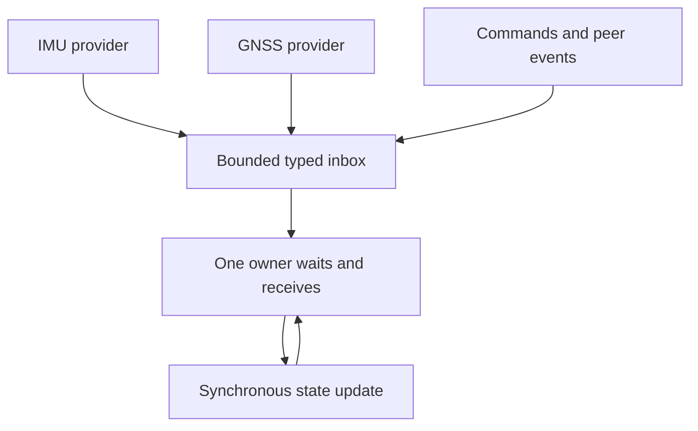

# Measuring Rust std in nxrs's event-driven core

nxrs is meant to let us write firmware with ordinary Rust: owned state, small
typed messages, threads when work needs independent execution, and a blocking
wait when there is nothing useful to do. The question behind this work was
practical: what do those familiar `std` facilities cost on a microcontroller?
Could a channel hide allocation, expensive wakeups, or enough code and stack
usage to make that programming model awkward?

The work in [#272][pr] makes the cost of one central building block much more
concrete. On ESP32-S3, a NuttX-specific implementation behind the normal bounded
channel API has reported physical delivery, throughput and memory measurements,
alongside source-level ownership checks and executable controls. That supports
continuing with nxrs's bounded inbox architecture. Application deadlines and
resource budgets still belong to the application that uses it.

This article explains the architecture, the implementation being measured, and
how to read the results without needing the earlier issue discussions. Hardware
numbers come from the [recorded campaign summary][campaign] at revision
`3410313500a29d31c5c45d2183cd3bc599969ae7`. The complete measurement fixture and
raw captures are retained privately; the [evidence section](#evidence-and-reproduction)
distinguishes those reported observations from what this checkout can reproduce.

A subsequent review scoped the unbounded/rendezvous outlining annotations to
`#[cfg_attr(target_os = "nuttx", inline(never))]`. On NuttX they still resolve to
`inline(never)`; the runtime implementation bodies are unchanged. No hardware
rerun accompanies that scope change. All physical numbers below continue to
describe the recorded campaign above.

## The path we want to keep simple

A provider waits for device readiness, reads and normalizes the data, then
offers a typed event from task context. The receiving service owns its state,
wakes on its inbox, runs ordinary synchronous Rust methods, and returns to its
wait. Local processing uses direct calls and borrows. Messages are for useful
ownership boundaries; there is no need to put every calculation on a thread.



That topology already exists. The [messaging implementation][messaging] wraps
`std::sync::mpsc::sync_channel` directly: cloned senders feed one queue, a unique
`Inbox` owns the receiver, and `Inbox::wait` calls `recv` or `recv_timeout`.
It adds no forwarding thread or intermediate queue. The [fusion service][fusion]
uses source-specific inputs to put IMU and GNSS events into the same inbox.

The distinction for the measurements is that **several providers can
share one inbox and one blocking wait**. Four producers do not require four
queues. Separate queues become useful when an owner needs independent capacity
for stop requests, important events and ordinary measurements. Selecting among
those queues is another operation, with its own progress, allocation and fairness
questions. The [communication guide][communication] and
[three-class owner fixture][owner] describe that extension; this campaign measures
a single bounded standard channel.

The surrounding contracts remain explicit. Providers must handle full queues,
retain terminal failures, wake acquisition on cancellation, and finish cleanup
before releasing resources. Interrupt handlers only issue qualified native
notifications; they do not call standard channels or service handlers. Those
rules are part of the [existing acquisition and lifecycle model][communication].

## Which part of std are we talking about?

Here, a channel means a **positive-capacity `sync_channel`**. Its bounded buffer
holds at most the configured number of messages. `send` can wait for capacity;
`try_send` returns the original message when the buffer is full or disconnected.
The receiver can block until data arrives. The public API documents these
[semantics][sync-channel].

`std::sync::mpsc::channel()` has an unbounded buffer, and `sync_channel(0)` is a
rendezvous channel with no queued capacity. Neither is the measured bounded
buffer. They remain available, but choosing them changes the resource or waiting
contract. A `try_` method avoids waiting for queue capacity; the name alone does
not establish a fixed execution time or make the operation safe in an ISR.

The implementation also matters. These results concern nxrs's **pinned, patched
NuttX std**, prepared in a private SDK. They are not a measurement of every
upstream standard library or target. Application source still uses normal Rust
APIs; the OS-specific implementation is selected below that boundary. Existing
`messaging` users therefore reach the same primitive without adopting another
application-facing channel API. The complete service path was not physically
remeasured by this channel fixture.

## Why patch std, and what changed?

There are two jobs here. First, the pinned Rust and libc inputs need to match
NuttX's native layouts and initialization rules. For example, the
[complete pollfd binding][pollfd-abi] and [std initialization patch][pollfd-init]
make polling pass a correctly laid out, initialized native object. Those are
target compatibility fixes. The channel work then makes implementation choices
for queue coordination, waiting and code placement on this RTOS.

Upstream [bounded channels][mpsc] already use a preallocated buffer of fixed
size. Keeping queue storage bounded did not require a replacement backend.
The questions here are how that buffer and its waiters make progress under
NuttX scheduling, and how much time and memory the channel path uses.

**The queue and its waiters now share one transaction.** The
[bounded-channel backend][queue-patch] owns its ring and waiter lists in Rust.
A short native guard protects admission, removal, completion, timeout and
disconnect. On the single-core configuration, the guard excludes interrupts
while the transaction runs. A ring reservation cannot be left half-published
while its owner is preempted. Waiting, native notification and message
destruction happen after the guard is released. Moving a payload still takes
work inside that transaction, so payload size belongs in the timing budget.

**Sleeping uses a native NuttX notification path.** The [NuttX parker][parker]
implements std's existing [single-permit contract][park] with a native semaphore:
repeated notifications coalesce. Timed waits use a monotonic deadline and retry
interrupted waits. A retained thread handle keeps notification storage alive
even if the completed receiver exits before the sender finishes waking it.
The implementation changes how this OS sleeps and wakes while preserving that
notification contract.

**The voluntary switch uses a direct native entry where qualified.** The
[ESP32-S3 switch patch][switch] builds the full native context and shares the
scheduler's commit and restoration path. It preserves register windows, thread
local state, loop state and coprocessor handling. This entry applies to flat,
single-core, windowed-ABI ESP32-S3 builds. Other execution modes retain the
syscall path.

**Code placement and inlining affect the result.** Putting frequently executed
synchronization code in internal instruction RAM, or IRAM, avoids depending on
flash-cache behavior for those operations. Keeping unbounded and rendezvous
operations out of line on NuttX also avoids copying their algorithms into
bounded callers through flavor dispatch. The [SDK patch description][std-patches]
records that separation. These are changes beneath the API, with real linked
code and shared-SRAM costs to account for.

The new queue and parker are selected only for `target_os = "nuttx"`. The
[unbounded][unbounded-boundaries] and [rendezvous][rendezvous-boundaries]
outlining annotations now use that same condition, leaving those flavors'
algorithms upstream. [SDK preparation][sdk] patches a private source copy;
normal host builds continue using their prebuilt std. These gates limit where
the new implementation runs; they do not establish performance on other targets
or every channel flavor.

The hardware tables describe the combined configuration. They do not isolate
the timing or CPU contribution of the queue replacement from the parker,
context switch and placement changes. The separate footprint controls below
answer narrower questions about linked memory costs.

None of this removes the scheduler from event delivery. A send can wake another
thread, that thread can preempt the sender, and the receiver can wait behind
other work. That is why an elapsed send-to-receive interval cannot be read as
the CPU cost of a queue instruction sequence.

## Reading the physical measurements

The retained campaign used ESP32-S3 hardware and a common measurement engine.
It covered one and four producers, payload and capacity variations, streaming,
paced delivery and overload. A native queue fixture was used as a reference
control for the engine and placement work. On that reference, Rust called
Zephyr's native `k_msgq`; it did not run a Zephyr std port.

There were 16 cases per runtime in a primary timing matrix and a separate
hardware-counter matrix: 64 fresh-boot captures altogether. Three additional
boots per runtime repeated the four-producer paced case, bringing the total to
70. Each full matrix had one pass per observer. Only the focal case had those
three additional repeats, and samples from different images or observers were
not pooled. The [campaign record][campaign] is the source for the observations
below.

| Reported std / NuttX observation | Value |
| --- | ---: |
| Sustained stream, one producer | 323,246 messages/s |
| Sustained stream, four producers | 273,677 messages/s |
| Delivery p99, four producers and 64-byte payload | 84.500 µs |
| Paced four-producer maximum, three focal boots | 8.0 µs on each boot |
| Single-producer 16-byte stream, p99.9 / maximum | 34.0 / 34.4375 µs |
| 64-byte stream, p99.9 | 60.0625 µs |

These are observations from different cases. In particular, the published
summary does not attach a payload/capacity pair to the two throughput rows or
publish the full per-case sample counts, arrival rates and priority settings.
Those entries describe the recorded stream tests; they are not a complete
configuration recipe or a way to infer latency at a particular sensor rate.

The useful takeaway is that this bounded thread-to-thread path has demonstrated
substantial sustained delivery and measured latency distributions on the
target. Turning that into an application budget requires knowing what is inside
each interval:

| Measurement | What it tells us |
| --- | --- |
| Delivery latency | Elapsed handoff delay, including queue residence and scheduling between producer and receiver |
| Sustained throughput | Completed work under the fixture's producer/consumer arrangement, without real acquisition or application processing |
| p99, p99.9 and maximum | The observed distribution and tail of that case; a maximum is not a worst-case execution bound |
| Whole-core active CPU per delivered message | A separate counter observation including IRQ, scheduler and idle-loop activity; it is not the reciprocal of throughput |
| Joined reclamation | The fixture completed its worker cleanup; this does not measure a product's cancellation latency |

Normal cases reported no loss, valid payloads and preserved per-producer FIFO
order. In overload, every admitted message was delivered and rejection was
observable. That establishes useful queue behavior for the recorded workloads.
It does not establish deterministic order between independent producers, fair
service under every priority arrangement, or bounded shutdown for a real driver.

The CPU campaign was recorded separately because instrumentation can change the
image and its timing. Its published summary contains relative observations, but
no absolute active-cycle or CPU-time table from which to build an nxrs workload
budget. We therefore do not turn the throughput figures into a CPU percentage.
Native per-thread counters also have different attribution from the whole-core
observer. Isolated context-switch costs, wakeup counts and idle residency are
not supplied by this summary.

### One useful lesson from the tail measurements

An earlier fixture queried endpoint priority and scheduling policy before its
measurement interval had fully closed. Those diagnostics could delay delivery
of a producer's final message. Moving them after the existing retirement barrier
changed the four-producer paced std maximum from 25.1875 to 8.0 µs in the
diagnostic control. The final placement-corrected repeats also recorded 8.0 µs
on all three std boots. Validation and joined cleanup still ran.

That was a [fixture correction][phase-patch], not a channel optimization. The
queue, arrival schedule and message timestamps did not change. It is a good
example of why a long tail needs attribution: the extra delay can be real while
the cause sits outside the operation being investigated. Reported delays remain
in their respective results; we do not subtract a guessed scheduler or interrupt
cost to make a cleaner channel number.

## Where the memory goes

The memory question is easier to reason about once we separate four things:
queue storage, participant state, thread stacks and the linked runtime/image.

### The queue has a fixed buffer; the whole system has more state

The [selected backend][queue-patch] constructs a `VecDeque` with space for the
positive capacity. Admitted ready-path sends and receive/refill operations reuse
that storage. Blocked operations keep an intrusive waiter on the calling
thread's stack; a blocked sender retains its pending value there. The source
does not create a new heap queue node for every message.

For a capacity of eight, the raw inline-payload arithmetic is small:

| Inline payload size | Eight payload slots |
| --- | ---: |
| 16 bytes | 128 bytes |
| 64 bytes | 512 bytes |

These are calculated storage components, not measured total channel allocations.
They exclude channel/control objects, allocator rounding, thread/parker state
and stacks. A `Vec`, `String` or `Box` carried inside a message can own additional
memory independently of the ring. The campaign reports that changing capacity
or payload in its captured std cases changed storage by the corresponding
payload amount; that observation is specific to those types and configurations.

Capacity bounds messages **in the buffer**. It does not include messages held
by blocked senders, currently executing handlers or upstream drivers. A useful
firmware budget therefore includes queue slots, bounded pending producer work,
owned payload buffers, thread stacks, runtime metadata and service state.
Bounding the participants matters as well as bounding the queue. Inline values
in stack waiters are covered by the stack reservation; their separately owned
heap buffers are additional. Count each allocation once.

The implementation gives a concrete reason to expect reuse on the ready path.
It does not prove that all of `std`, thread creation, first blocking use or an
application's message construction is allocation-free. Construction, first use,
steady state, timeout, overload and teardown still need separate allocation
observations on the selected runtime. This campaign's live snapshots alone
cannot establish long-duration leak or fragmentation behavior.

### Stacks and runtime provisioning are much larger than the payload ring

The campaign accounts for linked reservations plus captured live heap, counting
IRAM/DRAM aliases only once:

| Std / NuttX stream case, capacity eight | Accounted live RAM |
| --- | ---: |
| One producer, 16-byte payload | 244,584 bytes |
| Four producers, 64-byte payload | 295,432 bytes |

Those are whole-fixture observations. They include the OS/runtime and worker
provisioning; they are not a per-queue charge or the minimum memory needed by an
nxrs service. They exclude free heap and cache/ROM/RTC reservations. The larger
case retained 142,376 bytes of free heap.

For the four-producer, 64-byte case, queue-plus-worker live allocation was
84,728 bytes above the retained baseline. Controller and worker stack requests
were 32 KiB and 16 KiB respectively. Four producers plus one receiver already
represent 80 KiB of requested worker-stack capacity before metadata and queue
storage. That arithmetic explains why reading the whole increment as “channel
overhead” would be misleading. Requested stack sizes are provisioning choices;
observed high-water marks fitting within them do not establish minimal safe
stack sizes for future handlers.

The native reference also made different provisioning choices: it reserved five
worker stacks and a 4,096-byte queue buffer regardless of the selected case,
while NuttX allocated for that case. A capacity-normalized reference object sum
was 83,216 bytes, compared with the 84,728-byte std live increment. The resulting
1,512-byte difference includes thread/runtime metadata and uses a derived
reference sum; it cannot be assigned to a queue object or described as a
measured alternative image. This control is useful mainly because it exposes
what must be counted before attributing memory to a library API.

There is also a measurement wrinkle: the pinned NuttX allocator high-water
counter double-counts its 368-byte allocator context. The campaign retained the
raw records and did not use that counter as a qualified startup peak. The
reference's zero heap readings came from an unsupported reader; its linked heap
buffer/control still reserved 4,180/24 bytes. Neither a live snapshot nor an
unsupported zero reading establishes peak memory use.

### Hot code uses SRAM too

The final std / NuttX fixture contains **61,492 bytes of IRAM text**. Its runtime
IRAM span, including vectors and padding, is **62,720 bytes**. Both are complete
OS/runtime/fixture measurements. Inlined channel code can appear under a caller's
symbol, so map-origin categories are not a clean price tag for the queue.

Several retained controls helped account for that footprint:

| Separate control | Reported change |
| --- | --- |
| Outline unbounded/rendezvous operations | 6,304 fewer IRAM text bytes and 6,144 fewer bytes of shared-SRAM reservation; no additional live heap or thread storage in that control |
| Select only the measured transport in each image | 7,332 fewer IRAM bytes than the mixed diagnostic image |
| Remove extra startup/peripheral/diagnostic promotions | 4,760 fewer text bytes and 4,864 fewer bytes of shared-SRAM reservation in the frozen-input relink control |

These controls have their own baselines. Adding their deltas does not reconstruct
a universal std footprint. The [entry-selection patch][entry-patch] removes an
unused workload from the measured image; it does not change the queue algorithm.
Likewise, moving diagnostics changes code generation as well as observation
order. The older [std footprint study](rust-std-footprint.md) uses a different
workload and compiler cohort and remains separate evidence.

## What this means for firmware development

The evidence supports keeping ordinary Rust ownership, threads and bounded
inboxes as the foundation. We have an inspectable implementation, explicit
message ownership, and concrete target observations of the transport's time and
memory costs. Applications can keep their existing composition and APIs while
platform support evolves underneath.

The next useful measurements follow the architecture's actual boundaries:

| Boundary | What to establish when a product uses it |
| --- | --- |
| Provider to inbox to useful handler | Acquisition-to-handler latency, source rate, burst handling and CPU time with real processing enabled |
| Several independent admission classes | Selection allocation, priority progress, ordinary-event fairness and stop latency under sustained traffic |
| Runtime and payload storage | Initialization and first-use costs, repeated blocking/timeouts, peak heap, stack high-water and bounded retained buffers |
| Lifecycle | Cancellation wakes device waits; full queues cannot prevent shutdown; callbacks and workers finish before reclamation |
| Product placement and load | Final code/IRAM/RAM budgets and timing with the chosen peripherals, interrupts and concurrent work |

For a simple one-inbox owner, the current `messaging` API already supplies the
intended wait shape. For an owner needing independent stop/important/ordinary
capacity, standard receivers cannot be passed to Crossbeam's selector. The
existing selection fixture and its participant/progress qualification remain
separate work. These results neither require migrating all inboxes nor qualify
that selection path by association.

The [synchronization profile][profile] selects the platform-owned IRAM fragment
through `iram-layout`; applications keep ordinary std calls. The physical
fixture additionally placed its workers, adapters and measurement wrappers in
IRAM. That extra fixture placement is not part of the product profile. Merely
selecting the profile therefore does not reproduce the table's application
performance. `ESP32S3_RUN_IRAM`, which loads the entire image, is another choice.

The clocks in this campaign use nominal conversion without external deadline
calibration. The recorded repeats describe those boots, and the full matrices
have one pass per observer. The evidence flags `physical_timing_qualified` and
`production_qualified` remain false. This is useful physical transport evidence
for continued development; calibrated deadlines, SMP behavior and complete
camera/navigation product budgets still need their corresponding measurements.

## Evidence and reproduction

The public implementation and the historical device campaign have different
reproduction boundaries:

| Evidence | Available here | What it establishes |
| --- | --- | --- |
| Queue/parker/switch patches and SDK wiring | [Std patchset][std-patches], [SDK preparation][sdk], [switch patch][switch] | Exact implementation and target admission rules that can be reviewed |
| Native queue body on a host | [Host controls][controls] | Capacity/errors, producer FIFO, MPMC ownership, disconnect/drop, timeout races, reentrant destruction, unrelated park permits, other-flavor compatibility and notification after owner exit |
| Native target qualification | Reported in the [campaign record][campaign] | State/preemption/signal/TLS checks, ordinary thread/channel checks and seven retained priority-progress primitive cases; these do not qualify arbitrary selected-owner scheduling |
| Physical timing and resource tables | Summary above; full fixture/overlays/receipts/captures retained privately | Historical campaign observations; they cannot currently be regenerated from a clean checkout |

The host runner verifies the queue patch, copies a prepared SDK privately,
changes only the module selector for the test, rebuilds std, and checks that
Cargo compiled the actual native queue body. Its host lock and parking do not
qualify target interrupt exclusion or NuttX semaphore behavior. These are
semantic controls, not host performance comparisons; the unbounded/rendezvous
checks establish basic compatibility, without measuring those flavors' timing
or memory costs. With a prepared SDK from the normal frontend and a new output
directory, run:

```sh
python3 tests/nuttx-std/channels/run.py \
  --prepared-sdk PREPARED --out NEW_OUTPUT
```

The retained device campaign used these identities:

| Input | Recorded identity |
| --- | --- |
| NuttX base | `2b5c0de5e933281c209f954a63b99cf10c132346` |
| Rust compiler | Pinned ESP Rust 1.90 distribution; [download pins][pins] |
| Frozen MPSC fixture | `a8a1b1baa05aeca76264e882ed31c3b2baa9973d`, plus the recorded observer overlays and entry/phase patches |
| Native reference | Zephyr 4.5.0 at `41d10b59730406bbab4ca9f1fbbe9e96aafb4966`, manifest-pinned modules and SDK 1.0.1 |
| Native compilers | GCC 14.2 / 14.3; separate native build inputs |
| SoC caches | 16 KiB instruction / 32 KiB data, eight ways, 32-byte hardware lines |

The same [fixture IRAM fragment][fixture-iram] was applied to both runtimes.
The campaign audited the linked worker, adapter, clock/gate, release-callback,
queue, wait and scheduler paths, including literal-loaded Xtensa calls. Memory
copies used the same SoC ROM entries. Setup, reporting, retirement diagnostics
and joined reclamation retained normal placement. The final audit corrected
residual flash-resident helpers; earlier placements remain separate controls.
Equivalent executed operations, rather than equal compiled byte counts, defined
the placement condition.

`tests/mpsc-comparison/`, the base to which the retained fixture patches apply,
is not included at this revision. Its recorded commit is not available from
the public repository. A sanitized fixture and aggregate result bundle with
per-case configuration, sample counts, distributions/counters, reporting scripts
and image/source identities would make the physical tables independently
reproducible without publishing device identifiers or flash backups. The host
controls above do not fill that gap. The pinned campaign record retains the
device restoration and test-image provenance details.

[pr]: https://github.com/yongkyuns/nxrs/pull/272
[campaign]: https://github.com/yongkyuns/nxrs/blob/3410313500a29d31c5c45d2183cd3bc599969ae7/docs/std-channel-performance.md
[messaging]: ../shared/messaging/src/channel.rs
[fusion]: ../service/navigation/src/fusion.rs
[communication]: concurrency-event-communication.md
[owner]: ../tests/nuttx-std/wifi/README.md
[sync-channel]: https://doc.rust-lang.org/std/sync/mpsc/fn.sync_channel.html
[mpsc]: https://doc.rust-lang.org/std/sync/mpsc/
[park]: https://doc.rust-lang.org/std/thread/fn.park.html
[pollfd-abi]: ../upstream/libc/patches/0001-nuttx-pollfd-abi.patch
[pollfd-init]: ../upstream/rust-std/patches/0001-native-pollfd-initialization.patch
[queue-patch]: ../upstream/rust-std/patches/0007-nuttx-bounded-channel.patch
[parker]: ../upstream/rust-std/patches/0002-nuttx-parker.patch
[unbounded-boundaries]: ../upstream/rust-std/patches/0010-unbounded-operation-boundaries.patch
[rendezvous-boundaries]: ../upstream/rust-std/patches/0011-rendezvous-operation-boundaries.patch
[switch]: ../upstream/nuttx/patches/0106-esp32s3-direct-voluntary-switch.patch
[std-patches]: ../upstream/rust-std/README.md
[phase-patch]: ../tests/nuttx-std/channels/mpsc-fixture-phase.patch
[entry-patch]: ../tests/nuttx-std/channels/mpsc-fixture-entry.patch
[profile]: ../platform/nuttx/platforms/esp32s3-sync-iram.toml
[controls]: ../tests/nuttx-std/channels/README.md
[sdk]: ../platform/build/src/sdk.rs
[pins]: ../tests/event-services-comparison/setup-pins.json
[fixture-iram]: ../tests/nuttx-std/channels/mpsc-fixture-iram.ld
