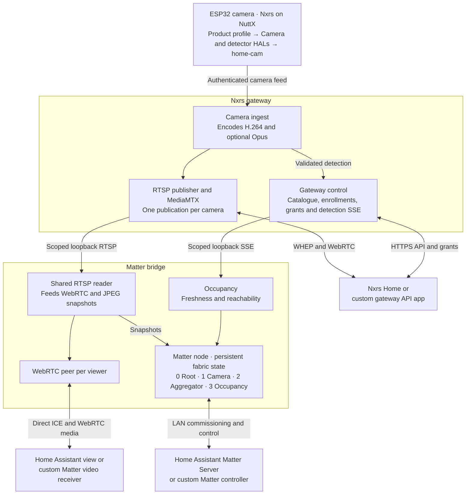
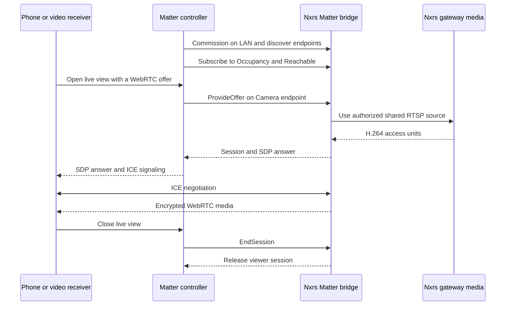

# Use an Nxrs camera in your application

Nxrs captures video and detects people on the camera. A gateway publishes the
video and confirmed presence to enrolled viewers. Its optional Matter bridge
makes the same camera and occupancy sensor available to a Matter controller.

| If you want to… | Start here |
| --- | --- |
| View video on a phone or use occupancy in a home automation | [Connect Home Assistant](#connect-home-assistant) |
| Commission and control the camera from your own Matter stack | [Use your own Matter controller](#use-your-own-matter-controller) |
| Render video and presence in an app you control | [Use the Nxrs gateway API](#use-the-nxrs-gateway-api) |

Use a development installation for the current video-only ESP32 camera.
A production Matter Camera needs qualified microphone capture, product
attestation and conformance. For another kind of Matter device, define its
own endpoint and clusters and qualify them with the intended controller and
app. The camera and occupancy results cover the endpoints shown below.
[Host and controller evidence](../tests/matter/README.md#scope-of-the-evidence).
[Production requirements](../tests/matter/conformance.md).

## How the pieces connect



- **Camera and gateway.** The selected profile supplies the camera and detector
  resources. The firmware sends one authenticated feed. The Linux or macOS
  gateway encodes once and publishes once. MediaMTX checks authorization
  through private gateway control callbacks. Nxrs Home and custom API clients use separate enrolled
  HTTPS origins for control and WHEP. Detection updates travel through gateway
  control and have their own freshness deadline.
- **Matter bridge.** The configured site and camera select one catalogue entry.
  A scoped source credential resolves the camera's current media path and
  admits a shared local RTSP reader. Each viewer
  has its own WebRTC session. Slow viewers resume at a keyframe, and replacement
  of the source ends sessions tied to the old publication. Snapshot requests
  use frames from the same reader. A separately scoped detection subscription
  feeds occupancy. Fresh `person` means occupied, fresh `clear` means
  unoccupied, and missing or expired data makes the bridged sensor unreachable.
- **Optional media controls.** When the gateway recorder and bridge privacy
  controls are enabled, Matter can control recording for that camera through
  a scoped loopback grant. Optional microphone control uses a separate grant
  and requires confirmation from the camera. These features require their
  own gateway configuration and media qualification.
  [Capture and privacy configuration](README.md#capture-and-privacy).
- **Trust and transport.** Camera publication, Nxrs viewer enrollment, and
  Matter fabric membership authorize different operations. The bridge keeps its
  fabrics and endpoint identities in its private state directory. Matter
  discovery and controller commands use the configured LAN, including IPv6.
  Video uses a separate connection to the IPv4 address advertised in ICE.
  The Home Assistant server can relay signaling while the phone or browser
  receives video directly from the bridge.

[Nxrs gateway deployment](../deploy/strict-services.md).
[Matter bridge configuration](README.md#configure-the-bridge).

## Connect Home Assistant

1. Bring up your camera and gateway. Confirm the intended camera appears in
   the gateway catalogue and plays in Nxrs Home. Copy its catalogue
   `camera_id` for bridge setup.
2. [Build the bridge](README.md#build-the-gateway-candidate) for your gateway
   host. [Configure it](README.md#configure-the-bridge) with that camera,
   an IPv4 address on the Matter LAN, and the two scoped credential files.
   Keep the gateway backends and credential files private. For a disposable
   development installation, follow the
   [phone pairing fixture](../tests/matter/README.md#pair-from-a-phone-on-the-lan)
   for test attestation and onboarding.
3. Add the Matter integration and a camera-capable Matter Server in Home
   Assistant. Put your phone, Matter Server and bridge on the selected LAN.
   Start the bridge with its first-install commissioning window and scan its
   QR code using **Add Matter device** in the Home Assistant mobile app. Keep
   the state directory across restarts. [Home Assistant Matter setup and
   camera requirements](https://www.home-assistant.io/integrations/matter/#matter-cameras).
4. Open the bridged camera from **Settings → Devices & services → Matter**.
   Play the live view, verify that the real image moves and close the view
   when finished. Find the occupancy entity on the device page and copy its
   entity ID for automations or application code.

For a dashboard, add Home Assistant's camera entity. For an automation, use
the occupancy entity with an explicit condition for an unavailable sensor.
A backend using Home Assistant can read the same entity with
`GET /api/states/<entity_id>` and a Home Assistant Bearer token. Read `on`
as occupied, `off` as clear, and `unavailable` or `unknown` as unavailable.
For push updates, subscribe to `state_changed` through Home Assistant's
WebSocket API and filter on the entity ID. Keep the Home Assistant token in
your backend's secret store. For video rendered directly by your own app, use
one of the next two paths.
[Home Assistant REST API](https://contributors.home-assistant.io/core/internals/rest-api/).
[Home Assistant WebSocket API](https://contributors.home-assistant.io/core/internals/websocket-api/).

## Use your own Matter controller

Use a controller SDK with Matter Camera support. Commission the bridge into
your fabric using its QR code or manual code. After commissioning, discover the
Camera and Occupancy Sensor endpoints through Descriptor. Subscribe to
Occupancy Sensing and the bridged sensor's Reachable attribute. For video,
use Camera AV Stream Management to discover the stream and WebRTC Transport
Provider to negotiate a session. The diagram shows a controller-provided
offer. Controllers that solicit an offer use the same media path.



Keep the controller authorized on the fabric for the session's lifetime and
send `EndSession` when the view closes. If the source changes, negotiate a
new session. For a JPEG snapshot, request explicit nonzero width and height
from the camera cluster. This path returned distinct JPEGs in the independent
controller test. [Live video, source replacement, and controller
scripts](../tests/matter/README.md#shared-live-video-and-source-replacement).
[Snapshot qualification](../tests/matter/README.md#matter-jpeg-snapshots).

## Use the Nxrs gateway API

Your application needs a viewer enrollment for the camera, the enrolled HTTPS
control and media origins, and a WebRTC receiver. Read the
[OpenAPI contract](../../docs/monitoring-api.json) for payloads and errors.
The examples use a private file containing the gateway viewer token.

1. List the cameras your viewer can access. Choose the camera by `camera_id`
   from the response. The example prints only IDs, names and availability.

   ```sh
   control_url='https://control.example.com'
   viewer_token_file='/absolute/private/viewer.token'

   printf 'Authorization: Bearer %s\n' "$(cat "$viewer_token_file")" |
     curl --fail --silent --show-error --header @- "$control_url/v1/cameras" |
     jq '.cameras[] | {camera_id, name, availability}'
   ```

2. Create a receive-only WebRTC peer and gather its ICE candidates. When the
   local offer is ready, request a fresh WHEP grant. This inspection command
   prints a subset of the response. In application code keep the grant's
   `access_token` in memory for the WHEP request and cleanup.

   ```sh
   camera_id='porch' # Set to the ID returned above.

   printf 'Authorization: Bearer %s\n' "$(cat "$viewer_token_file")" |
     curl --fail --silent --show-error --header @- \
       --header 'Content-Type: application/json' --data '{}' \
       "$control_url/v1/cameras/$camera_id/playback-grants" |
     jq '{camera_id, protocol, endpoint, expires_at}'
   ```

3. Check the camera ID, WHEP protocol, and expiration. Require the exact
   enrolled HTTPS media origin and reject URLs with user info, query strings
   or fragments. POST the gathered offer to the
   endpoint as `application/sdp`, authenticated with the **grant** token.
   Disallow redirects. A successful `201` supplies an SDP answer and a
   session `Location`. Resolve relative locations against the WHEP endpoint
   and check the same trusted origin before using them. Apply the answer and
   mark the view live once decoded frames advance.
4. Close the local peer and send a bounded `DELETE` to its session
   `Location` using the same grant token, including if setup fails after
   receiving a trusted location. On reconnect, create a new peer and fetch
   a new grant. [Nxrs iOS WHEP reference](../../clients/ios/Sources/NxrsMonitorCore/WHEPClient.swift).
5. For the person indicator, use the **viewer** token to subscribe to
   `GET /v1/cameras/{camera_id}/detections` with `Accept: text/event-stream`.
   Each detection event carries the current snapshot. Apply the remaining
   `valid_for_ms` lease after accounting for delivery delay using
   `stream_elapsed_ms` and a local monotonic clock. Expire on silence, and
   clear old state when switching cameras or closing the session.
   `Last-Event-ID` can report a gap when resuming. Frame overlays additionally
   require the exact source identity of the decoded image.
   [Detection delivery and frame matching](../../docs/camera-detection-delivery.md).

Store persistent viewer credentials in the platform credential store. For a
browser app, keep long-lived credentials in your authenticated backend and
scope any signaling proxy to the enrolled gateway. The gateway's internal
RTSP and bridge credentials belong on the gateway host.

## Verify your integration

| What you see | What to check |
| --- | --- |
| The phone cannot discover or pair the bridge | Confirm a live commissioning window, the chosen interface, and IPv6 and multicast discovery on the LAN. Keep the state of a previously paired bridge. |
| The camera tile opens but the image stays blank | Check that the source has an advancing feed and that the app can reach the IPv4 ICE address over UDP. Google Home pairing showed both tiles and occupancy in the lab. Its Camera tile offered no playback control. |
| Home Assistant is reachable remotely but video stalls | Provide both a route to Home Assistant for signaling and a routed VPN path to the advertised ICE address for media. Commission on the LAN. [Routed playback qualification](../tests/matter/README.md#playback-across-a-routed-vpn). |
| Video works but occupancy is unavailable | Check the detection subscription and observation freshness. With the detector available, verify that an occupied room transitions to clear and a lost source transitions to unavailable. |
| A snapshot request fails in Home Assistant | The tested stock width-only request sent a zero height. For an independent controller, specify both dimensions. |
| Closing the app leaves a session open | Check that the app closes its receiver and signals `EndSession` for Matter or deletes its WHEP session. Repeat open and close, then test a disconnect and reconnect. |
