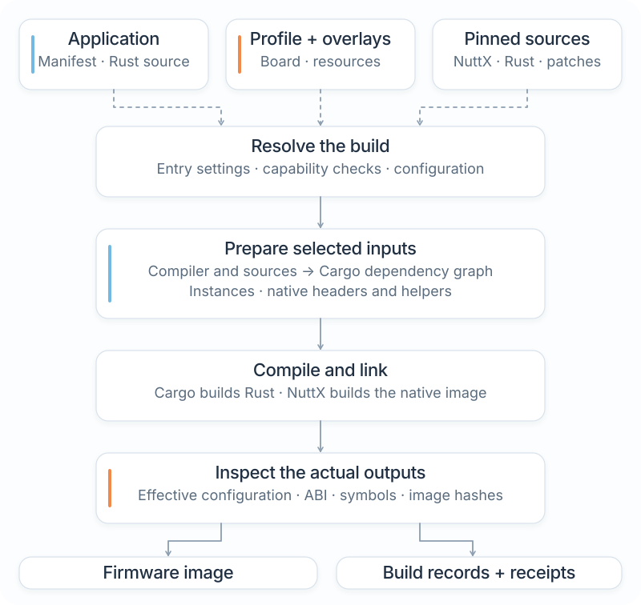
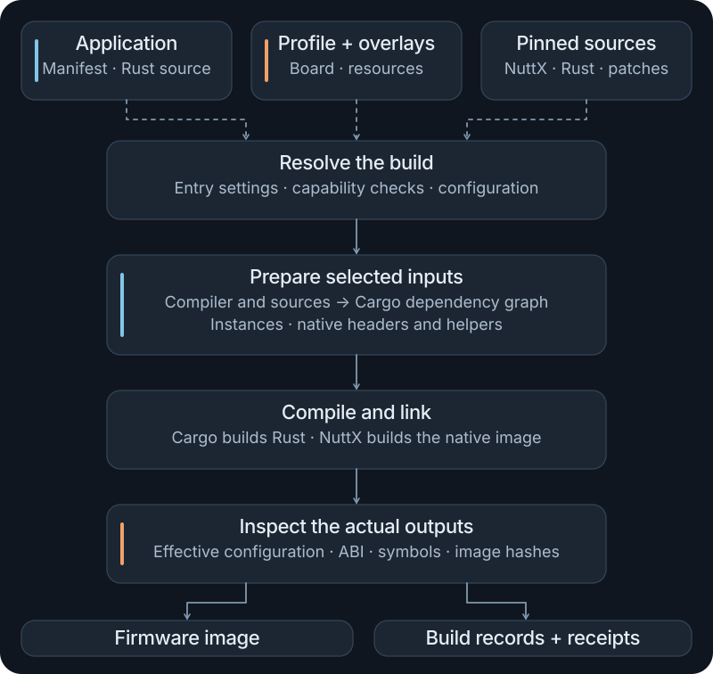

# Build workflow

Use Cargo to describe your application and its dependencies. Use `cargo nxrs build` when that application needs a selected NXRS target, native configuration, and firmware image. The frontend connects those inputs to Cargo and NuttX; application startup and component connections remain in your Rust source.

This guide explains the commands you will use after [building your first firmware](firmware.md), where the outputs come from, and which input to change when your product changes.

## Choose the right command

Run these commands from the NXRS repository root. The checkout defines `cargo nxrs` in [`.cargo/config.toml`](../../.cargo/config.toml); the host controller lives in [tools/build](../../tools/build/).

| Task | Entry point | What it does |
| --- | --- | --- |
| Run ordinary host Rust | `cargo run --manifest-path ../my-firmware/Cargo.toml --bin hello` | Builds and runs your application on the development computer |
| Test a portable package | `cargo test --locked -p nxrs-std-demo` | Tests the selected Cargo package without a firmware image |
| List available choices | `cargo nxrs apps` and `cargo nxrs platforms` | Lists repository applications and platform families |
| Inspect profile composition | `cargo nxrs profile --platform esp32s3-qemu-mock` | Resolves a named profile and prints its configuration as JSON |
| Edit native NuttX settings | `cargo nxrs config --app event-demo --platform cores3` | Searches settings, previews native resolution, and saves to the owning sources |
| Check native settings | `cargo nxrs config check --app event-demo --platform cores3` | Verifies the effective NuttX configuration without compiling firmware |
| Plan a firmware build | `cargo nxrs build --manifest-path ../my-firmware/Cargo.toml --profile esp32s3-qemu-mock --dry-run` | Validates the selection and prints the build plan |
| Build the firmware | The same build command without `--dry-run` | Prepares the selected toolchain inputs, compiles source, links, and checks artifacts |

The `profile` inspection command uses `--platform` for either a platform family or a named profile. The `build` command distinguishes `--platform` (a family default) from `--profile` (a specific configuration). An NXRS profile is also different from a Cargo optimization profile: `cargo nxrs build` uses Cargo's release build settings.

## Know which input owns a decision

| Decision | Change here | Example |
| --- | --- | --- |
| Application behavior and service connections | Handwritten `main()` and application modules | Start a recorder and send it typed work |
| Component dependencies and optional software | `Cargo.toml` dependencies and additive features | Enable a supported recording or replay feature |
| Firmware entry point | `[package.metadata.nxrs.firmware]` | Binary, NSH command, entry priority, stack bytes |
| Required capabilities | `[package.metadata.nxrs]` | Reject configurations that cannot provide a required capability |
| OS, board, resources, devices, and product budgets | Named platform profile | Choose a board and its supported resource bindings |
| A reusable wiring or device variation | Ordered composition overlay | Replace a supported peripheral while preserving its application alias |
| Explicit native settings | Profile's `nuttx-config` fragment | Set diagnostic or OS options using native Kconfig assignments |
| Native controller setup and endpoint registration | NuttX BSP, Kconfig, and checked resource mapping | Register the bus endpoint selected by the profile |

Changing a profile does not add an arbitrary crate to your application. Cargo resolves the declared dependency graph. The frontend requests the driver, resource, and model features needed by consumed, configured components through those existing dependency edges. [Profiles and overlays](profiles.md) explains the configuration side; [Drivers and HALs](hardware.md) explains runtime ownership.

## Follow a NuttX build

<figure class="architecture-art">
  
  
  <figcaption>The build combines source and configuration into an image. The profile describes hardware and build inputs; the application still owns its runtime topology. <a href="../../docs/assets/nxrs-build-workflow.svg">Open SVG</a>.</figcaption>
</figure>

1. **Resolve the application and profile.** Read firmware metadata, profile inheritance, ordered overlays, supported bindings, and required capabilities. Validate target compatibility and resource conflicts.
2. **Prepare the target inputs.** Use the pinned native sources and registered patches. Configure NuttX and its generated headers; select the matching Rust standard-library sources, compiler, and target settings.
3. **Resolve and compile the Cargo graph.** Cargo chooses dependencies and features. Shared preparation supplies validated device declarations and the consumed native helpers. Package adapters check those prepared inputs before using them.
4. **Link the firmware.** The Rust executable and configured NuttX build become the target image. Entry metadata registers the selected application command.
5. **Check and record the result.** Inspect the resulting configuration, ABI and source selection, symbols, image layout, and provenance. A successful build produces artifacts for the separate emulator or board execution step.

The host controller and its build-support dependencies execute on your computer. They do not become a firmware scheduler or a runtime service. Cargo dependencies, native helper selection, and final linked symbols answer different questions about the finished image.

## Inspect before compiling

Start with a profile inspection and a dry run:

```sh
cargo nxrs profile --platform esp32s3-qemu-mock --manifest-path ../my-firmware/Cargo.toml
cargo nxrs build --manifest-path ../my-firmware/Cargo.toml --profile esp32s3-qemu-mock --dry-run
```

The first command prints the resolved profile, including source paths and any composition information. The second prints the selected binary, shell command, backend, output directory, and deployment inputs. For the first tutorial application, the default output is `target/build/hello/esp32s3-qemu-mock/`.

A dry run catches selection and profile errors without compiling. Its dependency resolution remains `pending`; driver, resource, and model feature requests are not yet a completed Cargo result. It does not resolve native Kconfig, check that the target compiler is installed, prove that an image links, or verify attached hardware. Use `cargo nxrs config check` with the same application/profile selections to check effective native settings before the real build and target execution.

Use `cargo nxrs config --help` for native editing and inspection, and `cargo nxrs build --help` for build switches. [Configure NuttX](profiles.md#configure-nuttx) explains prerequisites, the editing cycle, and where settings are saved. Persistent product settings belong in the profile and its referenced native fragment; inspection and subsequent builds consume those same inputs. Diagnostic Kconfig and ABI command-line overrides remain qualification tools.

## Read the build output

The default directory is `target/build/<binary>/<profile>/`. `--out` selects a different directory relative to the NXRS root. Keep separate output directories for concurrent builds.

| NuttX output | Use it to answer |
| --- | --- |
| `nuttx/nuttx` | Which linked ELF was produced? |
| `nuttx/<profile image name>` | Which image should the matching boot or flashing procedure load? |
| `resolved-profile.json` | Which profile inputs and resolved target configuration were handed to Cargo? |
| `resolved.config` | Which NuttX settings were effective after Kconfig resolution? |
| `provider-selection.json` | Which bindings, Cargo selections, and prepared resources were recorded? |
| `cargo-messages.jsonl` | Which compiler artifacts did Cargo report? |
| `std-source.json`, `abi-report.json` | Which standard-library source and ABI checks were used? |
| `image-size.txt`, `image-layout.txt`, `provenance.txt` | What was linked, where was it placed, and which build inputs produced it? |

The image filename is profile-specific. The tutorial creates `nuttx.merged.bin` for ESP32-S3 QEMU; a different board or bootloader can require another image. Use the profile's board instructions instead of renaming an artifact.

Bindings listed in `provider-selection.json` are not by themselves a list of code retained in the image. A profile can make a capability available without your application consuming it. Use Cargo artifact records and final image inspection for dependency and footprint questions.

## Rebuild after a change

Repeat the normal build command after editing source. Cargo and Make still run; they decide which compilation units need rebuilding. Compatible builds retain their compilation output, prepared native trees, and private SDK work. Generated files keep their timestamps when their contents do not change.

Profile, compiler, SDK, patch, or other configuration changes can invalidate retained state automatically. Each build regenerates its success evidence. A failed or interrupted rebuild does not leave a current successful qualification bundle behind.

Use `--clean` when you intentionally need a fresh build or the frontend requests it for inconsistent retained state:

```sh
cargo nxrs build --manifest-path ../my-firmware/Cargo.toml --profile esp32s3-qemu-mock --clean
```

Clean the selected output through the frontend. Its ownership checks protect unrelated directories. Do not edit generated native headers, resolved configuration, or prepared helper files as a way to configure the product; change the owning source or profile and rebuild.

## Keep an application outside the SDK

The first tutorial already uses an independent Cargo workspace. Its source, manifest, and lockfile belong to the application. The NXRS checkout supplies profiles, tool integration, and pinned native inputs.

Run `cargo nxrs` from that checkout and pass the external manifest. Relative `--manifest-path`, `--out`, and other build paths are resolved against the selected NXRS root. The controller also accepts `--workspace-root <path>` before its subcommand for an explicitly selected SDK checkout; this does not install the repository Cargo alias in unrelated directories.

As you add NXRS packages, declare normal Cargo dependencies using the actual package names and paths. Portable package checks can use Cargo directly. Selected NuttX builds use the frontend so their Cargo adapters receive a verified resolved profile and native preparation. Detached host consumers that need a profile provide `NXRS_SDK_ROOT` as described in the [external-consumer reference](../../docs/build-system.md#external-applications-and-package-boundaries).

A product workspace can select its own composition package with `workspace.metadata.nxrs.device-catalogue`. Declare that package as a direct application dependency with the capability features the application consumes. Pass the same external `--manifest-path` to profile inspection and builds so both use that catalogue. Driver discovery supports local path packages, including workspace-inherited dependencies. See [product-owned catalogues](../../platform/README.md#own-the-catalogue-in-an-external-product) for the declarations and typed factory requirements.

## Optional SDKs and deployment

Features that use the TLS or detector SDKs have explicit preparation commands:

```sh
cargo nxrs fetch tls
cargo nxrs fetch detector
```

Run them when the selected capability's guide calls for them. They prepare pinned sources for those integrations; neither is required by the introductory `hello` application. Ordinary Cargo dependency downloads and board-specific tool installation remain separate setup steps.

Signed product profiles require signing, verification-root, version, and security-counter inputs. Follow the [firmware update reference](../../docs/firmware-updates.md) for that lifecycle. Building and packaging produce artifacts; flashing, provisioning, and emulator execution are separate operations.

## Next steps

Use [Profiles and overlays](profiles.md) to change configuration, [Examples](examples.md) to choose a runnable application, and [Testing and debugging](testing.md) to verify the behavior after a build. The [build reference](../../docs/build-system.md) records the detailed preparation, dependency, and cache contracts.
