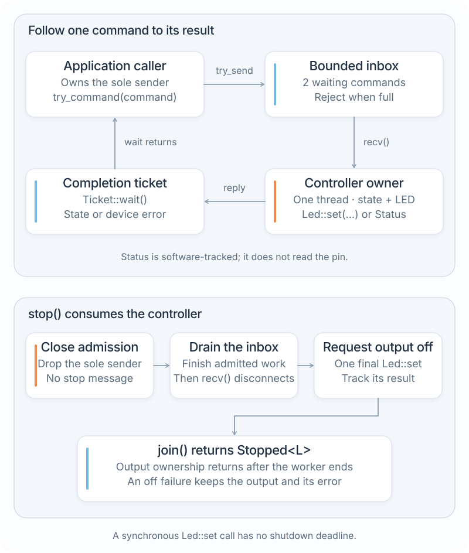
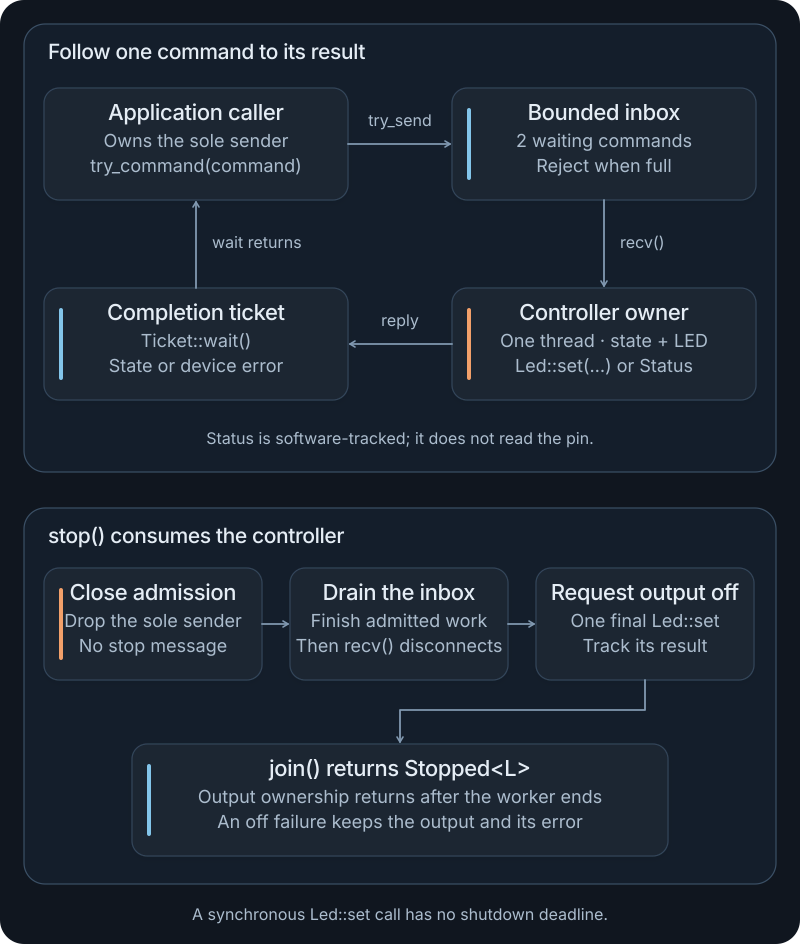

# Build a controller

Run a small controller, send typed commands to an output owner, and wait for each command's result. Then close admission, finish accepted work, switch the output off and join the worker. The same ordinary Rust application runs on your host and on NuttX in QEMU.

**Before you start:** complete [Your first application](first-application.md) and the [bounded worker](services.md#run-the-worker-in-your-application). Target execution also needs the Ubuntu tool setup in [Building for NuttX](firmware.md). Run the commands in this chapter from the NXRS checkout.

This tutorial uses the existing LED capability with an explicit mock provider. It exercises the Rust application and target integration without needing a board. The reported state records command results; physical LED behavior needs a separately configured and tested device.

The [Rust API reference](../api.md) links the `led` library's `Led`, `LedSet`, `DeviceError`, and `open` documentation. The application-specific controller types are defined in the source package below.

## Run the controller on your host

The [controller package](../examples/controller/) is a standalone Cargo workspace inside the checkout. Its dependency on the LED capability is an ordinary relative path dependency.

<!-- tutorial:controller-host -->
```sh
NXRS_PLATFORM=mock cargo run --locked --manifest-path website/examples/controller/Cargo.toml --bin controller
```

After Cargo's build messages, the program prints:

<!-- tutorial:controller-output -->
```text
ready: off
on: on
status: on
off: off
stopped: off
```

Startup validates LED index `0` and requests it off before starting the worker. With no arguments, the entry point sends `on`, `status` and `off`, waiting for each result before sending the next command. Finally, it stops and joins the owner. The `ready` and `stopped` lines describe successful off requests through the provider.

`NXRS_PLATFORM=mock` selects the explicit host test binding for this command only. Keep it as a command prefix. The NuttX build below selects its LED mock through a named profile.

## Choose a command sequence

Supply positional arguments after Cargo's `--`:

```sh
NXRS_PLATFORM=mock cargo run --locked --manifest-path website/examples/controller/Cargo.toml --bin controller -- on status off stop
```

This produces the same five application lines. `stop` must be the final argument; reaching the end of the arguments also stops the application. The program runs a finite sequence and returns to your shell.

| Argument | Operation | Result printed after completion |
| --- | --- | --- |
| `on` | Request `Led::set(0, true)` | `on: on` on success |
| `off` | Request `Led::set(0, false)` | `off: off` on success |
| `status` | Read the owner's software-tracked state | For example, `status: on` |
| `stop` | End command submission, drain and join | `stopped: off` when the final off request succeeds |

Try an invalid command after a valid one:

```sh
NXRS_PLATFORM=mock cargo run --locked --manifest-path website/examples/controller/Cargo.toml --bin controller -- on invalid
```

This intentionally exits with status `1`. The application prints `ready: off`, `on: on` and `stopped: off`, and reports the unknown command on standard error. Input is checked as the sequence executes: the earlier `on` command has already completed. Cleanup still runs after that input error.

The CLI waits for each ticket, so this sequential exercise does not fill the inbox. The tests later in this chapter pause an output operation to exercise saturation deterministically.

## Read the source package

| File | Responsibility |
| --- | --- |
| [Cargo.toml](../examples/controller/Cargo.toml) | Declared dependency, independent workspace and NuttX entry metadata |
| [Cargo.lock](../examples/controller/Cargo.lock) | Resolved dependencies used by the locked commands |
| [src/main.rs](../examples/controller/src/main.rs) | Acquire the output, parse arguments, submit commands, print results and always attempt joined cleanup |
| [src/lib.rs](../examples/controller/src/lib.rs) | Typed commands, completion tickets and the output owner's lifetime |
| [tests/behaviour.rs](../examples/controller/tests/behaviour.rs) | Controlled output fixtures and failure/lifecycle checks |
| [LED mock profile](../../tests/profiles/esp32s3-qemu-led-mock.toml) | Reuse the ESP32-S3 QEMU setup and bind the LED capability explicitly |

The complete manifest is:

<!-- tutorial:controller-manifest -->
```toml
[package]
name = "nxrs-controller-demo"
version = "0.1.0"
edition = "2024"

[workspace]

[[bin]]
name = "controller"
path = "src/main.rs"

[package.metadata.nxrs]
required-capabilities = ["led"]

[package.metadata.nxrs.firmware]
bin = "controller"
command = "controller"
priority = 100
stack-size = 65536

[dependencies]
nxrs-led = { path = "../../../hal/led" }
```

`required-capabilities = ["led"]` makes the target builder reject an unbound LED configuration. The dependency adds software; the selected profile supplies its provider. `controller` is both the binary and the command registered in NSH. The entry stack and priority are explicit tutorial settings, not recommended values for every product.

The following library excerpts come from the linked `src/lib.rs`. Source checks keep them aligned with that file. Keep the complete file when running or adapting the application; each excerpt explains one part of it.

## Define commands and observable state

The application translates the command-line words into this small typed interface:

<!-- tutorial:controller-commands -->
```rust
#[derive(Clone, Copy, Debug, PartialEq, Eq)]
pub enum Command {
    Set(bool),
    Status,
}

/// Last successfully commanded value, never electrical readback.
/// A failed write can have changed the output, so its value becomes unknown.
#[derive(Clone, Copy, Debug, PartialEq, Eq)]
pub enum State {
    Off,
    On,
    Unknown(DeviceError),
}

#[derive(Clone, Copy, Debug, PartialEq, Eq)]
pub struct ParseError;

pub fn parse_command(text: &str) -> Result<Command, ParseError> {
    match text.trim() {
        "on" => Ok(Command::Set(true)),
        "off" => Ok(Command::Set(false)),
        "status" => Ok(Command::Status),
        _ => Err(ParseError),
    }
}
```

`stop` is handled by the entry point as a lifetime operation. It is never inserted into the command inbox.

`Off` and `On` mean that the corresponding output request succeeded. A failed write sets `Unknown(error)` because an operation can report failure after affecting the device. A later `status` returns that stored state; it does not read a physical pin. A subsequent successful write establishes the newly commanded state.

## Separate admission from completion

<figure class="architecture-art">
  
  
  <figcaption>Admission returns a ticket; the owner completes it after handling the command. Shutdown closes the existing input path and joins the same owner. A synchronous output call must return for shutdown to finish. <a href="../../docs/assets/nxrs-controller-command.svg">Open SVG</a>.</figcaption>
</figure>

The controller keeps one `SyncSender` for a `std::sync::mpsc::sync_channel` with `COMMAND_CAPACITY = 2`. Callers use this method rather than obtaining or cloning that sender:

<!-- tutorial:controller-admit -->
```rust
pub fn try_command(&self, command: Command) -> Result<Ticket, SubmitError> {
    let (reply, completion) = mpsc::sync_channel(1);
    match self.commands.try_send(Request { command, reply }) {
        Ok(()) => Ok(Ticket(completion)),
        Err(TrySendError::Full(request)) => Err(SubmitError::Full(request.command)),
        Err(TrySendError::Disconnected(request)) => {
            Err(SubmitError::Disconnected(request.command))
        }
    }
}
```

| API result | What it establishes | Caller action |
| --- | --- | --- |
| `try_command` returns `Ok(ticket)` | The owner has accepted responsibility for this request | Wait for completion or deliberately discard the ticket |
| `SubmitError::Full(command)` | The request was not admitted because the waiting slots were occupied | Retain, reject or retry the returned command according to application policy |
| `SubmitError::Disconnected(command)` | The receiving owner is unavailable | Report the failure and finish lifecycle handling |
| `ticket.wait()` returns `Ok(Ok(state))` | The owner handled the command and returned its state | Use the command's stated meaning of completion |
| `ticket.wait()` returns `Ok(Err(error))` | The output operation reported a device error | Handle the provider error; do not report success |
| `ticket.wait()` returns `Err(...)` | The reply path closed without a result | Report the missing completion, for example after a worker panic |

`try_command` does not wait for queue capacity. `Ticket::wait` does wait for the owner, including any synchronous output call ahead of that request. Neither method provides a hardware deadline.

The two inbox slots bound **waiting requests**, with one more request possibly being handled. Each accepted request also has a one-slot completion channel. Callers can retain completed tickets, so the inbox capacity alone does not bound all application memory. Consume or discard tickets promptly and measure the worker stack and other allocations for the target.

## Handle commands with one output owner

The worker owns the LED and mutable state. It receives one request, performs the synchronous operation, and deposits one result before receiving another:

<!-- tutorial:controller-owner -->
```rust
fn own_output<L: Led>(mut output: L, index: u8, incoming: Receiver<Request>) -> Stopped<L> {
    let mut state = State::Off;
    while let Ok(request) = incoming.recv() {
        let result = match request.command {
            Command::Status => Ok(state),
            Command::Set(on) => match output.set(index, on) {
                Ok(()) => {
                    state = if on { State::On } else { State::Off };
                    Ok(state)
                }
                Err(error) => {
                    state = State::Unknown(error);
                    Err(error)
                }
            },
        };
        // One result, one slot. A caller discarding a ticket cannot block us.
        let _ = request.reply.try_send(result);
    }
    let shutdown = output.set(index, false);
    state = match shutdown {
        Ok(()) => State::Off,
        Err(error) => State::Unknown(error),
    };
    Stopped {
        output,
        state,
        shutdown,
    }
}
```

A caller can drop its ticket without cancelling the accepted command. The reply uses `try_send`, so an abandoned completion receiver cannot hold the owner waiting for the caller. Command execution and the final off request still depend on `Led::set` returning.

Only this thread touches the output after startup. The entry point owns the `Controller` handle and its unique sender, while each `Ticket` owns the receiver for one result. These are application types built from the LED contract and standard-library channels and threads.

## Close admission, drain and join

The controller handle is consumed by `stop`:

<!-- tutorial:controller-stop -->
```rust
/// Drain admitted commands, attempt output-off, and join. This depends on
/// synchronous Led::set calls returning; it is not a shutdown deadline.
pub fn stop(self) -> thread::Result<Stopped<L>> {
    drop(self.commands);
    self.worker.join()
}
```

Closing the only sender lets `recv()` finish all queued requests and then report disconnection. The owner attempts one final off request and returns `Stopped<L>`; `join()` waits for that thread to end. A full inbox needs no extra slot for shutdown.

Check both levels of the result. A successful join establishes that the worker ended. `Stopped::shutdown` says whether its final off request succeeded, and `Stopped::state` is `Unknown(error)` if it failed. `Stopped` still owns the output, so library callers can inspect the error and choose recovery before releasing the resource. Startup validation or initial off failures similarly return the output through `StartError::Output`; a failed thread spawn starts no worker.

The entry point below reports a shutdown error and releases the returned output after joining. It does not retry a failed off request or claim the output is off. A product with a recovery requirement must choose and implement that policy.

`Led::set` is synchronous and has no cancellation or deadline parameter. Closing the inbox wakes an idle receiver, but it cannot interrupt an output call already in progress. The example proves the close/drain/join protocol under the exercised provider behavior; it does not establish a maximum physical shutdown time.

Call `stop` explicitly. Dropping `Controller` closes its sender but drops the standard `JoinHandle`, which detaches the thread; that does not observe cleanup completion or its result.

## Keep orchestration in main

This is the complete entry point. It collects any command error, performs explicit shutdown, and then reports the command and cleanup results:

<!-- tutorial:controller-main -->
```rust
use led::Led;
use nxrs_controller_demo::{Controller, SubmitError, parse_command};

fn execute<L, I, S>(controller: &Controller<L>, input: I) -> Result<(), String>
where
    L: Led + Send + 'static,
    I: IntoIterator<Item = S>,
    S: AsRef<str>,
{
    let mut input = input.into_iter().peekable();
    while let Some(text) = input.next() {
        let text = text.as_ref();
        if text.trim() == "stop" {
            return if input.peek().is_none() {
                Ok(())
            } else {
                Err("stop must be the last command".into())
            };
        }
        let command = parse_command(text)
            .map_err(|_| format!("unknown command {text:?} (use on, off, status, stop)"))?;
        let ticket = controller
            .try_command(command)
            .map_err(|error| match error {
                SubmitError::Full(_) => "command queue is full".to_owned(),
                SubmitError::Disconnected(_) => "controller worker is unavailable".to_owned(),
            })?;
        let state = ticket
            .wait()
            .map_err(|_| "controller disappeared before completion".to_owned())?
            .map_err(|error| format!("output command failed: {error:?}"))?;
        println!("{command}: {state}");
    }
    Ok(())
}

fn run() -> Result<(), String> {
    let output = led::open().map_err(|error| format!("cannot acquire LED output: {error:?}"))?;
    let controller = Controller::start(output, 0).map_err(|error| error.to_string())?;
    println!("ready: off");

    let mut input = std::env::args().skip(1).peekable();
    let commands = if input.peek().is_none() {
        execute(&controller, ["on", "status", "off"])
    } else {
        execute(&controller, input)
    };

    // Even rejected input or a failed output operation reaches explicit cleanup.
    let stopped = controller
        .stop()
        .map_err(|_| "controller worker panicked during shutdown".to_owned())?;
    println!("stopped: {}", stopped.state);
    let shutdown = stopped
        .shutdown
        .map_err(|error| format!("cannot switch output off: {error:?}"));
    drop(stopped.output);
    match (commands, shutdown) {
        (Ok(()), Ok(())) => Ok(()),
        (Err(error), Ok(())) | (Ok(()), Err(error)) => Err(error),
        (Err(command), Err(shutdown)) => Err(format!("{command}; {shutdown}")),
    }
}

fn main() {
    if let Err(error) = run() {
        eprintln!("controller: {error}");
        std::process::exit(1);
    }
}
```

The `execute` function waits after every admitted command, so a printed command result always follows that command's handling. `run` reaches `stop` after invalid input or an output error once startup has succeeded. Acquiring the capability, deciding how errors are presented, and selecting recovery remain application responsibilities.

## Build and boot on NuttX

Reuse the Ubuntu x86-64 tool setup and active Python environment from [Building for NuttX](firmware.md#prepare-ubuntu). The [controller profile](../../tests/profiles/esp32s3-qemu-led-mock.toml) extends `esp32s3-qemu-mock` and selects `hal.led = "mock"`. It is a qualification configuration for this tutorial.

<!-- tutorial:controller-build -->
```sh
cargo nxrs build --manifest-path website/examples/controller/Cargo.toml --profile esp32s3-qemu-led-mock
```

The build compiles this application's source, its dependencies, Rust standard-library integration and NuttX. The outputs are under `target/build/controller/esp32s3-qemu-led-mock/`. Boot that build's flash image:

<!-- tutorial:controller-qemu -->
```sh
(
  source target/qemu-tools/environment.sh
  qemu-system-xtensa -nographic -machine esp32s3 -nic none -no-reboot -snapshot \
    -drive file=target/build/controller/esp32s3-qemu-led-mock/nuttx/nuttx.merged.bin,if=mtd,format=raw
)
```

At `nsh>`, enter:

```text
nsh> controller
ready: off
on: on
status: on
off: off
stopped: off
nsh> echo $?
0
```

Run `controller` again in the same boot to exercise a fresh lifetime. You can also enter `controller on status stop` to choose a shorter sequence. Exit QEMU with **Ctrl+A, then X**. Keep the emulator environment inside the shown subshell so it does not select the target compiler for subsequent host builds.

This run exercises Rust threads, channels, the configured mock capability and the NuttX application entry path. The mock has no physical LED. A physical profile needs a supported LED provider, a valid output index and separate hardware tests; do not infer those from the QEMU result. Consult [Drivers and HALs](hardware.md) and [Profiles and overlays](profiles.md) when selecting that integration.

## Exercise failures and cleanup

Run the example's host tests with the same explicit binding:

<!-- tutorial:controller-test -->
```sh
NXRS_PLATFORM=mock cargo test --locked --manifest-path website/examples/controller/Cargo.toml
```

The [behavior tests](../examples/controller/tests/behaviour.rs) inject controlled implementations of the existing `Led` trait. They can pause an output operation or return an error at a chosen point without depending on timing guesses or a physical device.

| Situation to verify | Required observation |
| --- | --- |
| Normal command sequence | Ordered state changes and a result for each accepted command |
| Paused handler and two waiting commands | A further command returns `Full` with its value |
| Stop while work is queued | Accepted work completes before the final off request and join |
| Caller discards a completion ticket | The owner still handles the admitted command and can stop |
| Invalid output index or initial off failure | Startup fails without launching an owner; output/error ownership is visible |
| Output write failure | The completion reports failure and status becomes unknown |
| Final off failure | The joined result retains the output, unknown state and shutdown error |
| Repeated start/stop | Each lifetime starts with an off request and ends with a joined owner |

The repository's [First firmware tutorial workflow](../../.github/workflows/first-firmware.yml) preserves the hello and worker exercises and adds this controller's host checks and target run. It checks the guide's source against the package, retains source/build identities and console output, and verifies repeated invocations and error exits. Host fixtures establish the specified application behavior; the QEMU run establishes integration with that exact target configuration.

## Adapt the application

Start with the command and state definitions when adding behavior. Keep output effects in the owner, give every new command an explicit result, and decide how failures affect subsequent commands. If the application needs recording or networking, define those operations' completion and capacity contracts before introducing another owner.

[Designing an application](designing-applications.md) covers those choices. [Networking and storage](io.md) links the existing I/O contracts, and [Testing and debugging](testing.md) explains how to move from controlled fixtures to target and physical-device evidence.
