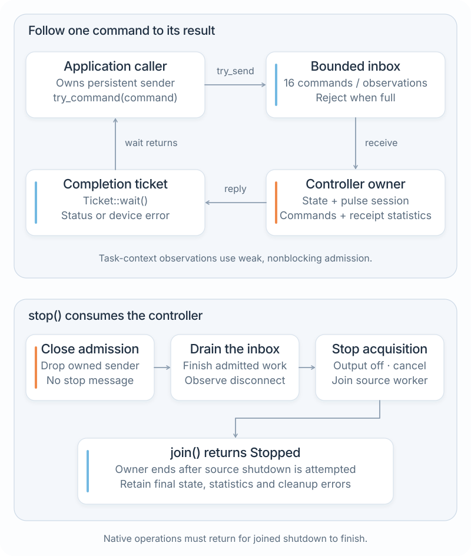
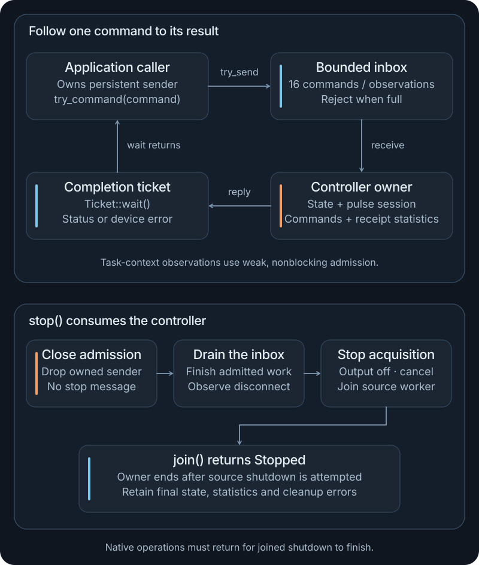

# Build a controller

Use one portable application to control a PWM output, receive observations through a bounded inbox, inspect progress, and stop with joined cleanup. Start with an explicit mock on your host, run the same source on NuttX in QEMU, then select the hardware profile for an ESP32-S3 WROOM or Raspberry Pi Pico 2 W.

**Before you start:** complete [Your first application](first-application.md) and the [bounded worker](services.md#run-the-worker-in-your-application). Target execution needs the tools in [Building for NuttX](firmware.md); the Pico additionally needs the ARM setup below. Run the commands below from the NXRS checkout.

The [controller package](../examples/controller/) is the canonical application throughout this chapter. Its `pulse` capability combines output ownership with a managed observation stream using the existing PWM, GPIO and acquisition adapters. The two board profiles sense the PWM on the same pad, so this exercise needs no external sensor or jumper.

## Run and inspect on your host

<!-- tutorial:controller-host -->
```sh
NXRS_PLATFORM=mock cargo run --locked --manifest-path website/examples/controller/Cargo.toml --bin controller
```

After Cargo's build messages, the default sequence prints:

<!-- tutorial:controller-output -->
```text
ready: off
on: on (25 Hz, 25%)
status: on (25 Hz, 25%)
off: off
stopped: off
```

Startup acquires the pulse session and establishes stopped output. With no arguments, the entry point sends `on`, `status` and `off`, waits for each result, and then stops and joins the owner. `NXRS_PLATFORM=mock` selects a synthetic source for that host command; leave it as a command prefix.

Allow acquisition to run before inspecting its counters:

```sh
NXRS_PLATFORM=mock cargo run --locked --manifest-path website/examples/controller/Cargo.toml --bin controller -- on wait 300 stats off
```

`stats` prints `observed`, `rejected`, `processed`, `gaps`, `max_dispatch_us`, `last_interval_us`, `fault`, and `watchdog_fault`. The counts and times vary between runs. A successful observation run has `processed > 0`, consistent counts and both fault fields `none`, followed by `off: off` and `stopped: off`. The mock exercises delivery and ownership; its timer does not establish physical pulse accuracy.

| Command | Operation |
| --- | --- |
| `on` | Start the remembered waveform, initially 25 Hz at 25% duty |
| `set HZ DUTY` | Validate and start a waveform: 10–100 Hz, 1–99% duty |
| `off` | Stop output; already queued observations can still arrive |
| `status` | Report the last completed output request |
| `stats` | Report source accounting and application dispatch observations |
| `wait MS` | Pause the command client for 0–60000 ms while acquisition and the owner continue |
| `stop` | End submission, drain accepted work, stop acquisition and join; must be last |

For a persistent command session, append `-- --interactive` to the host command. Enter one command per `controller>` prompt. `stop`, end of input, malformed input and provider errors all reach explicit cleanup after successful startup. The console accepts LF or CRLF line endings and bounds each line to 128 bytes. A batch ends and cleans up when its last argument completes.

The state `on (25 Hz, 25%)` records a successful output request. It is not electrical readback. GPIO observations provide a separate activity signal. Their timestamps are captured when the source worker receives a notification, so `last_interval_us` measures task-context receipt spacing and `max_dispatch_us` measures receipt-to-owner dispatch delay. Neither measures ISR latency, electrical duty accuracy or every physical edge; native notifications can coalesce.

## Read the one source package

| File | Responsibility |
| --- | --- |
| [Cargo.toml](../examples/controller/Cargo.toml) | Ordinary dependencies, independent workspace and NuttX command metadata |
| [Cargo.lock](../examples/controller/Cargo.lock) | Dependencies pinned for the locked commands |
| [src/main.rs](../examples/controller/src/main.rs) | Console and batch input, completion reporting and cleanup on every exit path |
| [src/lib.rs](../examples/controller/src/lib.rs) | Typed commands, bounded admission, observation accounting and session lifetime |
| [src/supervision.rs](../examples/controller/src/supervision.rs) | Optional watchdog health, feed and shutdown policy on the existing owner |
| [tests/behaviour.rs](../examples/controller/tests/behaviour.rs) | Controlled session fixtures for overload, failure and joined cleanup |
| [Pulse capability](../../hal/pulse/README.md) | Portable waveform, observation and shutdown contracts |

The manifest requires the `pulse` capability and registers `controller` as both the binary and NSH command. The profile supplies the provider and native endpoints; application source contains no board paths or platform branches. The package is a standalone Cargo workspace. An external product can use the same ordinary dependency arrangement described in [the build-system guide](build-system.md#keep-an-application-outside-the-sdk).

The following short excerpts are checked against the linked library. Keep the complete canonical files when adapting the application.

### Define commands and state

<!-- tutorial:controller-commands -->
```rust
#[derive(Clone, Copy, Debug, PartialEq, Eq)]
pub enum Command {
    On,
    Off,
    Set(Waveform),
    Status,
    Stats,
}

/// Last successfully requested output state, not electrical readback.
#[derive(Clone, Copy, Debug, PartialEq, Eq)]
pub enum State {
    Off,
    Running(Waveform),
    Unknown(Error),
}
```

A failed operation sets `Unknown(error)`: failure can follow a partial device effect. A retained acquisition fault prevents restarting the output. `status` reports the stored request state; `stats` exposes the source's independently retained fault even when a fault event could not enter the full inbox.

### Own commands and observations together

<!-- tutorial:controller-start -->
```rust
let (sender, incoming) = mpsc::sync_channel(INBOX_CAPACITY);
let commands = Arc::new(sender);
let source = Arc::downgrade(&commands);
let session = open(Box::new(move |event| {
    source
        .upgrade()
        .is_some_and(|sender| sender.try_send(Message::Source(event)).is_ok())
}))
.map_err(StartError::Device)?;
```

This is the shared admission setup inside `Controller::start_with_watchdog`; `Controller::start(pulse::open)` selects the same lifetime without supervision. The controller has one persistent sender and one owner thread. Commands and source observations share 16 waiting slots. The source callback runs in acquisition task context, attempts one nonblocking admission and returns its result. It holds a weak reference so it cannot keep its own receiving owner alive after the controller closes admission. GPIO interrupt handling stays inside the native driver and HAL readiness path.

<figure class="architecture-art">
  
  
  <figcaption>The same owner handles commands and observations. Admission, command completion and joined source shutdown are distinct events. <a href="../../docs/assets/nxrs-controller-command.svg">Open SVG</a>.</figcaption>
</figure>

### Separate admission from completion

<!-- tutorial:controller-admit -->
```rust
pub fn try_command(&self, command: Command) -> Result<Ticket, SubmitError> {
    let (reply, completion) = mpsc::sync_channel(1);
    match self
        .commands
        .try_send(Message::Command(Request { command, reply }))
    {
        Ok(()) => Ok(Ticket(completion)),
        Err(TrySendError::Full(Message::Command(request))) => {
            Err(SubmitError::Full(request.command))
        }
        Err(TrySendError::Disconnected(Message::Command(request))) => {
            Err(SubmitError::Disconnected(request.command))
        }
        _ => unreachable!("only the submitted command can be returned"),
    }
}
```

`Ok(ticket)` means the request entered the inbox. `ticket.wait()` waits for the owner and returns its completed status or device error. `Full(command)` and `Disconnected(command)` return an unadmitted command to the caller. The CLI submits sequentially, so controlled behavior tests exercise saturation instead of relying on timing guesses.

The source makes one attempt per observation. A rejected edge increments `rejected`; skipped source sequence numbers become application `gaps`. At a snapshot, some accepted observations can still be queued or in flight, so `observed - rejected` can exceed `processed`. These counters describe delivered notifications, not missed electrical pulses. Completion tickets have one result slot, and discarded tickets cannot block the owner. Consume or discard tickets promptly: inbox capacity alone does not bound memory retained by callers.

### Close admission and join

<!-- tutorial:controller-stop -->
```rust
/// Close admission, drain accepted commands/observations, stop acquisition,
/// and join. Native operations must return; this is not a hard time bound.
pub fn stop(self) -> thread::Result<Stopped> {
    drop(self.commands);
    self.worker.join()
}
```

Dropping the persistent sender lets the owner drain admitted work and observe disconnection. It then stops output, requests cancellation, joins acquisition and returns `Stopped`. Check the outer join result, `Stopped::shutdown` and `Stopped::watchdog`. A failed pulse shutdown leaves the final state unknown. A retained source fault also makes shutdown return an error even when cleanup completed, so that error alone does not describe which cleanup step failed. Native cleanup uncertainty can keep resources quarantined until reboot. There is no extra stop message requiring an inbox slot and no hard shutdown deadline for native operations.

Call `stop` explicitly. Dropping the controller closes admission and detaches its standard-library join handle, so the caller has not observed cleanup completion. The entry point collects input or command failures, performs explicit shutdown, and only then reports errors and exits with status 1.

## Run the same application on NuttX/QEMU

The [QEMU profile](../../tests/profiles/esp32s3-qemu-pulse-mock.toml) extends `esp32s3-qemu-mock` and explicitly binds `pulse` to `mock`.

<!-- tutorial:controller-build -->
```sh
cargo nxrs build --manifest-path website/examples/controller/Cargo.toml --profile esp32s3-qemu-pulse-mock
```

<!-- tutorial:controller-qemu -->
```sh
(
  source target/qemu-tools/environment.sh
  qemu-system-xtensa -nographic -machine esp32s3 -nic none -no-reboot -snapshot \
    -drive file=target/build/controller/esp32s3-qemu-pulse-mock/nuttx/nuttx.merged.bin,if=mtd,format=raw
)
```

At `nsh>`, run `controller`, then `echo $?`; require the default output above and status `0`. Run `controller on wait 300 stats off` to observe acquisition, then `controller` again in the same boot. Exit QEMU with **Ctrl+A, then X**. Keep the emulator environment in the shown subshell so it does not affect subsequent host builds.

This checks the application, Rust threads/channels and NuttX integration using synthetic pulses. Physical PWM/GPIO operation requires the board run below.

## Select either physical board

Both hardware profiles inherit their existing peripheral configuration and choose ordinary hardware application admission. The underlying qualification profiles remain restricted to qualification packages.

On Ubuntu, add the pinned ARM Rust toolchain and GNU ARM/newlib packages before building Pico 2 W:

```sh
rustup toolchain install nightly-2025-09-15 --profile minimal --component rust-src
sudo apt-get install -y gcc-arm-none-eabi binutils-arm-none-eabi libnewlib-arm-none-eabi
```

| Board | Profile | PWM endpoint | Rising-edge input | Shared pad | Source stack request |
| --- | --- | --- | --- | --- | --- |
| ESP32-S3 WROOM | [`wroom-pulse`](../../platform/wroom/profiles/wroom-pulse.toml) | `/dev/pwm0` | `/dev/gpio2` | GPIO14 | 16384 bytes |
| Raspberry Pi Pico 2 W | [`pico2w-pulse`](../../platform/pico2w/profiles/pico2w-pulse.toml) | `/dev/pwm7` | `/dev/gpio14` | GP14 | 8192 bytes |

The WROOM profile inherits the `ARCH_CHIP_ESP32S3WROOM2N16R8V` module selection and a 16 MiB flash configuration. Confirm that the module marking and flash capacity match before using this profile.

Select one profile and use the same inspection/build sequence:

```sh
profile=wroom-pulse
cargo nxrs profile --platform "$profile" --manifest-path website/examples/controller/Cargo.toml
cargo nxrs config check --manifest-path website/examples/controller/Cargo.toml --profile "$profile"
cargo nxrs build --manifest-path website/examples/controller/Cargo.toml --profile "$profile" --out "target/controller-$profile"
sha256sum "target/controller-$profile/nuttx/nuttx" "target/controller-$profile/nuttx/nuttx.bin"
```

For Pico 2 W, set `profile=pico2w-pulse`. Retain the source commit, dirty diff if present, resolved profile, effective `.config`, image hashes and console transcript together. The stack values are requests to measure on the board, not demonstrated headroom.

Install the selected image using the board's verified identity and backup/restore procedure. WROOM uses the simple-boot `nuttx.bin`. After the Pico enters BOOTSEL, pass `-t elf` to picotool because `nuttx/nuttx` has no extension:

```sh
image=target/controller-pico2w-pulse/nuttx/nuttx
picotool load -v "$image" -t elf --ser "$chip_serial"
picotool verify "$image" -t elf --ser "$chip_serial"
```

Use the Pico chip serial confirmed during backup. The [existing peripheral qualification](../../tests/nuttx-std/peripherals/README.md) records the native path and previous physical evidence. [Pico USB recovery](../../tests/nuttx-std/wifi/README.md#usb-recovery) describes the bootloader-entry helper. The exercise works offline over USB.

### Run the serial acceptance checks

Close other programs using the board's console. On the connected computer, install the serial dependency and find the actual port:

```sh
python3 -m pip install pyserial==3.5
python3 -m serial.tools.list_ports
```

Use the same runner with that port and the complete build directory from the selected profile. Replace `/dev/ttyACM0` with the listed port, such as `/dev/ttyUSB0`, `/dev/cu.usbmodem...` or `COM5`, and use `target/controller-pico2w-pulse` for the Pico build above:

```sh
python3 website/tests/controller_example.py --serial-port /dev/ttyACM0 \
  --build-dir target/controller-wroom-pulse --repeat 10
```

Serial mode runs against an already installed image and needs Python 3.11 or newer plus pyserial; it does not invoke Cargo or a cross compiler. The build directory can be copied from the build machine or extracted from a CI artifact. Keep its relative layout and the JSON, configuration, hash and provenance records beside `nuttx/nuttx` and `nuttx/nuttx.bin`. The runner checks the controller package, hardware pulse binding, coherent configuration and ABI receipts, and candidate image hashes before opening the port. It opens at 115200 baud with DTR and RTS disabled, synchronizes with NSH, and checks a fresh `uname` response.

The run reuses the QEMU command sequence, checks reconfiguration to 25 Hz at 50% duty, reads the current boot's reset cause, and repeats acquisition and cleanup. Each invocation must return the expected output, fault-free and consistent observation counts where requested, and the immediate `echo $?` status. The invalid command must complete cleanup and return `1`; the following invocation must reacquire successfully. A warm-up precedes the `free` and `ps` snapshots around the repeated runs. Those snapshots are retained for inspection; they are not automatic heap-leak or stack-headroom qualification. `--repeat` accepts 1–100 and defaults to 10. Add `--watchdog` to include a supervised run with a 3000 ms timeout.

The runner writes a JSON result and raw console transcript to a unique serial run directory under `target/controller-tutorial/`, including on timeout, disconnect or validation failure. `--out DIR` selects a new output directory. The result records the candidate build separately from observed serial execution: matching local files and a NuttX response do not prove which image is installed on the board. Record the installation and any independent image verification alongside the report. Recover to the saved image and verify its identity and normal behavior when ending the hardware trial.

### Watchdog behavior

The application's `--watchdog MS` option admits 1000–60000 ms, and the selected watchdog must also support the requested timeout. The pinned Pico 2 W driver accepts at most 16777 ms. It arms the existing runtime watchdog on the controller owner, which wakes every 100 ms to assess health and feed. While output runs, health requires recent source progress within two requested periods plus 250 ms; repeating `on` or `set` does not extend that grace. Off and healthy is a valid idle state.

A retained source fault, stalled observations or watchdog error stops feeding. Normal shutdown disarms only after pulse shutdown succeeds; a retained terminal source fault deliberately leaves the watchdog armed even after cleanup completes. Watchdog arm failure can also leave hardware armed under the existing HAL contract. After an unexpected reboot, capture `controller --reset-cause` and the previous transcript before restarting the trial. Host/QEMU mocks have no watchdog or reset-cause provider and explicitly reject those options.

A successful cross-build or historical native peripheral run does not qualify this integrated controller. Record each board's actual results separately. Exact electrical frequency, duty and stop level require an independent pin measurement; task-receipt statistics alone cannot establish them.

## Check failures and source drift

<!-- tutorial:controller-test -->
```sh
NXRS_PLATFORM=mock cargo test --locked --manifest-path website/examples/controller/Cargo.toml
```

Controlled session fixtures cover full admission, dropped replies, retained faults under saturation, failed output changes, failed shutdown and repeated lifetimes. The console tests cover bounded lines. The guide runner also exercises invalid input followed by successful reacquisition:

```sh
python3 website/tests/controller_example.py
```

Add `--target` after installing the pinned QEMU tools to build and boot that same package. The runner checks these excerpts against the canonical source, validates command/output drift, parses observation statistics, requires error exit status and cleanup, and runs a detached temporary copy whose source and lockfile hashes match. Only dependency paths change in that copy, with `NXRS_SDK_ROOT` selecting the same SDK. There is no second checked-in application.

The [First firmware workflow](../../.github/workflows/first-firmware.yml) runs host/QEMU checks and cross-builds WROOM. The [Pico workflow](../../.github/workflows/nuttx-pico2.yml) cross-builds the same package for Pico 2 W. Reports live under `target/controller-tutorial/`; CI retains build records and console evidence. Use the same runner's [serial mode](#run-the-serial-acceptance-checks) to record a connected board's results.

When extending the application, keep output effects in the owner, define each command's completion and failure behavior, and preserve source cancellation and join. [Designing an application](designing-applications.md), [Networking and storage](io.md) and [Testing and debugging](testing.md) cover the next decisions without requiring another controller example.
