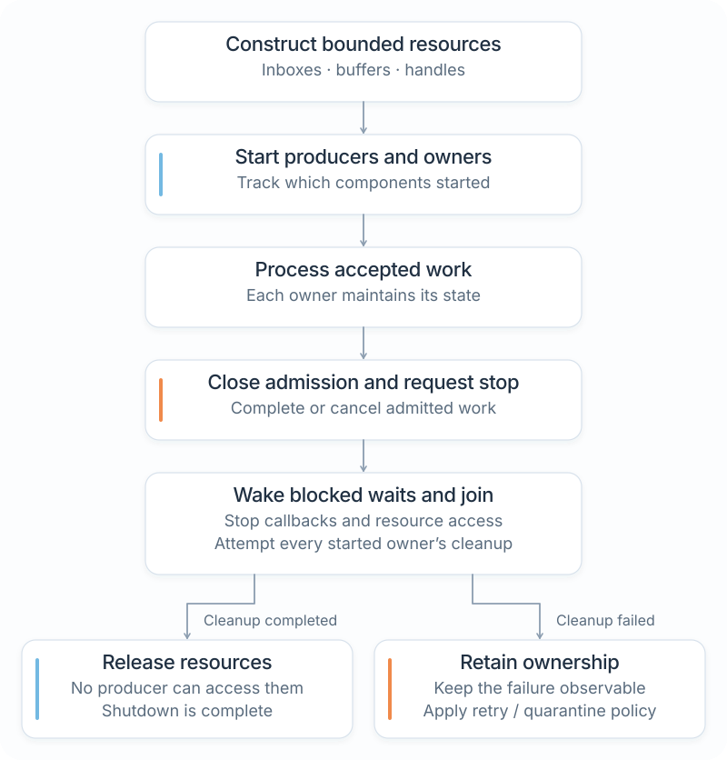
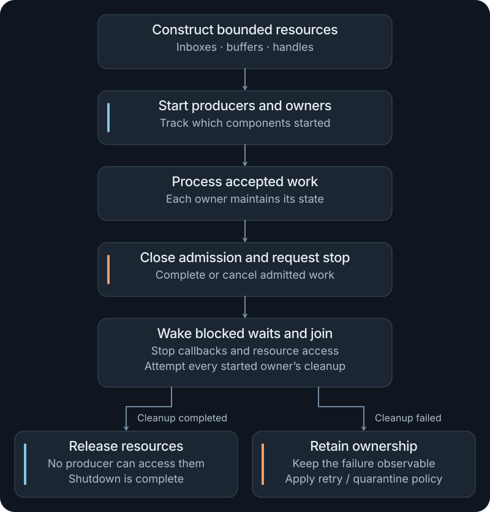

# Designing an application

An NXRS application is the composition root: its ordinary `main()` creates resources, connects behavior and controls lifetime. This guide shows how to grow the [bounded worker](services.md) into a firmware design without giving every function a thread or exposing board wiring to reusable code.

The worked design is a generic controller that accepts commands, controls an output, records selected events and optionally reports status over a network. [Build a controller](controller.md) implements the command, output and shutdown portion as a complete application. Recording and network reporting remain design extensions in this chapter.

## 1. Describe the behavior before the components

Write down the decisions a caller needs to understand:

| Operation | Define before implementation |
| --- | --- |
| Set an output | Valid values, allowed transitions and the required acknowledgement |
| Read status | Which owner supplies the state and how freshness is represented |
| Record an event | Whether acceptance or durable commitment is required before continuing |
| Send status | Whether old status can be replaced after a disconnect |
| Stop | Which work drains, which work cancels, and the completion condition |

A command that changes an output and a periodically refreshed status display do not need the same delivery contract. Make that difference explicit at their interfaces.

## 2. Choose owners around state and waiting

Start with one controller object that owns the product state. Its validation, state transitions and record formatting can be ordinary synchronous methods. The top-level application can own that object directly.

Introduce independent execution only where it solves a concrete problem. If storage can block longer than the controller permits, give storage its own worker. If the connection protocol must keep progressing independently, give that behavior an owner too. A simple output control can remain a synchronous capability call.

| Owner or component | Owns | Communicates through |
| --- | --- | --- |
| Application | Composition and startup/shutdown order | Direct construction and lifecycle calls |
| Controller | Product state and command decisions | Typed commands and results |
| Output capability | The selected resource and its control operations | Synchronous capability contract |
| Recorder, if needed | File, pending records and commit policy | Bounded requests plus completion/failure |
| Connection owner, if needed | Socket, protocol and retry state | Bounded reports and connection status |

This table is a proposed partition, not five required threads. Move state into its execution owner. Share an `Arc` or mutex only when a real shared-ownership requirement remains.

## 3. Keep physical selection in configuration

Declare software dependencies in Cargo. Use a platform profile and overlays to select physical devices and their resources. The application can select a portable named device where the capability provides a catalogue; services receive the corresponding contract.

The output's bus, address and native pin selection should not appear in the controller's state machine. Likewise, a service should not branch on a board name to decide its error policy. The profile binds hardware; the application decides what an unavailable optional feature means.

Follow [Profiles and overlays](profiles.md) for concrete configuration and [Drivers and HALs](hardware.md) for adding a peripheral. An ordinary host exercise using only standard Rust APIs needs no profile.

## 4. Follow a command to completion

Trace one operation through the design before adding background traffic:

1. The input boundary parses and validates the request's shape.
2. The controller accepts or rejects the request according to state and available capacity.
3. The controller applies the requested transition through its output contract and handles the result.
4. If recording is required, it submits the resulting event and observes the level of completion the product promises.
5. It replies with the defined command result. The input boundary presents or encodes that result for its caller.

Do not reply “recorded” after only queueing the record if the protocol promises commitment. If a peer can retry after losing a response, decide whether the operation is idempotent or needs a bounded duplicate-detection scheme. Those decisions belong to the application's protocol.

## 5. Give each boundary a budget

For every queued operation, record capacity, maximum payload size, producer burst, permitted blocking and full-queue behavior. Count payload buffers as well as queue slots. A fixed number of messages containing growable vectors is not a fixed payload-memory limit.

| Boundary | A possible policy | Evidence to collect |
| --- | --- | --- |
| Incoming commands | Reject when full, returning a useful error | Saturation leaves state consistent and does not create a retry backlog |
| Recorder | Stop admission or report a fault when required recording cannot progress | Accepted records have the documented commit/failure result |
| Status output | Replace an obsolete pending value if the protocol permits it | Freshness and replacement remain observable |
| Stop | Reserve an independent path from ordinary traffic | Full and empty data queues both permit shutdown progress |

These are examples of policies to choose, not NXRS defaults for every service. The [services guide](services.md#choose-delivery-behavior) explains admission classes. The [performance guide](performance.md) covers measurement of stacks, queues and payload storage.

## 6. Make startup and shutdown explicit

Create queues and install destination endpoints before starting producers. Acquire required resources before reporting the application ready. Track each successful start so a later failure can unwind only the owners that exist.

<figure class="architecture-art">
  
  
  <figcaption>The application coordinates owners. Only successfully started owners require cleanup, and a failed cleanup must leave ownership and failure visible. <a href="../../docs/assets/nxrs-owner-lifecycle.svg">Open SVG</a>.</figcaption>
</figure>

During shutdown, stop admitting new work, request producer cancellation and wake blocked waits. Finish or cancel admitted work according to its contract. Join workers after their progress dependencies are resolved, then release their resources.

Attempt cleanup for all independent owners even if one operation fails. A convenient `?` in a teardown sequence can otherwise skip later cleanup. Retain errors and any still-live ownership so the caller can decide whether to retry, enter a degraded state or reset the system.

`Drop` behavior is contract-specific. A standard thread handle detaches when dropped; some NXRS resources only request cancellation in `Drop`. Use the explicit stop, flush or join operation when the application needs completion. See [Interfaces and APIs](interfaces.md#read-completion-and-lifecycle-semantics).

## 7. Test each decision at its boundary

Start with deterministic tests for the controller's synchronous behavior: valid and invalid commands, repeated requests and state transitions. Inject a fake output or sink where the contract allows it. This separates the product decision from hardware availability.

Then exercise ownership and integration: saturate queues, disconnect a receiver, fail acquisition after another owner starts, stall I/O during shutdown, and attempt a fresh start after cleanup. A test should assert the promised state, result and cleanup rather than only checking that a log line appeared.

Finally, build and run the selected target. Verify native resource access, scheduling, stack use and deadlines on the configuration that will run the application. The [testing guide](testing.md) explains the differences between host, target ABI, emulated and physical evidence.

## Turn the design into code

Use these existing programs and contracts as small building blocks:

| Next step | Runnable or maintained source |
| --- | --- |
| Start a source project and run it | [Your first application](first-application.md) |
| Follow commands from admission through output and joined shutdown | [Build a controller](controller.md) |
| Add a worker, bounded messages and explicit join | [Services and concurrency](services.md#run-the-worker-in-your-application) |
| Practice ownership, deadlines and synchronization | [Standard-library APIs](standard-library.md) |
| Check actual file and socket behavior | [Networking and storage](io.md) |
| Explore a larger application after the fundamentals | [Examples](examples.md) |

Keep the application as an ordinary Rust package. Extract a reusable service when another caller benefits from its behavior and contract, and add platform integration when the required resource needs it.
