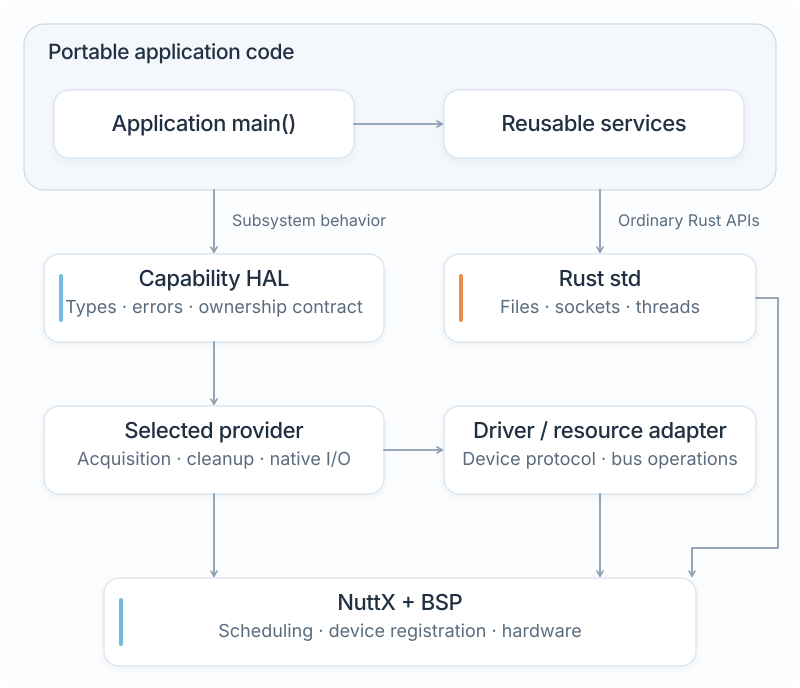
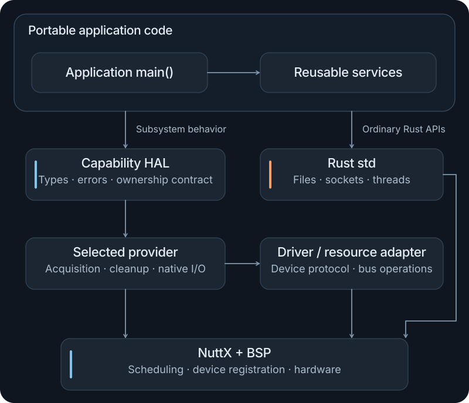

# Interfaces and APIs

NXRS has several interfaces with different jobs: Cargo and the build frontend on your computer, the NuttX shell on the device, and Rust APIs inside the application. This guide helps you choose the right one and understand the result it promises.

## Development commands

Run these from the NXRS checkout unless a guide says otherwise. Its Cargo configuration supplies the `cargo nxrs` alias; the selected application's manifest can live outside the checkout.

| Task | Interface | Where to continue |
| --- | --- | --- |
| Run or test portable Rust code | `cargo run`, `cargo test` | [Your first application](first-application.md) |
| Build a NuttX image from an application and profile | `cargo nxrs build` | [Building for NuttX](firmware.md) |
| Inspect a profile or list platform families | `cargo nxrs profile`, `cargo nxrs platforms` | [Profiles and overlays](profiles.md) |
| Understand build inputs and outputs | `cargo nxrs build --help` and a build's retained files | [Build system](build-system.md) |
| Read a component's Rust API documentation | `cargo doc -p <package> --no-deps` | The package's public modules and source |

The application is an ordinary Cargo package. `cargo nxrs` adds the target preparation and NuttX integration needed to produce firmware. It does not replace Cargo's dependency resolver or define a separate application programming language.

## The device shell and application console

The introductory firmware registers `hello` as a NuttX shell command through `[package.metadata.nxrs.firmware]`. After booting the image, type `hello` at `nsh>`; application output returns to that console. The command name, selected Rust binary, entry-task priority and entry stack are build metadata. See [Building for NuttX](firmware.md#boot-qemu) for the complete interaction.

An application's argument parsing can use `std::env::args`, and ordinary diagnostics can use `println!` or `eprintln!`. The [standard-library demo](../../app/std-demo/src/main.rs) shows a real command parser with `--list`, `--case` and an exit result. Keep the accepted command syntax, error output and exit behavior useful to both a person and a test harness.

For an application that needs its own commissioning byte stream, [the console capability](../../hal/console/src/lib.rs) exposes `console::open()` with `Read` and `Write`. Its NuttX provider owns acquisition and terminal configuration; an unbound provider reports `Unsupported`. Reading can report `WouldBlock`, so the caller needs a waiting or retry policy. This is an application I/O resource, not a shell server or a general logging subsystem.

A graphical interface, remote control protocol or companion client is application-specific. Keep its parsing and session policy with the product, then translate validated requests into typed operations. The [examples index](examples.md) links the existing application-specific work.

## Choose the Rust boundary

<figure class="architecture-art">
  
  
  <figcaption>Choose a contract for the operation. A filesystem write can use std directly, while device acquisition can use a capability with its own lifecycle. <a href="../../docs/assets/nxrs-interface-boundaries.svg">Open SVG</a>.</figcaption>
</figure>

| You need to… | Start with… | Why |
| --- | --- | --- |
| Transform or validate data | A Rust function or owned struct | No execution or hardware boundary is required |
| Manage a file, socket, thread or collection | The relevant `std` API | It already expresses the operation and ownership |
| Reuse behavior with a lifecycle | A service API | It can own state, policy and any workers it needs |
| Acquire or control a subsystem | Its capability HAL | It defines availability, resource ownership and errors |
| Speak a chip's protocol | A driver using the appropriate bus trait | The protocol stays reusable across resource implementations |
| Connect a native device or SDK operation | A capability-local provider or resource adapter | Native types and callback lifetimes stay at the integration boundary |

The [hardware guide](hardware.md) explains providers and drivers. The [services guide](services.md) explains active owners and typed command interfaces.

## Read the public API, not the provider layout

These are current entry points, not a universal HAL template. The Cargo package name used with `-p` can differ from its Rust library name: for example, package `nxrs-transport` declares library `transport`.

| Package / Rust library | Public contract or operation | Availability and meaning |
| --- | --- | --- |
| `nxrs-messaging` / `messaging` | `bounded`, `Sender`, `Inbox::wait` | Default `channels` feature supplies a task-context wrapper around standard bounded channels |
| `nxrs-transport` / `transport` | `PacketSink::send` | Local whole-packet acceptance; a compatible closure can implement the contract |
| `nxrs-transport` / `transport` | `udp::UdpTransport::connect` | Explicit `udp` feature; uses a numeric address and the standard socket path |
| `nxrs-storage` / `storage` | `Storage` | Frame-record acceptance and flush contract; ordinary files can still use std directly |
| `nxrs-storage` / `storage` | `recording::FileRecorder::create_new` | Explicit `recording` feature; queued directory recording with bounded buffers |
| `nxrs-storage` / `storage` | `create_record_file` | Configured synchronous NuttX record-file acquisition; unbound acquisition reports `Unsupported` |
| `nxrs-led` / `led` | `Led::supported`, `Led::set`, `open` | Synchronous typed controls; availability and indices depend on the selected provider |
| `nxrs-console` / `console` | `open` returning a readable/writable resource | Configured commissioning console; native setup and ownership stay in its provider |

Source and detailed contracts: [messaging](../../shared/messaging/src/lib.rs), [packet output](../../hal/transport/README.md), [record storage](../../hal/storage/README.md), [LED controls](../../hal/led/src/api.rs), and [console](../../hal/console/src/platform/mod.rs).

Generate local Rust documentation for a small component with:

```sh
cargo doc --locked -p nxrs-messaging --no-deps
```

Cargo reports the output location. Larger hardware components may need a selected profile and prepared native inputs; use the owning component's instructions before generating target-specific docs.

## Availability, features and acquisition

Three questions are separate:

1. **Is the software compiled?** Cargo dependencies and features select available code.
2. **Does this configuration bind the hardware capability?** The profile selects supported implementations and resources.
3. **Can it be acquired now?** The constructor or acquisition call reports actual resource availability and initialization errors.

An explicit software feature such as `udp` or `recording` does not require a hardware profile. Enabling it alongside a mock profile still enables real socket or file I/O through its explicit constructor. Conversely, compiling a capability contract does not make hardware acquisition available.

For a capability that must exist, an application can declare `required-capabilities` in its manifest so the build rejects a missing binding. Optional capabilities are handled at acquisition. A mock binding can satisfy configuration checks in a test profile; that check is separate from physical device operation. See [Required and optional devices](profiles.md#required-and-optional-devices).

## Read completion and lifecycle semantics

Before calling an unfamiliar API, answer these questions from its contract:

| Question | What to look for |
| --- | --- |
| Can this call wait? | A blocking operation, nonblocking admission result, timeout or pending state |
| Who owns the input after success or failure? | A borrow, moved value, copied payload or returned rejected value |
| What does success prove? | Admission, completed I/O, committed records or an application acknowledgement |
| How is overload reported? | `Full`, `Busy`, a gap counter, replacement semantics or an explicit rejection |
| What happens after a fault? | Retryable error, terminal retained failure or an unavailable resource |
| How does it stop? | Cancellation, wakeup, draining, joining and the precise meaning of `Drop` |

Similar error variant names across capabilities do not make their contracts identical. For example, a recorder's `Busy` can mean that its caller should retry a flush later, while an acquisition's `Busy` can mean another owner holds the resource. Keep those meanings visible in the caller.

Continue with [Designing an application](designing-applications.md) to choose the boundaries, then [Build a controller](controller.md) to run a complete command, output and shutdown path. The controller's completion tickets demonstrate the distinction between admission and a handled result using the existing LED contract.
