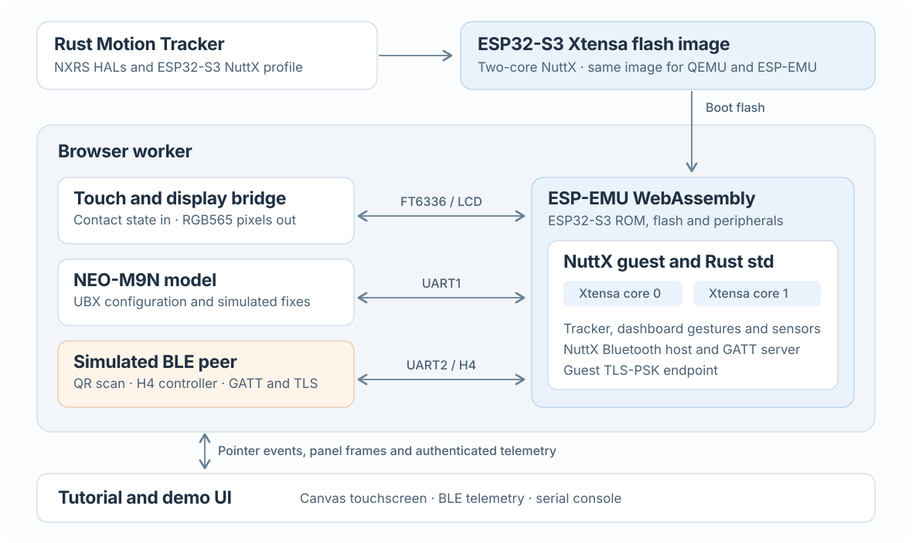

# Motion Tracker in the browser

Run the NXRS Motion Tracker on a two-core NuttX guest, switch its dashboard
tabs, and pair with it over a simulated Bluetooth LE link. The demo runs on
the ESP32-S3 target. The device display shows pixels drawn by the guest.
The telemetry panel reads from its authenticated BLE stream.

## Try the tracker

1. Open **Start browser demo** and wait for **2 cores active** and
   **Touchscreen ready**.
2. Drag down from the small bar at the top of the device display. Tap **IMU 2**.
   Drag down again and tap **GNSS** to switch plots.
3. Drag down again and tap **PAIR**. The guest opens its pairing screen and
   generates a QR code. The browser companion reads that code and connects
   automatically.
4. Check **Paired over BLE** and watch the sample count advance. Both IMUs
   and GNSS should show **Live**. Their readings come from the modeled devices.

<!-- motion-tracker-demo -->

**Restart** boots a fresh guest and clears the browser connection. Close the
demo to stop the emulator.

### Use the NuttX shell

Open **Serial console**, type `help` or `ps` in **NSH command**, then press
**Enter** or select **Send**. The output appears above the command field.
The demo starts the tracker as a separate NuttX task, so you can run shell
commands while the touchscreen and telemetry are active.

## What runs where

<figure>
  
  <figcaption>The same two-core qualification image boots in QEMU and in ESP-EMU. In the browser, a worker connects the emulated board to the page and to its local peripheral models. <a href="../../docs/assets/nxrs-motion-tracker-browser.svg">Open the architecture diagram</a>.</figcaption>
</figure>

### Build an ESP32-S3 image

The [Motion Tracker application](../../app/motion-tracker/) is ordinary Rust.
It uses NXRS capability HALs and the Rust standard library built for
`xtensa-esp32s3-nuttx`. The
[qualification profile](../../tests/profiles/esp32s3-esp-emu-tracker.toml)
selects two guest cores and the NuttX device bindings. The
[startup fixture](../../tests/nuttx-std/tracker-sim/dashboard_init.c) registers
modeled board resources and attaches the NuttX H4 lower half to `/dev/ttyS2`.
For the interactive image, it launches the tracker before entering NuttShell.
The result is a merged ESP32-S3 flash image containing the application,
NuttX and board setup. See [Building for NuttX](firmware.md).

ESP-EMU itself is compiled to WebAssembly. It loads the flash image and
executes the Xtensa instructions and ROM boot path. NuttX starts CPU 1 and
owns guest scheduling, timers, interrupts, threads, and device access. The
browser worker advances the emulated machine in bounded batches and yields
between them so it can service the peripherals and post frames to the page.
The two active CPUs are guest cores. The separate
[preemption witness](../../tests/browser/esp32s3-preemption/README.md)
checks timer and inter-core interruption of a non-yielding guest task.

### Move a contact through NuttX

The canvas scales browser pointer coordinates to the guest's 320 × 240 display.
Pointer capture keeps a drag attached to the canvas when the pointer leaves
its edge. The worker queues press, move and release states, coalesces pending
moves and waits for the guest's polling counter before advancing to the next
state. This gives the guest a chance to observe a quick click as a press and
a release. [Pointer Events](https://www.w3.org/TR/pointerevents3/#pointer-capture)

The ESP-EMU patch writes one aligned word to the address of the touch fixture
symbol from the firmware ELF. The [FT6336 board model](../../tests/nuttx-std/tracker-sim/devices.c)
reports that contact through its I²C register response. NuttX's FT5x06 driver
polls the model and the touch HAL delivers the event to the Rust tracker.
The tracker recognizes the gesture, selects the tab, and redraws over its
SPI display path. The worker reads a completed RGB565 panel frame from guest
RAM and copies it to the browser canvas. The tab bar, plots and QR are all
rendered by the guest.

### Pair and read telemetry

Tapping **PAIR** tells the guest to advertise its GATT service and draw a QR
with a fresh pre-shared key. The ESP-EMU patch supplies the guest's simulated
RNG register with Web Crypto. The browser worker decodes the guest's actual
pixels, discovers the tracker service and its read and write characteristics,
then starts a TLS 1.2 PSK session with a Mbed TLS WebAssembly client.
The [browser package](../../tests/browser/tracker-demo/README.md) documents
the third-party inputs.

The worker's controller and central exchange HCI H4 packets with the NuttX
Bluetooth host through emulated UART2. UART interrupts reach NuttX through
the ESP32-S3 interrupt matrix. The GATT characteristics carry encrypted TLS
records. The browser displays readings only after the client authenticates
and decrypts the stream. The report counter and source sequences demonstrate
that further samples arrive on the same connection.

### Connect the sensor models

| Guest path | Demo input or output |
| --- | --- |
| NSH UART0 | The browser sends submitted lines to the guest and displays its serial output. |
| IMU and battery I²C | The board fixture answers for two BMI270s and an AXP2101. The IMU X readings have opposite signs so you can distinguish the sources. |
| GNSS UART1 | A browser model responds to u-blox configuration commands and sends periodic UBX fixes. |
| Touch I²C and display SPI | The FT6336 model supplies contact state. The LCD model records the pixels the app writes. |
| BLE UART2 | The browser controller and central carry the tracker GATT service and TLS pairing traffic. |
| Settings | The qualification board registers a RAM-backed settings device. Restart creates a fresh guest. |

On a physical CoreS3, the [hardware profile](../../docs/m5stack-cores3.md)
builds the same Rust application and Xtensa target with its own board and
device bindings. The browser demo qualifies firmware behavior with modeled
devices. Physical radio, electrical timing and flash retention require
on-board tests.

## Rebuild and verify

Follow the [firmware and emulator instructions](../../tests/browser/esp32s3-preemption/README.md#motion-tracker-ble-pairing)
to build the image and patch ESP-EMU. The
[browser packager](../../tools/build-tracker-browser-demo.sh) cross-compiles
the browser TLS client and stages the firmware, emulator and local scripts.
The [website build](../README.md) serves those assets at the same origin and
loads them when the demo opens. The browser needs a secure origin such as
HTTPS or loopback. [Web Cryptography API](https://w3c.github.io/webcrypto/)

The [Chromium verifier](../../tests/browser/tracker-demo/verify.mjs) drives
real pointer actions. It checks the guest-rendered selection indicators,
initiates pairing from the guest, and requires advancing authenticated IMU
and GNSS samples with both cores active. It also submits an NSH command while
telemetry is live and checks the guest's reply. It repeats the flow after
restarting the guest and verifies that a corrupted QR key yields zero samples. The
verification uses Chromium and a Node static server. Python is used for
build preparation. The running demo and browser verification require no
Python process, BLE relay or external service.
