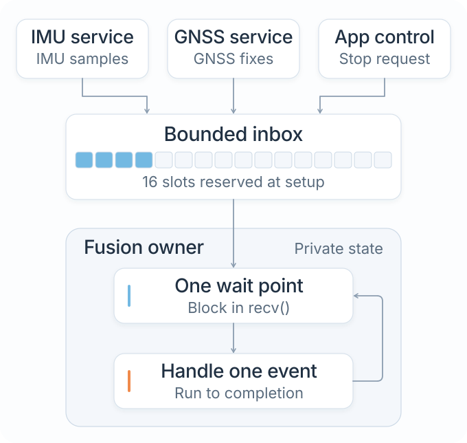
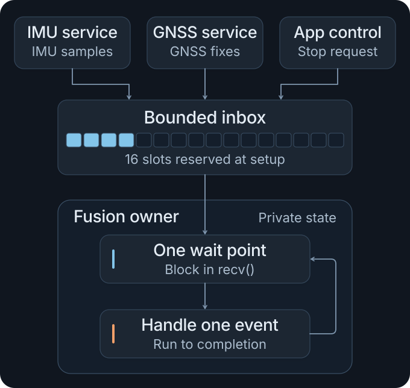

# Architecture overview

NXRS uses ordinary Rust `std` code for application behavior, with hardware integration and product configuration kept separate. NuttX provides the RTOS and board support.

Read [Why NXRS?](motivation.md) for the reasoning behind these choices, or [Getting started](getting-started.md) to run an application.

## NuttX supplies the operating system

NuttX's C/POSIX environment supplies scheduling, board support, controller drivers and hardware resource registration.

A Rust standard library compiled for the selected NuttX target provides thread, synchronization, time, file and socket interfaces. The [Rust std integration reference](../../docs/nuttx-std.md) describes the maintained patches, target configuration and supported APIs.

## Rust components supply firmware behavior

Peripheral wrappers connect Rust code to resources exposed by NuttX. Chip drivers implement device protocols. Capability HALs provide interfaces such as IMU or GNSS acquisition. Services add reusable behavior, and the application composes the components.

Ordinary file or socket operations use `std` directly. An application can also own a capability directly rather than introducing a service for it.

The [architecture reference](../../docs/architecture.md), [HAL ownership reference](../../docs/hal-platform-architecture.md) and [peripheral composition reference](../../docs/peripheral-composition.md) describe these interfaces and their implementation.

## Profiles describe the product

Platform profiles and overlays select implementations, devices, resource bindings and logical roles at build time. NuttX owns MCU pin configuration, controller initialization and device registration.

An application selects a portable device name, such as `devices::primary_imu()`, and the profile supplies its concrete construction. [Profiles and overlays](profiles.md) explains device selection and the supported bindings.

## Event-driven communication

The application composes its services in `main()`. A service that needs independent execution owns its mutable state and waits at one logical point. It handles one event to completion before taking the next. Within that handler, ordinary Rust methods can work directly on the owner's state.

<figure class="architecture-art">
  
  
  <figcaption>Fusion handles one event at a time and exits on shutdown. The single wait point follows the model in <a href="https://www.state-machine.com/doc/Cummings1006.pdf#page=12">Cummings, p. 12</a>.</figcaption>
</figure>

The usual inbox wraps a positive-capacity `std::sync::mpsc::sync_channel`. Its fixed ring is allocated when the inbox is created, and message transfers reuse those slots. The same Rust API works on NuttX, Linux and macOS. Their implementations differ in how they store blocked waiters and what can allocate on first use.

The [services guide](services.md) covers memory sizing, overload, blocking and safe shutdown. The [event communication reference](../../docs/concurrency-event-communication.md) covers owners that need independent capacity for different event classes.

## Tests and evaluations

Host tests cover application and service behavior. Simulator and QEMU runs test firmware execution, while on-board tests measure device behavior and performance. Existing evaluations include thread stacks, queues, heap use, image size and event-delivery latency.

See [Testing and debugging](testing.md), [Performance and memory](performance.md) and [Current status](status.md) for commands and results.
