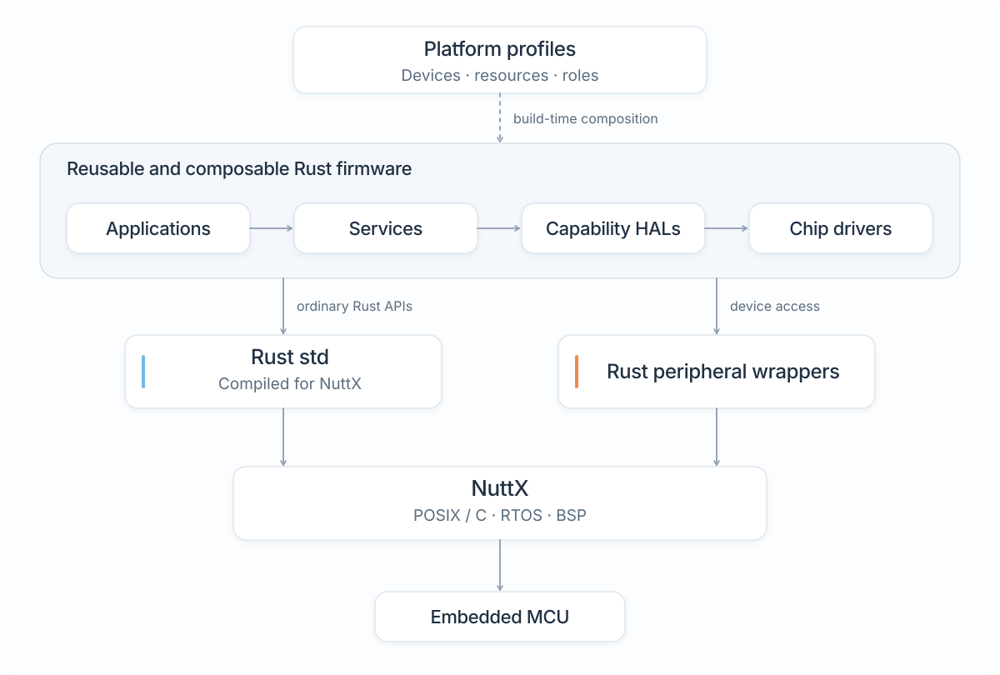
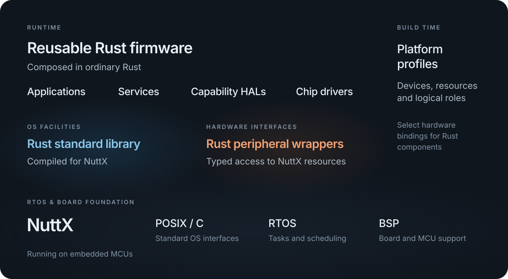

# Architecture overview

NXRS is a general-purpose Rust firmware development environment built on NuttX. NuttX supplies the RTOS and board support; NXRS supplies the Rust integration, reusable components, and platform configuration used by applications.

This chapter explains where code and configuration belong. Read it after [Your first application](first-application.md), or use it to orient yourself before exploring the source.

<figure class="architecture-art">
  
  
  <figcaption>The arrows show responsibilities and dependencies. They do not prescribe a separate thread, allocation, or message queue for each box. <a href="../../docs/assets/nxrs-architecture.svg">Open SVG</a>.</figcaption>
</figure>

## NuttX and Rust std

NuttX's C/POSIX environment supplies scheduling, synchronization, files, sockets, controller drivers, and hardware resource registration. A Rust standard library compiled for the target exposes the corresponding Rust APIs.

Application code uses ordinary Rust functions and libraries. A `File`, socket, collection, or thread is still the corresponding Rust type. The target build connects those APIs to the selected NuttX configuration and the repository's maintained Rust integration. This requires the pinned target tools and patches; it is not a claim that every upstream crate or operating-system API works unchanged.

NuttX remains responsible for scheduling and board initialization. Native bindings handle operations that Rust APIs cannot express, such as a device-specific control or SDK callback. The [Rust std reference](../../docs/nuttx-std.md) documents the integration and its qualification scope.

## Components and responsibilities

| Component | Responsibility | Example of a decision it owns |
| --- | --- | --- |
| Application | Construct components and define product behavior | Which workflows run, and what happens after a fault |
| Service | Provide reusable behavior with an explicit lifecycle | A recording policy or command processor |
| Capability HAL | Present a subsystem API and manage its resources | Device acquisition, delivery and cancellation |
| Device driver | Implement a device's protocol | Register access, packet parsing and physical-unit conversion |
| Resource adapter | Expose an OS resource or peripheral bus to Rust | An I²C transaction through a registered controller |
| Platform profile | Select hardware bindings and build configuration | Board, devices, buses, aliases and supported pin choices |
| NuttX BSP | Initialize and register native hardware resources | Controller startup and the device node it exposes |

Use the layers that the operation needs. A file write or socket exchange can use `std` directly. An application can use a capability directly when it is the natural owner. Extract a service when the behavior has a useful interface, lifecycle or reuse boundary.

A capability HAL is a subsystem interface, not a requirement to wrap every ordinary Rust operation. A simple synchronous output may be a small object. Streaming acquisition can need a session, worker and cancellation path. Both belong behind APIs appropriate to their operation. [Choose an interface](interfaces.md) maps those choices to the current public APIs.

## Follow one operation through the system

Consider a controller that accepts a command, updates an output and saves a status record:

1. The application interprets the product command and calls the component that owns the state.
2. That component updates its state and uses the selected output capability. Any chip-specific operation stays below the capability boundary.
3. The capability or resource adapter reaches the registered NuttX resource. The BSP has already configured the controller and pins.
4. A record can be written through `std::io::Write` on an owned file. It does not need to travel through the output's driver or HAL.

If the storage operation can block longer than the controller permits, give storage a bounded worker and completion interface. That new execution boundary exists because of the workload, not because storage occupies another directory.

## Concurrency

Applications have handwritten `main()` functions. An active component can own a thread, mutable state, and a bounded inbox. It waits for events, handles them synchronously, and supports explicit shutdown. Components that do not need independent execution remain ordinary objects or functions.

The application creates and connects owners explicitly. Queue admission, completed work and externally committed results are separate events: successful enqueueing alone does not prove a command ran or a record reached durable storage. Each interface specifies the guarantee its caller needs.

[Services and concurrency](services.md) explains this with a small command-processing example. The [event communication reference](../../docs/concurrency-event-communication.md) records delivery and lifecycle conventions.

## Platform configuration

Profiles and overlays select implementations, device instances, resources, and logical names at build time. This borrows the declarative configuration approach of device trees while retaining NuttX's BSP and native configuration.

Application behavior stays in Rust; board wiring stays in the profile and platform integration. Cargo manifests remain the dependency graph. The build tools resolve configuration, prepare native inputs and invoke Cargo and NuttX; they do not generate an application's service graph. [Profiles and overlays](profiles.md) explains the build inputs.

## Find the code you need

| Your task | Start here | Keep out of it |
| --- | --- | --- |
| Change a product workflow | `app/<application>/` or your external Cargo package | Board identities and native device paths |
| Reuse a behavior across applications | `service/<behavior>/` | Concrete chip selection |
| Add a subsystem operation | `hal/<capability>/` | Unrelated product policy |
| Implement a chip protocol | `driver/<device>/` | Service threads and application dependencies |
| Change board wiring or add a product variant | `platform/` and the owning NuttX BSP | Runtime workflow decisions |
| Change profile resolution or build preparation | `tools/` | Firmware runtime behavior |
| Share a layer-independent contract | `shared/` | A new mandatory runtime or global registry |

The [source ownership reference](../../docs/architecture.md) and [HAL architecture reference](../../docs/hal-platform-architecture.md) define the detailed boundaries. [Design an application](designing-applications.md) turns them into a practical composition exercise.

## Developing and testing

Begin with host execution and component tests. Build the same application model for a selected NuttX configuration, then test device access and resource use on the target. Existing tests cover host behavior, simulator/QEMU execution, and on-board performance and memory use.

Host execution checks portable behavior. Target compilation and ABI checks establish a different boundary; on-board measurements establish the timing and resource behavior of an actual configuration. Keep those results distinct when choosing a component.

Continue with [Choose an interface](interfaces.md) for the API map or [Services and concurrency](services.md) for a complete worker. [Why NXRS?](motivation.md) explains the design choices, and [Current status](status.md) links implementation and validation evidence.
