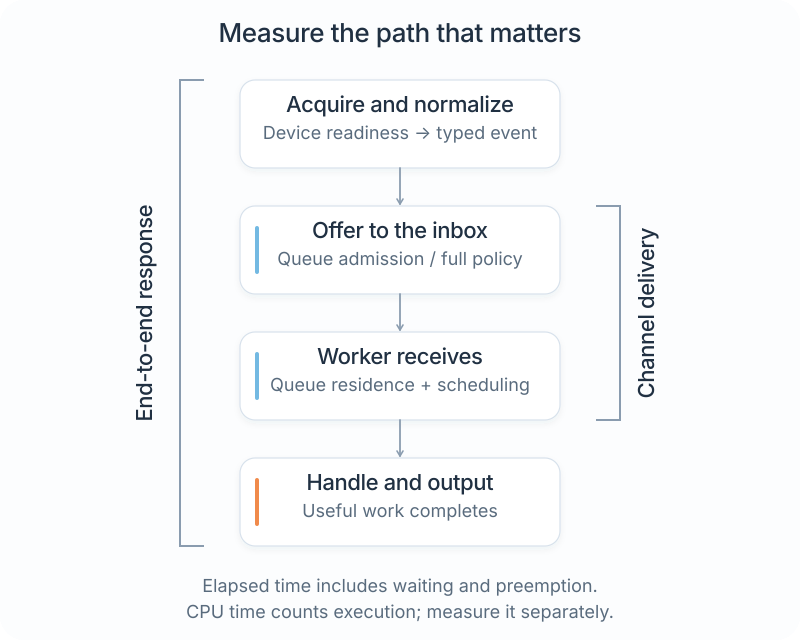

# Performance and memory

Existing NXRS evaluations cover event delivery, channel storage, thread stacks, code size and heap use. These measurements help track the cost of using Rust `std` and reusable components within an application's resource budget.

Start with a concrete application requirement: how much useful work must finish, by when, and within which memory budget? Then choose a fixture that exercises the same transport, ownership, and scheduling behavior. The presence of a measurement in the repository does not make it representative of every application.

## Existing evaluations

Choose the question first. Each report states its tested setup, assumptions and measurement boundaries before presenting results. Evidence links retain the firmware identities, workload and recorded runs.

| Your question | Start with | What you can take from it |
| --- | --- | --- |
| How close is message delivery to Zephyr? | [RTOS comparison results](../../docs/rtos-comparison.md) | Same-board latency, throughput and interrupt observations, with remaining differences |
| Why does the std channel behave this way? | [Bounded channels](../../docs/std-channel-performance.md) | Queue ownership, waiting, target implementation and where time goes |
| How much RAM and flash will my application need? | [Memory and image size](../../docs/rust-std-footprint.md) | Ordinary std worker/inbox measurements and a usable accounting model |
| Is my code allocating or retaining memory? | [Rust allocation probes](../../docs/memory-qualification.md) and [NuttX heap/stack checks](../../docs/nuttx-memory-qualification.md) | Construction, first-use, steady-state and teardown observations |
| Does it still make progress and recover under load? | [Evaluation method](../../docs/rtos-characterization.md) | Workload, overload, recovery and portability experiments |
| Why does camera video or detection slow down? | [Camera performance report](../../docs/camera-pico-performance.md) | Separate preprocessing, numerical execution, detection cadence and receiver FPS |

Transport, memory and detector results come from distinct experiments. Read the setup for the relevant report before applying its figures to your application's handlers, devices and concurrent work.

Historical native-adapter, compiler and model studies remain under **Historical measurements** in the [reference index](../../docs/README.md). Their results keep their original configuration; a new implementation is not automatically covered by an older run.

## Define the workload and budget

Record event sources, rates, bursts, payload sizes, queue capacities, processing work and deadlines. Include startup, idle, overload and shutdown. Use isolated channel benchmarks to measure transport costs and application tests to measure the complete processing path.

Use the same measurement points in each comparison. Record producer admission time, wake-to-handler latency, handler CPU time and end-to-end delivery separately. A caller's elapsed time can include work done by a preempting consumer.

| Budget | Write down before measuring |
| --- | --- |
| Workload | Sources, useful operations, steady rate, burst size, and payload bytes |
| Delivery | Required ordering, queue capacities, full-queue policy, and permitted loss |
| Responsiveness | Release point, completion point, deadline, and interference |
| Memory | Available region, stacks, queues, owned buffers, and headroom |
| Lifecycle | Time to ready, cancellation, joined shutdown, and restart behavior |

An inbox with `N` slots bounds queued messages. It does not bound all work in the system: include producer-held values, a message currently handled, pending replies, retry storage, and downstream buffers. Sustained arrival above service capacity eventually saturates any finite queue.

## Measure memory use

Record deployed code and read-only data, mutable static data, queue and payload storage, allocated thread stacks, heap high-water marks and retained buffers. Include alignment, allocator behavior and memory placement where they affect the result.

Measure deployed sections rather than the total ELF file size. Record stack allocation and measured stack use separately. Include buffers and other allocations outside the message queues.

| Memory figure | What it describes | Common accounting error |
| --- | --- | --- |
| Image sections | Code, read-only data, initialized data, and zero-filled storage | Using the full ELF file size as deployed flash consumption |
| Stack reservation | Memory allocated to each execution context | Treating unused reserved stack as available to another owner |
| Observed stack use | High-water use under the tested paths | Treating one observation as a worst-case bound |
| Heap reservation and live allocations | Allocator arena and allocations within it | Counting the arena and the same suballocations twice |
| Queue and payload storage | Slots, metadata, queued buffers, and in-flight ownership | Counting only `slots × payload size` as total application RAM |
| Retained resources | Buffers, handles, and caches that survive an operation | Comparing startup with a warmed steady state without saying so |

Measure startup, first use, steady state, saturation, and release separately. A lazy allocation may first occur when waiting or formatting a diagnostic. A successful smaller-stack build only establishes that the image links; exercise the relevant failure and shutdown paths before evaluating its margin.

## Measure event delivery

<figure class="architecture-art">
  <picture>
    <source media="(prefers-color-scheme: dark)" srcset="../../docs/assets/nxrs-latency-boundaries-dark.svg">
    
  </picture>
  <figcaption>A fast queue does not guarantee a fast device-to-output path. Choose the interval that matches your requirement. This diagram is conceptual, not to time scale. <a href="../../docs/assets/nxrs-latency-boundaries.svg">Open SVG</a>.</figcaption>
</figure>

Test ready and blocked consumers separately. Record admitted and rejected transfers and verify payload order before calculating latency. Keep the source revision, compiler version, configuration and firmware image with the result.

Scheduler policy, effective priorities, locking and endpoint lifetimes affect delivery behavior. The [event communication reference](../../docs/concurrency-event-communication.md) describes the relevant transport and lifecycle requirements.

Read loss, latency, and throughput together. Dropped work has no completion-latency sample, so a faster-looking latency distribution can reflect rejected work. Compare offered load and useful completed work, and preserve per-producer results when a total could conceal starvation.

## Run a small host experiment

The existing stress application gives a quick way to observe these tradeoffs before setting up target measurements:

```sh
cargo run --locked -p nxrs-ao-stress -- --scenario steady
cargo run --locked -p nxrs-ao-stress -- --scenario slow-consumer
```

Compare the `AO_CONFIG`, per-owner records, and `AO_RESULT` output. The slow-consumer scenario introduces a deliberate blocking-I/O surrogate, so inspect both ingress and egress losses. These runs describe your host and this synthetic workload.

The reported percentile values are upper bounds of histogram buckets, and the storage budget is a logical payload bound rather than a measured total heap footprint. See the [metrics reference](../../docs/std-demo-and-ao-stress.md#metrics-and-their-limitations) before using those fields in a report. Physical measurements require the corresponding fixture, image, and board procedure.

## Compare equivalent configurations

Use comparable workloads, hardware, CPU/cache settings, compiler options, memory placement and scheduling. Record whether hot code runs from flash or internal RAM.

Keep results from separate boots and configurations identifiable. Calculate component costs from matching measurements rather than subtracting unrelated percentiles. Report median, tail latency and observed maxima separately; a measured maximum is not a worst-case timing bound.

## Record the results

Include commands, raw data, configuration, workload, results and any failed runs. State whether timing uses calibrated time or raw counters, and whether execution was on a host, emulator or physical board.

Repeat the relevant evaluations when services, payloads, devices or toolchains change.

Use the result to make a specific decision: reduce a copy, bound a buffer, move blocking work to its owner, adjust a measured stack budget, or change queue admission. Keep the requirement and correctness check constant while changing one cause. [Testing and debugging](testing.md) covers the behavior checks that should accompany the measurement.

## Use a short result format

A useful report answers these questions in order:

1. **Question and requirement.** For example, can this owner finish each admitted event before its deadline under the declared burst?
2. **Tested setup and assumptions.** Board, pinned software/image, workload, priorities, capacities, memory placement, warm-up, sample counts, repetitions, measurement boundaries and correctness checks. State material exclusions or missing details before showing results.
3. **Finding.** A small table of useful completions, rejection, latency tails and relevant resource costs.
4. **Interpretation.** Which cost dominates, what mechanism explains the difference, and which explanation is still a hypothesis? Quantify the opportunity when the data permits it.
5. **Decision and focused follow-up.** What changes for the user, and which one or two tests would resolve the main uncertainty? State what outcome would justify an optimization.
6. **Evidence.** Commands, raw records and reproduction instructions in a linked fixture or report.

Keep a run-by-run investigation log behind that summary. If the question or configuration changes, give the new experiment its own result instead of extending one table indefinitely.
