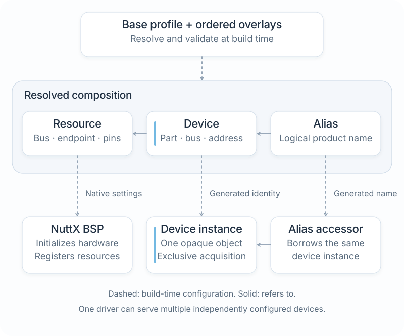
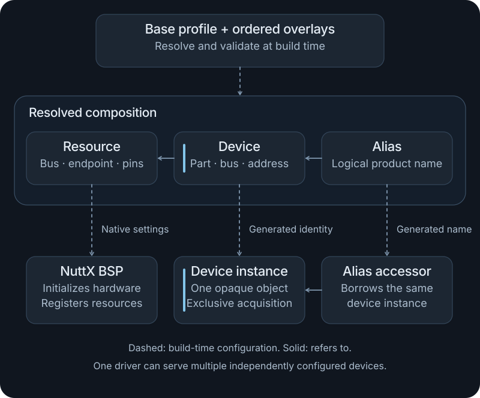

# Profiles and overlays

A platform profile describes the configuration used for a host or firmware build. It selects hardware resources, device instances, implementations, and target settings outside reusable application code.

Use this guide when changing where an application runs, adding a supported device, or making a product variant. Start from a profile that already builds for the intended target. The [first firmware tutorial](firmware.md) supplies a working emulator baseline; the [build workflow](build-system.md) explains how the frontend consumes the configuration.

## Application and platform are separate inputs

An application is a Cargo package. A profile describes where it runs. For example:

```sh
cargo nxrs build --app std-demo --profile esp32s3-qemu-mock --dry-run
```

The same application can be built with a different profile without adding board branches to its `main()` function.

`cargo nxrs platforms` lists platform families. `--platform` uses a family's default profile; `--profile` selects a specific configuration. When both are supplied, the profile must belong to that family. Use an explicit profile when reproducing a build.

| Selection | Meaning | Where to find it |
| --- | --- | --- |
| Platform family | A supported host or board family with a default configuration | `platform/<family>/profile.toml` |
| Named product profile | A specific board/product configuration, optionally inheriting another profile | `platform/<family>/profiles/` |
| Qualification profile | A deliberate input for a particular test or emulator setup | `tests/profiles/` |
| Overlay | Ordered resource, device, or alias changes applied to a composition | A version-controlled TOML file selected by the profile or command |

An NXRS profile selects platform inputs; it is unrelated to Cargo's `dev` and `release` optimization profiles. A name ending in `mock` describes the selected test inputs, not the implementation of every dependency in the image.

## Configure NuttX

Use `cargo nxrs config` to edit the native settings for the application and profile you intend to build. Run it from the NXRS checkout, with its pinned NuttX sources initialized. Inspection needs the [NuttX host tools](https://nuttx.apache.org/docs/latest/quickstart/install.html) and `kconfiglib==14.1.0` installed in the Python environment used by `olddefconfig`. **Save & sync also needs the target's compiler and SDK** to prepare build inputs. The [firmware setup](firmware.md#prepare-ubuntu) supplies both for the ESP32-S3 tutorial.

```sh
cargo nxrs config --app event-demo --platform cores3
```

With no arguments, the terminal command offers application and NuttX platform choices. From inside `app/<name>/`, it infers the application. Use the same `--manifest-path`, `--profile`, and ordered `--overlay` arguments as your build for an external application or product variant. `cargo nxrs config --help` lists selections and examples.

1. **Find a setting.** Press `g` to choose a native menu group: type to filter the groups, move with the arrow keys, then press Enter. Use `/` to search all settings by prompt text, such as `debug assertions`, or by native symbol, such as `CONFIG_DEBUG_ASSERTIONS`. Submitting a search clears the group and Changed filters. In the settings list, press Enter to open details.
2. **Understand its state.** The summary shows the current value and any restriction on editing. Press `p` to inspect a prerequisite and Escape to return. Press `t` to show or hide technical details, including native expressions, defaults, and source locations.
3. **Make an edit.** Press Space to change the value. NuttX evaluates dependencies and permitted values; a requested value that cannot take effect appears as a problem. Edited settings are marked in the list. Press `c` to toggle the Changed filter for settings requested in the current draft.
4. **Review and save.** Press `r` or uppercase `S` to review. The summary counts source edits, resulting native changes, and problems; blocking problems appear first. Check the destination files and the complete changes, then press `S` in Review to save and sync. After success, continue editing: the saved configuration becomes the new baseline. Firmware compilation is a separate step.

**Location** shows where NuttX organizes a setting in its menus. **Requires** shows the conditions that restrict it; **Enabled by** identifies other settings currently selecting its value. These relationships are separate: a menu name alone does not explain why a setting is unavailable. The technical view preserves the full native conditions. **Owned by** identifies values supplied by build requirements or resources. Required settings stay read-only. Supported I2C and UART pin edits update their owning resource field in the profile or overlay.

Tab switches between Settings and Detail; the active pane is emphasized. Escape closes a popup, returns from a detail or prerequisite, or clears a list filter. It never quits the editor. Use `d` to remove an ordinary fragment override; for a resource pin, it discards that pin's unsaved edit. Press `q` or Ctrl-C to quit; unsaved edits require confirmation before being discarded. Previously saved edits remain.

The Changed filter tracks your draft requests. Review also shows effective native changes caused by dependency resolution, so it can contain additional settings. During resolution, the UI labels any displayed values from the last resolved configuration; wait for completion before making another edit or saving.

### Where settings are saved

Ordinary settings go into a native `.conf` fragment referenced by the profile:

```toml
nuttx-config = "nuttx.conf"
```

The path is relative to the profile that declares it. The fragment contains ordinary NuttX assignments:

```text
CONFIG_DEBUG_FEATURES=y
CONFIG_DEBUG_ASSERTIONS=y
```

Disabled boolean settings use `# CONFIG_SYMBOL is not set`. Existing `[kconfig]` settings supply defaults; the fragment stores explicit choices. Mandatory build requirements and BSP resource settings retain their ownership.

An inherited fragment keeps its original owner, so editing it affects every profile that uses it. Review the destination before saving. To give a variant its own settings, copy the shared fragment and declare the new path in that variant first. A child `nuttx-config` **replaces** the inherited reference; fragments are not automatically combined. When no fragment exists, review shows the new fragment and reference to be added to the selected profile.

### Check, build, and recover

Scripts use explicit selections and the same native resolution as the editor:

```sh
cargo nxrs config check --app event-demo --platform cores3
cargo nxrs config show --app event-demo --platform cores3
cargo nxrs config explain CONFIG_DEBUG_ASSERTIONS --app event-demo --platform cores3
cargo nxrs build --app event-demo --platform cores3
```

`check` reports configuration problems; `show` prints JSON; `explain` describes one setting's dependencies and ownership. The ordinary build consumes the saved fragment and resource inputs. Save & sync refreshes prepared inputs and any [Zed context](../../docs/editor-setup.md) already bound to that output directory; select that context once with `cargo nxrs editor --build-dir <path>`.

**Saved; sync failed** means the source edits are already present. Fix the reported compiler, SDK, or preparation problem, then press `S` again in review to retry. External source edits require reopening the selection before publishing another draft. If a source publication was interrupted, run `cargo nxrs config recover` before reopening. A save with no changes leaves sources and the existing build cache untouched.

## Portable development with Cargo

For host code using profile-selected HALs, `NXRS_PLATFORM` selects the profile. For example, check the storage package with the Linux host integration:

```sh
NXRS_PLATFORM=linux cargo check --locked -p nxrs-storage
```

On Windows, PowerShell uses an environment assignment before the command and removes it afterward:

```powershell
$env:NXRS_PLATFORM = "windows"
cargo check --locked -p nxrs-storage
Remove-Item Env:NXRS_PLATFORM
```

NuttX firmware and qualification builds use `cargo nxrs build`; their Cargo adapters require its prepared inputs. For host fixtures, use the profile matching the host and package, with the prerequisites in the owning HAL's documentation. Standard-library-only programs, including the first examples, do not need a profile. Without one, HAL crates expose portable contracts and leave hardware implementations unbound.

## Configuration responsibilities

| Input | Owns |
| --- | --- |
| Cargo manifest | Packages, dependencies, and optional features |
| Application firmware metadata | Binary, NuttX command, entry priority, and stack |
| Platform profile | OS, board, devices, resources, and implementation bindings |
| Overlay | An ordered change to a base profile |
| Profile's `nuttx-config` fragment | Explicit native settings checked by NuttX |
| NuttX BSP and Kconfig | Native pin/controller configuration and device registration |

A reusable driver implements a device protocol. The profile selects its physical instance and resource bindings. A service receives the resulting capability, while the application chooses how that service participates in the firmware.

<figure class="architecture-art">
  
  
  <figcaption>One resolved configuration connects native resource registration and Rust device construction. Application behavior remains in source code. <a href="../../docs/assets/nxrs-profile-composition.svg">Open SVG</a>.</figcaption>
</figure>

The composition schema is implemented for the device families listed in the [composition reference](../../docs/peripheral-composition.md). It is not a universal declaration language for every HAL. Some capabilities use native operating-system facilities directly and do not need a chip catalogue or resource wrapper.

## Add a NuttX board

### Prepare the NuttX BSP

1. Start with the revisions of [NuttX](../../external/nuttx/) and
   [NuttX apps](../../external/nuttx-apps/) pinned by NXRS. For a
   supported board, inspect its schematic and existing defconfig for the
   console, flash and RAM layout, and the buses you need. For a new board on a
   supported SoC, add `boards/<arch>/<chip>/<board>/` with board headers,
   startup and bring-up sources, build rules, and
   `configs/<config>/defconfig`. Register the board in `boards/Kconfig`.
   A new SoC also needs a NuttX architecture or chip port.
   [NuttX board support](https://nuttx.apache.org/docs/13.1.0/components/boards.html)
2. In Kconfig, enable the controller, the required driver interface, and the
   board initialization hook that registers it. In the BSP, configure pin mux,
   power and reset as required by the hardware. Use the board's bring-up path
   to initialize controllers and register their endpoints before the app opens
   them. For example, `CONFIG_BOARD_LATE_INITIALIZE=y` enables
   `board_late_initialize()`, where NuttX can run setup that needs I/O or
   waits. [NuttX initialization hooks](https://nuttx.apache.org/docs/latest/reference/os/board.html)
3. Build a native NSH image first. In a clean, separate NuttX checkout with
   the board changes applied, the matching apps checkout at `../apps`, and
   the board's cross compiler, Kconfig and image tools installed, run the
   following with the actual board and configuration names. Use `-m` in
   place of `-l` on macOS. Enable the native resource settings in
   `make menuconfig` and use `make savedefconfig` to export defaults you
   want to keep in the BSP.

   ```sh
   ./tools/configure.sh -l -a ../apps BOARD:CONFIG
   make menuconfig
   make olddefconfig
   make
   ```

   Use the board's documented flashing procedure for the chosen bootloader
   and image layout. Boot to `nsh>`, check the expected nodes with `ls /dev`,
   and exercise the needed I/O. A visible node confirms registration. A
   transfer or sample checks the wiring and driver together.
   [NuttX build prerequisites](https://nuttx.apache.org/docs/latest/quickstart/install.html)

### Connect the BSP to NXRS

1. Put the BSP changes in a pinned revision, or add a
   [NuttX patch](../../upstream/nuttx/patches/) and register it in
   [upstream/build-patches.json](../../upstream/build-patches.json).
   The NXRS build extracts the pinned sources into its output directory
   before applying the registered patches.
2. Create `platform/<family>/profile.toml`. Give it a unique `name`, select
   `board = "<board>:<defconfig>"`, and set `target`, `crossdev`, `machine`,
   and `image`. Set the capability bindings in `hal` and BSP defaults in
   `[kconfig]`. Use the [configuration editor](#configure-nuttx) for explicit
   product settings. Use a checked-in profile for the same supported target as a
   reference. A new target or OS needs build support and the providers for the
   capabilities you intend to use.
3. For composed peripherals, add or extend
   `platform/nuttx/resources/<board>.toml`, using the board ID before the colon.
   Map each registered endpoint to the Kconfig requirements and native pin
   settings that produce it. Select those mappings and supply the actual
   wiring in the profile. See [Add a peripheral](hardware.md#add-a-peripheral).
4. Inspect the resolved profile with `cargo nxrs profile --platform <family>`.
   Run `cargo nxrs build --app <app> --platform <family> --dry-run`, then build
   without `--dry-run`. The build applies the profile to the board defconfig,
   runs NuttX Kconfig, and saves the effective settings in `resolved.config`
   in the build output. Boot the resulting image and verify the endpoints and
   application acquisition on the board.

For a variant within an existing family, add a named file under
`platform/<family>/profiles/` and set `extends` to the base profile's name.
Use an overlay for a wiring or device change you want to apply to an existing
profile. See the [CoreS3 profile](../../platform/cores3/profile.toml),
[its BSP mapping](../../platform/nuttx/resources/esp32s3-m5-cores3.toml), and the
[worked sensor example](examples.md#add-a-second-sensor-on-cores3).

## Required and optional devices

Cargo enables the capability APIs the app uses. The profile determines which
implementations are available on the target. A missing optional binding leaves
the HAL unbound. Handle `Unsupported` when opening the device and continue
with the features the platform can provide. A device declared in the profile
can still fail to open if it is missing or fails to initialize.

For hardware the app requires, list the capability in its manifest.

```toml
[package.metadata.nxrs]
required-capabilities = ["camera"]
```

`cargo nxrs build` rejects a profile with a missing required binding before
compilation. A mock binding in a qualification profile can satisfy this
check. Opening a physical device verifies that acquisition can start.

## Inspect a profile before changing it

```sh
cargo nxrs platforms
cargo nxrs profile --platform esp32s3-qemu-mock
cargo nxrs build --app std-demo --profile esp32s3-qemu-mock --dry-run
```

The default configurations are under [the platform directories](../../platform/). Use [tests/profiles](../../tests/profiles/) to find a specific test or qualification input.

The resolver validates device/resource bindings and records the resolved configuration with the build. Checked BSP mappings under `platform/nuttx/resources/` connect admitted native settings to Rust endpoints.

Read the output in this order:

1. Check the profile name, target, and board. Make sure this is the configuration you intend to build.
2. Check capability bindings. Availability here does not prove the application actually depends on that capability.
3. For a composed device, inspect its resource, address or endpoint, wake settings, and aliases.
4. Check the source list and composition provenance to see which profile or overlay supplied the final value.
5. Use `cargo nxrs config check` with the same application and profile selections to check native Kconfig resolution. After a real NuttX build, inspect the effective `resolved.config` retained with the image.

Profile inspection uses `--platform` even when the argument is an explicit profile name. Use `cargo nxrs profile --help` for profile inspection, `cargo nxrs config --help` for native settings, and `cargo nxrs build --help` for builds. A dry run validates selection; native resolution, compilation, and physical acquisition are separate checks.

## Apply an overlay

An overlay changes devices, resources, or aliases in a base composition. The frontend applies repeated `--overlay` arguments in order. Keep product overlays in version control and review the resolved configuration after changing them.

Resolution applies inherited profile values, the child profile, declared overlays from ancestor to child, and finally command-line overlays in their supplied order. Declared overlay paths are relative to the declaring profile; command-line overlay paths are relative to the selected NXRS root.

| Change | Merge behavior |
| --- | --- |
| Update a named resource or device | Merge the supplied properties; later scalar and array values replace earlier values |
| Change a device's `compatible` or a resource's `binding` | Replace the whole record and supply its required fields again |
| Change `wake` or a resource's `kconfig` | Replace that table as a unit |
| Change an alias | Replace the named assignment |
| Remove a device, resource, or alias | Use the explicit removal list and repair references that would become invalid |

Overlays cannot change the execution OS, target, BSP, or composition mode, and cannot include further overlays. Use a named profile for those changes. The resolver checks the final graph for missing references, unsupported combinations, duplicate physical claims, and conflicting declared native settings.

For example, two revisions of an IoT device may use different supported peripheral parts while keeping the same application-level capability. Their profiles describe that difference. The application should not need to inspect a board name to choose its behavior.

The [second-device example](examples.md#add-a-second-sensor-on-cores3) contains a complete overlay plus matching inspection, build, and board checks. When adapting it, keep the same overlay arguments on the inspection and real build commands. An overlay can select an implemented device; it cannot add the driver, BSP registration, or electrical support for a new part.

## Device instances

Driver availability and physical instances are separate. Several instances can use the same driver, but each physical endpoint needs its own configured identity and ownership. The available acquisition API depends on the capability.

The [peripheral composition reference](../../docs/peripheral-composition.md) contains the schema and concrete device examples. The [static-device design](../../docs/static-device-composition.md) describes named devices and ownership. Keep those implementation details separate from the basic application/build workflow.

References and aliases point to configured objects. They do not independently acquire the hardware. The capability's acquisition method establishes an active lifetime and can report busy, unsupported, or initialization failure. Two aliases for the same physical device share ownership state; separate configured devices can have independent lifetimes while sharing a serialized bus.

## Check a configuration change

Keep the application source unchanged while you inspect and build the new profile. On the target, check that NuttX registered the expected resources, then open the capability and exercise useful I/O. Test cleanup and reopening as well as the first successful operation.

Record the source revision, profile, overlay order, image, and observed hardware behavior. This separates a successfully resolved configuration from a working device. Continue with [Testing and debugging](testing.md) for the verification steps.
