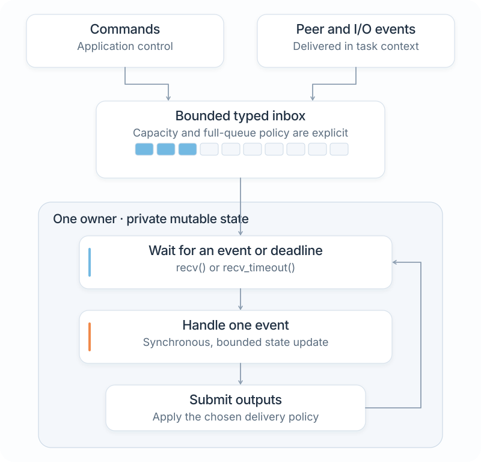
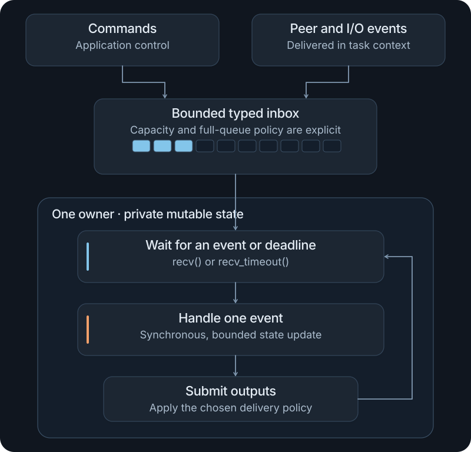

# Services and concurrency

A service is reusable application behavior with a defined interface and lifecycle. It may be a synchronous object or an active component with its own worker. NXRS uses ordinary Rust functions, threads, and synchronization rather than requiring an async executor.

This chapter extends [Your first application](first-application.md) into a complete bounded worker, then explains the additional decisions needed for a long-running firmware service. You need the host setup from that tutorial; target execution also needs [Building for NuttX](firmware.md).

## Start with ownership

Keep mutable state with the code that updates it. When a component needs independent execution, give it one event loop and send typed commands to that loop. The application constructs the components, connects them, and controls startup and shutdown.

A device controller, background recorder, or connection manager can use this pattern. A parser or calculation that runs as part of another operation can remain an ordinary function.

| Requirement | Start with |
| --- | --- |
| Transform a value without waiting | A function or an owned synchronous object |
| Share reusable stateful behavior with one caller | An object with `&mut self` methods |
| Isolate blocking I/O or independent timing | An owner with a worker and explicit shutdown |
| Deliver several event types to that owner | A private event enum and narrow public endpoints |
| Reserve capacity for control or faults | Independently bounded admission classes and one logical wait |

<figure class="architecture-art">
  
  
  <figcaption>A simple owner has one inbox. More demanding admission policies can use several bounded queues while retaining one logical selection point. <a href="../../docs/assets/nxrs-owner-event-loop.svg">Open SVG</a>.</figcaption>
</figure>

## A small event loop

The [worker example](../examples/basic-firmware/examples/worker.rs) owns a counter. It accepts `Add` and `Stop` events through a bounded inbox:

```rust
#[derive(Debug)]
enum Event {
    Add(u32),
    Stop,
}

fn process(inbox: std::sync::mpsc::Receiver<Event>) -> u64 {
    let mut total = 0;
    for event in inbox {
        match event {
            Event::Add(value) => total += u64::from(value),
            Event::Stop => break,
        }
    }
    total
}
```

The owner handles one event at a time. Calls within a handler remain synchronous. Cloning a sender allows several producers to submit commands to the same inbox.

## Run the worker in your application

Replace `../my-firmware/src/main.rs` from [Your first application](first-application.md) with this complete program:

<!-- tutorial:worker-source -->
```rust
use std::error::Error;
use std::io;
use std::sync::mpsc;
use std::thread;

#[derive(Debug)]
enum Event {
    Add(u32),
    Stop,
}

fn process(inbox: std::sync::mpsc::Receiver<Event>) -> u64 {
    let mut total = 0;
    for event in inbox {
        match event {
            Event::Add(value) => total += u64::from(value),
            Event::Stop => break,
        }
    }
    total
}

fn main() -> Result<(), Box<dyn Error>> {
    let (sender, inbox) = mpsc::sync_channel(4);
    let worker = thread::Builder::new()
        .name("counter".into())
        .stack_size(32 * 1024)
        .spawn(move || process(inbox))?;

    let delivery = (|| -> Result<(), mpsc::SendError<Event>> {
        for value in [1, 2, 3] {
            sender.send(Event::Add(value))?;
        }
        sender.send(Event::Stop)
    })();

    // Also let the worker finish if sending a command failed.
    drop(sender);
    let total = worker
        .join()
        .map_err(|_| io::Error::other("counter worker panicked"))?;
    delivery?;
    println!("Processed total: {total}");
    Ok(())
}
```

Keep your manifest unchanged. From the NXRS checkout, run the same host and firmware builds:

```sh
cargo run --locked --manifest-path ../my-firmware/Cargo.toml --bin hello
cargo nxrs build --manifest-path ../my-firmware/Cargo.toml --profile esp32s3-qemu-mock
```

Start QEMU with the command in [Building for NuttX](firmware.md#boot-qemu). The binary and shell command remain `hello`, but now execute the worker:

```text
nsh> hello
Processed total: 6
nsh> echo $?
0
```

The program sends three values, requests stop, and joins the worker before printing the result. It closes the sender even if delivery fails. The requested worker stack is 32 KiB; measure the stack use before selecting an allocation for a deployed application.

Here, blocking `send` runs in top-level orchestration while the worker keeps consuming. The worker does not synchronously wait for a reply from its caller. This makes the small example's progress dependency easy to inspect. A production owner handling events should not wait indefinitely for another owner's queue to become writable.

The checked-in source has tests for stop and disconnect behavior:

```sh
cargo test --locked --manifest-path website/examples/basic-firmware/Cargo.toml --all-targets
```

The documentation checks ensure this program matches that source. Target CI also compiles it as your application's `src/main.rs` and runs it in NuttX/QEMU.

[Build a controller](controller.md) adds a capability output and an explicit completion ticket to this progression. It also demonstrates shutdown by closing the only sender, so an occupied command inbox does not need another slot for a stop message.

## Choose delivery behavior

A bounded queue needs an explicit full-queue policy. `send` waits for capacity; `try_send` returns the value when the queue is full or disconnected. Choose between backpressure, rejection, or a latest-state representation according to the operation. A command that must be acted on needs different handling from a replaceable status update.

Record errors and rejected work where the application can respond. Avoid an unbounded retry list beside an otherwise bounded inbox. [Event communication](../../docs/concurrency-event-communication.md) describes NXRS delivery and lifecycle conventions in detail.

| Event | A useful contract | Question to answer on saturation |
| --- | --- | --- |
| Command that must run | Admission result, then an explicit completion result | Can the caller wait, retry with a bounded deadline, or receive rejection? |
| Replaceable status | Latest value with freshness information | Which older value can be replaced, and how is staleness detected? |
| Measurement or record | Declared loss, sequence and gap semantics | Is dropping allowed, and how is loss reported? |
| Terminal fault | Retained fault state plus notification | How can the owner read the fault if notification fails? |
| Stop request | Admission independent of ordinary traffic | What wakes the owner when its data inbox is full or empty? |

Cloning a sender gives another producer access to the same destination. It does not broadcast an event to several consumers. If you intentionally send a value to several destinations, decide what partial acceptance means before submitting it.

## Expose a narrow service interface

Keep an owner's event enum private when callers only need a small set of operations. Public methods such as `submit`, `status` or `stop` can validate inputs and translate them into internal messages. A producer can receive an ordinary typed callback that only admits its event to the destination; the callback must not run the destination's handler inline.

Distinguish these milestones in the API:

| Milestone | Meaning |
| --- | --- |
| Accepted | The destination took responsibility for the request |
| Completed | Its handler finished the defined operation |
| Committed | The stronger external guarantee specified by the operation holds |
| Stopped | New production or callbacks have ceased |
| Joined | Execution has terminated and its resources can be reclaimed |

Use a request/reply channel only where a result is needed. Include an operation deadline and handle disconnection. A synchronous request from one owner to another also creates a progress dependency; two owners must not each block waiting for the other to process a request.

The optional [messaging crate](../../shared/messaging/src/channel.rs) provides `bounded`, a cloneable `Sender`, and a unique `Inbox`. `Inbox::wait(None)` waits for work; `wait(Some(duration))` waits for work or timeout. It wraps standard bounded channels and does not introduce a broker or global registry. Direct use of `std::sync::mpsc` remains appropriate, as the tutorial demonstrates.

## One wait point, with the right capacity boundaries

The worker example can use one physical inbox because it has one small, finite producer sequence. A long-running owner may need separate capacity for stop, important commands and ordinary data. Reserving those capacities prevents ordinary traffic from consuming the slots needed for control.

Receive through one logical blocking selection point rather than blocking on each receiver in turn. The architecture reference describes the pinned Crossbeam candidate for multi-queue qualification; standard-library receivers cannot be used in that selector. Existing single-inbox services remain valid and do not need a migration solely for consistency.

A preferred selection arm does not preempt a handler already running. Bound handler work, check absolute deadlines between dispatches, and define ordinary-traffic progress under sustained important traffic. A closed channel is ready immediately: handle closure or remove an optional closed input instead of repeatedly selecting it.

See [Event communication](../../docs/concurrency-event-communication.md#dedicated-capacity-one-logical-wait-point) for the dispatch model and [Event-path measurements](../../docs/std-channel-performance.md) for measured scope and remaining qualification.

## Keep I/O out of unrelated owners

A blocking operation belongs with the component responsible for it. Hardware acquisition produces application events; it does not call arbitrary service handlers from an interrupt. A network or storage worker can own its handles and report completion through typed messages.

Use short, bounded interrupt notifications and defer parsing, allocation, and ordinary Rust channel operations to thread context. Keep registered callbacks and buffers alive until their producers have stopped.

## Shut down in order

Stop accepting new work, request producer shutdown, wake blocked waits, and join workers before releasing their resources. Decide whether admitted work is completed or cancelled. Dropping all senders closes a channel; a `Stop` message provides an explicit command while senders still exist.

Long-running I/O also needs a cancellation or timeout path. The application should be able to finish shutdown without waiting indefinitely for another device or network peer.

For the introductory worker, a `Stop` event is sufficient because the producer can wait and the worker keeps draining. For a long-running hardware owner, use a stop path whose admission cannot be exhausted by ordinary data. Keep terminal failures observable even if their notification could not be queued.

During partial startup, remember which owners actually started and stop those owners if a later acquisition fails. During shutdown, attempt cleanup for every independent resource, retain the errors, and release a resource only after its producer has become quiescent. Joining a producer while it waits for the joining owner to drain its queue creates a deadlock; resolve that dependency first.

The [application design guide](designing-applications.md) works through startup and shutdown as an application responsibility.

## Scheduling and tests

Test queue saturation, disconnects, partial startup, cancellation, and cleanup as well as normal processing. On fixed-priority targets, check the complete producer/consumer schedule: a nonblocking queue operation may still contend with other participants internally.

[Testing and debugging](testing.md) covers test setup. [Performance and memory](performance.md) covers stack, queue, latency, and throughput measurements.
